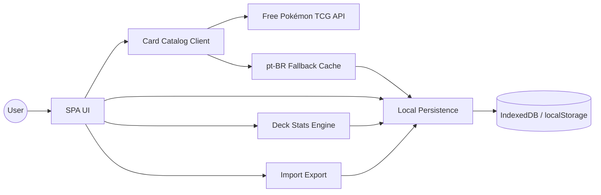

# MyPokeCards — Requirements

## Vision & Scope

MyPokeCards is a modern, client-only web app for searching Pokémon TCG cards and building decks with minimal friction. Users browse a visual card catalog (pt-BR where possible), manage personal decks and a owned-copies collection, see missing cards and deck statistics instantly, and import/export decks — all with a distinctive card-game aesthetic, light/dark themes, and excellent UX on desktop, tablet, and mobile. No backend is required; persistence is local to the browser.

## Functional Requirements

### FR-1 Card catalog & search
1. The system shall retrieve card data (name, types, rarity, set, costs/energy, rules text, and images) from a free public Pokémon TCG API (prefer Pokémon TCG API or an equivalent free source with locale/pt-BR support when available).
2. The system shall present card names and key labels in pt-BR when the API provides them; if the primary API lacks complete pt-BR, the system shall apply a documented fallback (e.g. cached/mapped pt-BR names) without blocking search or display.
3. The user shall search cards by text query (at least name; optionally set/type filters if the API supports them) and see results as a responsive visual grid of card images.
4. Search input shall debounce (target ≤ 300 ms) before issuing remote queries to limit API load.
5. Empty and error states shall show clear pt-BR messages (no results, offline/API failure) without corrupting local data.

### FR-2 Card detail
1. The user shall open a card detail view showing image(s), localized name, type(s), rarity, set, energy/cost info, and rules/ability text when available.
2. From card detail (and from search results where appropriate), the user shall reach deck add and collection actions in at most two clicks/taps.

### FR-3 Deck lifecycle
1. The user shall create a deck with a user-chosen name.
2. The user shall rename, edit composition, duplicate, and permanently delete a deck (delete requires an explicit confirmation).
3. The user shall mark a deck as favorite and assign a numeric rating (e.g. 1–5 stars).
4. Deck list shall show name, favorite state, rating, and a concise summary (e.g. card count).

### FR-4 Deck builder (low-friction)
1. The user shall add a card to a selected deck in one or two clicks/taps from search results, detail, or collection.
2. The user shall remove a card (or decrease copy count) from a deck in one or two clicks/taps.
3. The system shall enforce standard Pokémon TCG copy limits when known (e.g. max copies of a given card id per deck, excluding basic energy if the chosen ruleset allows unlimited basics); violations shall block the add and show a clear pt-BR message.
4. The deck builder shall keep the selected deck context visible so the user can iterate without re-navigating through menus.

### FR-5 Collection & missing cards
1. The user shall set how many physical copies they own for each card (integer ≥ 0).
2. For a selected deck, the system shall compute missing cards: for each required deck slot/card, owned copies vs required copies, listing shortages.
3. Missing-card results shall update when collection counts or deck composition change.

### FR-6 Import & export
1. The user shall export a deck to a human-readable JSON format and to a PTCGO-style plain-text list.
2. The user shall import a deck from the same JSON and PTCGO-style formats; invalid input shall fail with a clear error and leave existing decks unchanged.
3. Imported decks shall be editable like locally created decks.

### FR-7 Deck statistics
1. For each deck, the system shall show useful aggregates: energy/type distribution, count by rarity, and cost/mana curve (or equivalent cost metric available from card data).
2. Statistics shall refresh when deck composition changes.

### FR-8 Favorites
1. The user shall favorite/unfavorite cards and decks.
2. A dedicated favorites area shall list favorited cards and favorited decks for quick access.

### FR-9 Theme
1. The user shall switch between light and dark themes.
2. Theme preference shall persist across sessions (local persistence).

### FR-10 UI/UX & visual identity
1. Card imagery shall be the primary visual element on browse/build surfaces; chrome and menus shall stay minimal.
2. Layouts shall work on desktop, tablet, and mobile breakpoints without essential actions hidden behind unnecessary steps.
3. Visual identity shall evoke modern digital card games (distinct palette, typography, and motion) and must not read as a generic template UI.
4. All user-facing strings shall be in Brazilian Portuguese (pt-BR).

### FR-11 Local persistence
1. Decks, collection counts, favorites, ratings, theme, and any pt-BR name cache shall persist locally in the browser (IndexedDB and/or localStorage) without a mandatory backend.
2. Clearing site data may wipe user data; the product need not offer cloud sync in v1.

## Non-Functional Requirements

| ID | Category | Requirement | Target |
|----|----------|-------------|--------|
| NFR-1 | Performance | Search debounce and perceived result update | Debounce ≤ 300 ms; first paint of cached/local UI ≤ 2 s on a mid-range device |
| NFR-2 | Performance | Deck add/remove and missing-card recompute | Interaction feedback ≤ 100 ms for local operations |
| NFR-3 | Responsiveness | Breakpoints | Usable layouts at ≈360 px, ≈768 px, and ≥1280 px widths |
| NFR-4 | Accessibility | Keyboard & semantics | Search, theme toggle, and primary deck actions reachable by keyboard; meaningful labels/`aria` on icon-only controls |
| NFR-5 | Reliability | API failure | Offline/API errors degrade gracefully; local decks/collection remain usable |
| NFR-6 | Maintainability | Source language | Source code identifiers/comments in English; UI copy in pt-BR |
| NFR-7 | Testability | Critical logic | Unit/component tests for deck mutation rules, collection ownership, and missing-card calculation |
| NFR-8 | Privacy | Data locality | No mandatory account; user data stays in the browser unless the user exports |
| NFR-9 | UX | Interaction budget | Core add-to-deck and remove-from-deck paths ≤ 2 clicks/taps |
| NFR-10 | Visual | Brand | Custom theme tokens and card-forward composition; not a stock purple/gradient landing template |

## High-Level Architecture

Client-only SPA. External free card API feeds a catalog client; a local store holds decks, collection, favorites, ratings, theme, and optional locale cache. UI modules consume catalog + store; import/export and stats are pure client transforms.

**Key data flows**
1. **Search:** UI → Catalog Client → API (and/or cache) → card grid.
2. **Build deck:** UI → Store mutate deck composition → Stats + Missing Cards recompute.
3. **Collection:** UI → Store owned counts → Missing Cards vs active deck.
4. **Portability:** UI → Import/Export ↔ Store (no server).

## Assumptions & Constraints

1. App lives at workspace root (`projectRoot=.`); deliverable runs with `npm run dev`.
2. Stack is a modern SPA with TypeScript (exact framework/tooling chosen by Technology Architect); must be responsive.
3. Persistence is local-only for v1; no required backend, auth, or multi-device sync.
4. “Pokémon TCG” copy limits follow common constructed rules unless Open Questions change them; basic Energy may be unlimited.
5. Free API rate limits and image CDN terms of use must be respected; document the chosen API in `.docs/`.
6. UI language is pt-BR; source code is English.
7. Essential automated tests cover deck logic, collection, and missing cards — not necessarily full E2E in v1.
8. Product does not sell cards, process payments, or require Nintendo/Pokémon Company official APIs beyond a public free data source.

## Open Questions

1. Which free API is primary (Pokémon TCG API vs tcgpocket vs other), and what is the exact pt-BR fallback strategy when locale coverage is incomplete?
2. Which official/format ruleset (Standard, Expanded, unlimited, or casual) governs max copies and legal card sets in v1?
3. Should deck size be enforced (e.g. exactly 60 cards) or only advised in v1?
4. Are favorites for cards and decks a single unified list UI or two tabs/sections?
5. Rating scale: integer 1–5 only, or allow half-stars / 0 (unrated)?
6. Is multi-deck “active deck” sticky across sessions, or always explicitly selected?
7. Should import resolve cards by name+set+number only, and how are ambiguous names handled?
