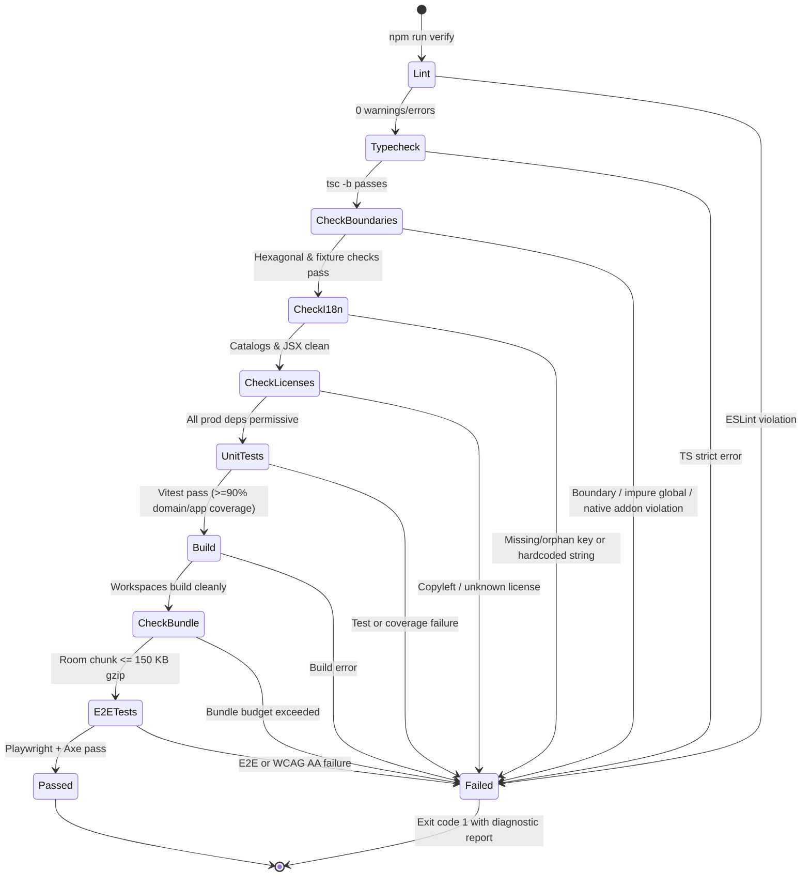

# Spec: `monorepo-foundation` — Pure npm workspaces, TypeScript strict config, architectural boundary checks, and shared `Result<T, AppError>` + domain primitives

## Traceability & Scope

| Attribute | Value |
| :--- | :--- |
| **Slug** | `monorepo-foundation` |
| **Release** | `R0` — Foundation & Hexagonal Core |
| **Priority** | `M` (*Must have*) |
| **Dependencies** | None (Order `1` in execution DAG; blocks `ports-and-testing-fakes`, `web-pwa-shell`, and `domain-scales-and-stats`) |
| **Requirements Covered** | `RNF-16` (Hexagonal Clean Architecture), `RNF-17` (Infrastructure Portability foundation), `RNF-18` (Quality, Strict TS, & Boundary Tests in CI), `RNF-24` (Pure `npm workspaces` & pinned Node LTS), `RNF-25` (Open Source License Governance), and `§10` (Operational Limits & Default Configuration Parameters) |
| **Host Constraints** | `.docs/host.json` (`win32 x64`, `Node v24.12.0`, `hasNodeSqlite: true`, `nativeCompileLikelyOk: false` — strict zero native C++ addon policy) |

### Scope Summary (SA + UX/DX + TA Perspectives)

- **System Architecture (SA):** Establishes the immutable inner core of the Hexagonal (`Ports & Adapters`) architecture (`packages/domain ← packages/application ← packages/adapter-* ← apps/web`). Defines the shared functional error-handling monad (`Result<T, AppError>`), canonical error taxonomy (`AppErrorCode` / `ErrorCode`), branded opaque entity identifiers, and all system-wide operational constants (`§10`).
- **Developer Experience & CLI Feedback (UX/DX):** Provides deterministic, fail-fast CLI tooling (`npm run verify`, `tools/check-boundaries.mjs`, `tools/check-licenses.mjs`) with actionable, human- and agent-readable diagnostic messages (file path, line number, violated rule, and remediation hint) and concise agent governance rules in `AGENTS.md` and `.docs/limits.md`.
- **Technical Architecture (TA):** Configures pure `npm workspaces` with a single root `package-lock.json`, Node.js v24 LTS pinning (`.nvmrc` and `engines`), strict TypeScript project references (`tsconfig.base.json`), flat ESLint rules (`eslint.config.js`) forbidding non-deterministic globals (`Date.now()`, `Math.random()`, `process.env`) in `domain` and `application`, and native-addon bans ensuring 100% compatibility with Windows environments lacking `node-gyp` (`nativeCompileLikelyOk: false`).

---

## Functionalities & Core Capabilities

1. **Pure `npm workspaces` Monorepo Structure (`RNF-24`, `ADR-01`):**
   - Root `package.json` configuring workspaces (`packages/*`, `apps/*`), pinning Node.js LTS (`>=24.0.0`) via `engines` and `.nvmrc` (`24`), and enforcing `npm` as the sole package manager (rejecting `pnpm-lock.yaml` and `yarn.lock`).
   - Workspace scaffolding for `@fibonaipe/domain`, `@fibonaipe/application`, and `@fibonaipe/testing` so TypeScript project references, linting, and unit tests execute cleanly across workspace boundaries.
2. **Zero-Dependency `@fibonaipe/domain` Package (`RNF-16`):**
   - `packages/domain/package.json` contains **zero** runtime `dependencies` (omitted or `{}`).
   - Exports shared foundational primitives from `packages/domain/src/shared/*` re-exported through `packages/domain/src/index.ts`.
3. **Functional `Result<T, AppError>` Monad & Combinators (`§2.11`, `§5.1`):**
   - Explicit discriminated union (`{ readonly ok: true; readonly value: T } | { readonly ok: false; readonly error: E }`) eliminating unhandled exceptions for expected domain and application errors.
   - Pure helper constructors and combinators (`ok`, `err`, `isOk`, `isErr`, `map`, `mapError`, `andThen`, `all`, `unwrapOr`) plus an immutable `AppErrorBuilder` / factory (`createAppError`) enforcing valid i18n message keys (`errors.<CODE>` or domain-scoped keys) and frozen parameter maps.
4. **Canonical `AppErrorCode` Enumeration (`§5.1`, `§7.1`):**
   - Complete, frozen enumeration and union type covering all 12 domain and application failure modes (`VALIDATION`, `NOT_FOUND`, `FORBIDDEN`, `ROOM_FULL`, `NICKNAME_TAKEN`, `ROUND_NOT_VOTING`, `LIMIT_EXCEEDED`, `RATE_LIMITED`, `INSUFFICIENT_DATA`, `LAST_ADMIN`, `AUTH_LINK_INVALID`, `ACCOUNT_SUSPENDED`) with deterministic HTTP status code mapping metadata.
5. **Branded Opaque Domain Identifiers (`packages/domain/src/shared/ids.ts`):**
   - Compile-time nominal typing (`Brand<string, B>`) preventing accidental swapping of string IDs (`RoomId`, `RoomCode`, `ParticipantId`, `UserId`, `TeamId`, `OrganizationId`, `InviteId`, `ItemId`, `RoundId`, `SprintId`, `HolidayId`, `HistoryEntryId`, `EstimateAuditId`, `ClientOpId`) alongside pure validation/branding constructors returning `Result<BrandedId, AppError>`.
6. **Operational Limits & Default Constants (`packages/domain/src/shared/constants.ts`, `§10`):**
   - Frozen, strongly typed constants for every operational parameter specified in `requirements.md §10` (`MAX_PARTICIPANTS = 30`, `ANON_ROOM_TTL_MINUTES = 60`, `ONLINE_WINDOW_SECONDS = 45`, `HEARTBEAT_INTERVAL_SECONDS = 20`, `HOST_GRACE_SECONDS = 60`, `MAX_ITEMS_PER_ROOM = 500`, `MAX_ITEM_TITLE_LENGTH = 200`, `MAX_ITEM_DESC_LENGTH = 2000`, `MAX_VOTE_COMMENT_LENGTH = 140`, `MIN_SPRINTS_FOR_FORECAST = 3`, `MAX_SPRINTS_FOR_FORECAST = 6`, rate-limit rules, bundle budget `150 KB`, and unambiguous room code alphabet).
7. **AST / Import & Dependency Boundary Verifier (`tools/check-boundaries.mjs`, `RNF-16`, `RNF-18`):**
   - Zero-dependency Node.js `.mjs` verification script that inspects both `package.json` manifests and TypeScript source imports/globals across all workspaces.
   - Verifies:
     1. `packages/domain` has `0` runtime dependencies and never imports `@fibonaipe/application`, `@fibonaipe/adapter-*`, `@fibonaipe/web`, `@fibonaipe/testing`, Node I/O modules (`node:fs`, `node:net`, `node:http`, `node:crypto`, `node:sqlite`), or non-deterministic globals (`Date.now()`, `new Date()` with 0 args, `Math.random()`, `process.env`).
     2. `packages/application` depends only on `@fibonaipe/domain` and never imports `@fibonaipe/adapter-*`, `@fibonaipe/web`, or non-deterministic globals.
     3. No `packages/adapter-*` package ever imports another `@fibonaipe/adapter-*` or `@fibonaipe/web`.
     4. Only `apps/web/src/server/composition.ts` (and adapter-specific tests) may wire concrete `@fibonaipe/adapter-*` packages together.
     5. No banned native C++ addon packages (`better-sqlite3`, `bcrypt`, `sharp`, `canvas`, `node-gyp`, `sqlite3`) appear anywhere in `package.json` or `package-lock.json`.
   - Includes a self-test mode (`--self-test` or invoked via Vitest against `tools/boundary-fixtures`) that runs the verifier against intentional negative fixtures and asserts that every violation category is caught.
8. **Permissive License & Quota Governance (`tools/check-licenses.mjs`, `.docs/limits.md`, `AGENTS.md`, `RNF-20`, `RNF-25`):**
   - `tools/check-licenses.mjs` parses `package-lock.json` and installed workspace metadata to assert all production dependencies use approved permissive licenses (`MIT`, `ISC`, `Apache-2.0`, `BSD-2-Clause`, `BSD-3-Clause`, `0BSD`, `BlueOak-1.0.0`, `Unlicense`, `CC0-1.0`) and fails immediately on copyleft (`GPL`, `AGPL`, `LGPL`, `SSPL`) or unknown licenses.
   - `.docs/limits.md` documents free-tier quotas and 80% warning thresholds (`RNF-20`).
   - `AGENTS.md` codifies the architectural law, Builder/Result standards, and verification gate for contributors and AI agents.

---

## Use Cases & Scenarios

### UC-1: Chaining Domain Validations and Builder Operations with `Result<T, AppError>`

- **Actor:** Domain Entity Builder or Application Use Case (`@fibonaipe/domain` / `@fibonaipe/application`).
- **Preconditions:** `@fibonaipe/domain` is imported; raw unvalidated inputs (e.g., `roomId`, `nickname`, `maxParticipants`) are supplied by a caller.
- **Main Success Scenario (Normal Flow):**
  1. Caller invokes branded ID constructor `RoomId.create("01J8Z7K9X2M4N6P8Q0R2S4T6V8")`, which validates non-empty visible characters and returns `ok(roomId)`.
  2. Caller chains validation via `andThen` or `Result.all` with `ParticipantId.create("01J8Z7K9X2M4N6P8Q0R2S4T6V9")` and maps the combined tuple using `map` into a domain value object.
  3. All steps succeed (`result.ok === true`), returning a deeply frozen value object without throwing or catching any exceptions.
- **Alternative / Error Flow (Validation Short-Circuit):**
  1. Caller passes an empty string `""` to `RoomId.create("")` in the first step of an `andThen` pipeline.
  2. `RoomId.create` immediately returns `err(AppErrorBuilder.validation("errors.id.invalid_room_id").withParam("field", "roomId").build())`.
  3. Subsequent `map` and `andThen` callbacks in the chain are bypassed (never executed), and the final return value preserves the exact `AppError` with `code: 'VALIDATION'`, `messageKey: 'errors.id.invalid_room_id'`, and frozen `params: { field: 'roomId' }`.

### UC-2: Detecting Hexagonal & Non-Determinism Violations via `tools/check-boundaries.mjs`

- **Actor:** Developer, CI Pipeline, or QA Test Suite executing `npm run check:boundaries`.
- **Preconditions:** Workspace files exist under `packages/*`, `apps/*`, and negative test fixtures exist under `tools/boundary-fixtures/*`.
- **Main Success Scenario (Clean Workspace + Negative Fixture Verification):**
  1. `node tools/check-boundaries.mjs` scans all `package.json` files and `.ts`/`.tsx` source files across `packages/*` and `apps/*`.
  2. It verifies `packages/domain/package.json` has zero runtime dependencies and all imports inside `packages/domain/src/**` resolve only to relative files within `packages/domain`.
  3. It runs its built-in negative fixture verification against `tools/boundary-fixtures`, confirming that each synthetic violation fixture triggers its expected rule code (`BOUNDARY_DOMAIN_RUNTIME_DEP`, `BOUNDARY_ILLEGAL_IMPORT`, `BOUNDARY_ADAPTER_CROSS_IMPORT`, `BOUNDARY_IMPURE_GLOBAL`, `BOUNDARY_NATIVE_ADDON`).
  4. The CLI prints a concise summary (`[check:boundaries] OK — verified workspace manifests, source files, and negative fixtures`) and exits with code `0`.
- **Violation Flow (Architectural Breach Detected in Source):**
  1. A developer accidentally adds `import { PostgresPersistence } from '@fibonaipe/adapter-persistence-postgres'` inside `packages/application/src/index.ts` or calls `Date.now()` inside `packages/domain/src/shared/ids.ts`.
  2. Running `npm run check:boundaries` (or `npm run lint`) catches the violation.
  3. `check-boundaries.mjs` outputs a structured error line containing `[BOUNDARY_ILLEGAL_IMPORT]` or `[BOUNDARY_IMPURE_GLOBAL]`, the offending file path, the 1-based line number, the forbidden specifier/expression, and the architectural remediation hint (e.g., *"Inject `Clock` port instead of calling `Date.now()` directly"*), exiting with code `1`.

### UC-3: Executing Unified Workspace Verification & License / Native-Addon Audit

- **Actor:** Developer on Windows (`win32/x64`, `nativeCompileLikelyOk: false`) or GitHub Actions CI runner executing `npm run verify`.
- **Preconditions:** Dependencies installed via `npm ci` using the single root `package-lock.json`.
- **Main Success Scenario (Normal Flow):**
  1. `npm run verify` executes sequentially: `lint` → `typecheck` → `check:boundaries` → `check:i18n` → `check:licenses` → `test:unit` → `build` → `check:bundle` → `test:e2e`.
  2. `tools/check-licenses.mjs` inspects all production packages in `package-lock.json` and confirms every package license belongs to the approved permissive allowlist (`RNF-25`) and zero native C++ addon packages exist.
  3. Vitest (`npm run test:unit`) runs unit tests for `Result`, `AppError`, branded IDs, operational constants, and boundary verifier fixtures, achieving `≥ 90%` line coverage in `packages/domain`.
  4. All steps exit with status `0`.
- **Violation Flow (Disallowed Copyleft License or Native Addon Introduced):**
  1. A dependency with license `GPL-3.0-only` or a native addon (`better-sqlite3`) is present in a lockfile fixture passed to `check-licenses.mjs` / `check-boundaries.mjs`.
  2. The verification script halts immediately with exit code `1`, printing the offending package name, version, detected license or native binding indicator, and the policy reference (`RNF-25` or `.docs/host.json nativeCompileLikelyOk: false`).

---

## Interface Contracts (Inputs, Outputs & Error Codes)

### 1. Canonical Error Codes & `AppError` (`packages/domain/src/shared/app-error.ts`)

- **`AppErrorCode` (also exported as `ErrorCode` for compatibility with `technologies.md §5.1`):**
  - Frozen constant object `AppErrorCode` and union type `ErrorCode` with the exact 12 string literals:

| `AppErrorCode` Value | Default `messageKey` | Mapped HTTP Status (`§7.1`) | Typical Trigger Invariant / Requirement |
| :--- | :--- | :---: | :--- |
| `'VALIDATION'` | `'errors.VALIDATION'` | `400` | Invalid builder input, scale size `< 2`, title/description length (`RF-30`), invalid card/suit (`INV-06`) |
| `'AUTH_LINK_INVALID'` | `'errors.AUTH_LINK_INVALID'` | `401` | Expired or invalid Magic Link / OAuth callback token (`RF-03`) |
| `'FORBIDDEN'` | `'errors.FORBIDDEN'` | `403` | Actor fails `can(actor, action, ctx)` policy (`§3.1`, `INV-07`) |
| `'ACCOUNT_SUSPENDED'` | `'errors.ACCOUNT_SUSPENDED'` | `403` | User account suspended by SuperAdmin (`RF-13`) |
| `'NOT_FOUND'` | `'errors.NOT_FOUND'` | `404` | Room, participant, item, team, or sprint not found (uniform payload per `§7.1`) |
| `'ROOM_FULL'` | `'errors.ROOM_FULL'` | `409` | 31st participant attempts to join room (`INV-01`, `RF-25`) |
| `'NICKNAME_TAKEN'` | `'errors.NICKNAME_TAKEN'` | `409` | Case-insensitive duplicate nickname in room (`INV-14`, `RF-01`) |
| `'ROUND_NOT_VOTING'` | `'errors.ROUND_NOT_VOTING'` | `409` | Vote cast/retracted when `Round.status !== 'voting'` (`INV-04`, `INV-05`) |
| `'LAST_ADMIN'` | `'errors.LAST_ADMIN'` | `409` | Attempt to demote or remove the last `Admin do Time` (`RF-11`) |
| `'INSUFFICIENT_DATA'` | `'errors.INSUFFICIENT_DATA'` | `409` | Forecast requested with `< 3` closed eligible sprints (`RF-85`) |
| `'LIMIT_EXCEEDED'` | `'errors.LIMIT_EXCEEDED'` | `422` | Queue or CSV import exceeds `MAX_ITEMS_PER_ROOM` (`500`, `RF-31`) |
| `'RATE_LIMITED'` | `'errors.RATE_LIMITED'` | `429` | Per-IP or per-participant rate limit exceeded (`§10`, `RNF-13`) |

- **`AppError` Interface & `AppErrorBuilder` Contract:**
  - Properties (all `readonly` and deeply frozen at construction):
    - `code: ErrorCode`
    - `messageKey: string` (non-empty i18n lookup key, e.g., `'errors.ROOM_FULL'` or `'errors.scale.min_cards'`)
    - `params?: Readonly<Record<string, string | number | boolean>>` (optional frozen interpolation dictionary)
  - Construction:
    - `createAppError(code: ErrorCode, messageKey?: string, params?: Record<string, string | number | boolean>): AppError` — defaults `messageKey` to `` `errors.${code}` `` if omitted, freezes `params` and the returned `AppError` object.
    - `AppErrorBuilder`: fluent builder (`AppErrorBuilder.fromCode(code)`, static shorthands `.validation(messageKey?)`, `.notFound(messageKey?)`, `.forbidden(messageKey?)`, `.withMessageKey(key)`, `.withParam(key, value)`, `.withParams(record)`, `.build(): AppError`) and `ERROR_HTTP_STATUS: Readonly<Record<ErrorCode, number>>`.

### 2. Functional `Result<T, E>` Contract (`packages/domain/src/shared/result.ts`)

- **Discriminated Union Types:**
  - `Ok<T>`: `{ readonly ok: true; readonly value: T }`
  - `Err<E>`: `{ readonly ok: false; readonly error: E }`
  - `Result<T, E = AppError>`: `Ok<T> | Err<E>`
- **Combinator Signatures & Behavioral Contracts:**
  - `ok<T>(value: T): Result<T, never>` — returns frozen `{ ok: true, value }`.
  - `err<E = AppError>(error: E): Result<never, E>` — returns frozen `{ ok: false, error }`.
  - `isOk<T, E>(result: Result<T, E>): result is Ok<T>` — type guard for success branch.
  - `isErr<T, E>(result: Result<T, E>): result is Err<E>` — type guard for failure branch.
  - `map<T, U, E>(result: Result<T, E>, fn: (value: T) => U): Result<U, E>` — transforms `value` when `ok === true`; passes `Err<E>` through untouched without invoking `fn`.
  - `mapError<T, E, F>(result: Result<T, E>, fn: (error: E) => F): Result<T, F>` — transforms `error` when `ok === false`; passes `Ok<T>` through untouched.
  - `andThen<T, U, E>(result: Result<T, E>, fn: (value: T) => Result<U, E>): Result<U, E>` — monadic bind (`flatMap`); chains a `Result`-returning operation when `ok === true` and short-circuits on the first `Err<E>`.
  - `all<T extends readonly Result<unknown, unknown>[]>(results: T): Result<{ [K in keyof T]: T[K] extends Result<infer V, unknown> ? V : never }, T[number] extends Result<unknown, infer E> ? E : never>` — collects an array/tuple of `Result` values into `ok([...values])` or returns the first encountered `Err`.
  - `unwrapOr<T, E>(result: Result<T, E>, fallback: T): T` — returns `result.value` if `ok`, otherwise `fallback`.
  - ` Result` namespace object re-exporting `{ ok, err, isOk, isErr, map, mapError, andThen, all, unwrapOr }` so callers can use either direct function imports or `Result.ok(...)` / `Result.andThen(...)`.

### 3. Branded Opaque Identifiers (`packages/domain/src/shared/ids.ts`)

- **Generic Branding Contract:**
  - `Brand<K, TBrand extends string> = K & { readonly __brand: TBrand }`
- **Exported Opaque ID Types:**
  - `RoomId`, `RoomCode`, `ParticipantId`, `UserId`, `TeamId`, `OrganizationId`, `InviteId`, `ItemId`, `RoundId`, `SprintId`, `HolidayId`, `HistoryEntryId`, `EstimateAuditId`, `ClientOpId`.
- **Validation & Factory Functions:**
  - `createEntityId<B extends string>(raw: string, brand: B, fieldName?: string): Result<Brand<string, B>, AppError>`:
    - Trims nothing silently; validates `typeof raw === 'string'`, length between `1` and `64` characters, and absence of whitespace or ASCII control characters (`\u0000`–`\u001F`, `\u007F`). Returns `err(createAppError('VALIDATION', 'errors.id.invalid', { field: fieldName ?? brand }))` on failure, or `ok(raw as Brand<string, B>)`.
  - Dedicated companion factories (`RoomId.create(raw)`, `ParticipantId.create(raw)`, `UserId.create(raw)`, `TeamId.create(raw)`, `OrganizationId.create(raw)`, `InviteId.create(raw)`, `ItemId.create(raw)`, `RoundId.create(raw)`, `SprintId.create(raw)`, `HolidayId.create(raw)`, `HistoryEntryId.create(raw)`, `EstimateAuditId.create(raw)`, `ClientOpId.create(raw)`).
  - `RoomCode.create(raw: string): Result<RoomCode, AppError>`:
    - Normalizes input via `.trim().toUpperCase()` and validates that it is **exactly 8 characters** drawn exclusively from the unambiguous CSPRNG alphabet `23456789ABCDEFGHJKMNPQRSTUVWXYZ` (31 chars; `0`, `O`, `1`, `I`, `L` are rejected with `code: 'VALIDATION'`, `messageKey: 'errors.room_code.invalid'`).

### 4. Operational Limits & Default Constants (`packages/domain/src/shared/constants.ts`)

All operational constants from `requirements.md §10` must be exported both individually and inside a frozen `OPERATIONAL_CONSTANTS` object:

| Constant Name | Exact Value | Type / Unit | Requirement / Section |
| :--- | :--- | :--- | :--- |
| `MAX_PARTICIPANTS` | `30` | `30` (participants) | `RF-25`, `INV-01`, `RNF-03`, `§10` |
| `ANON_ROOM_TTL_MINUTES` | `60` | `60` (minutes) | `RF-26`, `INV-13`, `RNF-15`, `§10` |
| `ONLINE_WINDOW_SECONDS` | `45` | `45` (seconds) | `RF-22`, `§10` |
| `HEARTBEAT_INTERVAL_SECONDS` | `20` | `20` (seconds) | `§10` |
| `HOST_GRACE_SECONDS` | `60` | `60` (seconds) | `RF-23`, `§3.1`, `§10` |
| `MAX_ITEMS_PER_ROOM` | `500` | `500` (items/rows) | `RF-31`, `§10` |
| `MAX_ITEM_TITLE_LENGTH` | `200` | `200` (chars) | `RF-30`, `§10` |
| `MAX_ITEM_DESC_LENGTH` | `2000` | `2000` (chars) | `RF-30`, `§10` |
| `MAX_VOTE_COMMENT_LENGTH` | `140` | `140` (chars) | `RF-50`, `§10` |
| `MIN_SPRINTS_FOR_FORECAST` | `3` | `3` (sprints) | `RF-85`, `§5.3`, `§10` |
| `MAX_SPRINTS_FOR_FORECAST` | `6` | `6` (sprints) | `RF-82`, `§5.3`, `§10` |
| `MIN_NICKNAME_LENGTH` | `1` | `1` (char) | `RF-01`, `INV-14` |
| `MAX_NICKNAME_LENGTH` | `30` | `30` (chars) | `RF-01`, `INV-14` |
| `ROOM_CODE_LENGTH` | `8` | `8` (chars) | `RF-21`, `§11.2` |
| `ROOM_CODE_ALPHABET` | `'23456789ABCDEFGHJKMNPQRSTUVWXYZ'` | `string` (31 chars) | `RF-21`, `§11.2` |
| `RATE_LIMIT_CREATE_ROOM` | `{ limit: 10, windowSeconds: 3600, scope: 'ip' }` | Frozen object | `RNF-13`, `§10` |
| `RATE_LIMIT_JOIN_ATTEMPTS` | `{ limit: 20, windowSeconds: 60, scope: 'ip' }` | Frozen object | `RNF-13`, `§10` |
| `RATE_LIMIT_MUTATIONS` | `{ limit: 60, windowSeconds: 60, scope: 'participant' }` | Frozen object | `RNF-13`, `§10` |
| `BUNDLE_BUDGET_ROOM_GZIP_BYTES` | `153600` (`150 * 1024`) | `153600` (bytes) | `RNF-02`, `§10` |
| `BUNDLE_BUDGET_ROOM_GZIP_KB` | `150` | `150` (KB) | `RNF-02`, `§10` |

---

## Flow & states

### 1. Unified Verification Pipeline State Machine (`npm run verify`)

### 2. Architectural Boundary Verification Flow (`tools/check-boundaries.mjs`)

1. **Phase A — Lockfile & Package Manager Hygiene:**
   - Assert `package-lock.json` exists at repository root and neither `pnpm-lock.yaml` nor `yarn.lock` exists (`RNF-24`).
   - Scan `package.json` and `package-lock.json` for banned native C++ packages (`better-sqlite3`, `bcrypt`, `sharp`, `canvas`, `sqlite3`, `node-gyp`).
2. **Phase B — Workspace `package.json` Dependency Graph Check:**
   - Parse every `packages/*/package.json` and `apps/*/package.json`.
   - For `@fibonaipe/domain`: assert `Object.keys(pkg.dependencies ?? {}).length === 0`.
   - For `@fibonaipe/application`: assert `Object.keys(pkg.dependencies ?? {})` contains at most `["@fibonaipe/domain"]`.
   - For `@fibonaipe/adapter-*`: assert `dependencies` never reference another `@fibonaipe/adapter-*` or `@fibonaipe/web`.
3. **Phase C — Source AST / Import & Impure Global Scan:**
   - Walk all `.ts` and `.tsx` files under `packages/*` and `apps/*` (stripping single-line and multi-line comments prior to pattern matching so comments do not cause false positives).
   - Extract static `import ... from '...'`, `export ... from '...'`, and dynamic `import('...')` specifiers.
   - Validate each specifier against the layer matrix:
     - `packages/domain`: only relative imports (`./`, `../`). Zero `@fibonaipe/*`, zero `node:*`, zero external packages.
     - `packages/application`: only relative imports and `@fibonaipe/domain`. Zero `node:*` runtime modules, zero `@fibonaipe/adapter-*`.
     - `packages/adapter-*`: only relative imports, `@fibonaipe/domain`, `@fibonaipe/application`, and allowed pure-JS external packages. Never another `@fibonaipe/adapter-*`.
     - `apps/web`: only `apps/web/src/server/composition.ts` may import `@fibonaipe/adapter-*`. Client files (`apps/web/src/client/**`) may never import `@fibonaipe/adapter-persistence-*` or server-only modules.
   - Scan `packages/domain/src/**` and `packages/application/src/**` (excluding `*.test.ts`) for forbidden non-deterministic or environment constructs: `Date.now(`, `new Date()`, `Math.random(`, `crypto.randomUUID(`, `process.env`.
4. **Phase D — Negative Fixture Self-Validation (`tools/boundary-fixtures`):**
   - Run the exact same checker logic against in-repo negative fixtures in `tools/boundary-fixtures/` (each representing an illegal import, impure global, cross-adapter import, or non-zero domain dependency) and assert that every negative fixture produces at least one violation. If any negative fixture passes silently, `check-boundaries.mjs` fails with `[BOUNDARY_SELF_TEST_FAILED]`.

---

## Technical design / how-to

### Step 1: Root Monorepo & Node.js LTS Configuration
1. Create `.nvmrc` containing `24` and update `.gitignore` to ignore `node_modules/`, `dist/`, `coverage/`, `playwright-report/`, `test-results/`, and `.env*.local` while keeping `package-lock.json` tracked.
2. Configure root `package.json`:
   - Set `"name": "fibonaipe"`, `"private": true`, `"type": "module"`, `"license": "Apache-2.0"`.
   - Set `"engines": { "node": ">=24.0.0", "npm": ">=10.0.0" }`.
   - Set `"workspaces": ["packages/*", "apps/*"]`.
   - Define all 9 unified verification scripts (`lint`, `typecheck`, `check:boundaries`, `check:i18n`, `check:licenses`, `test:unit`, `build`, `check:bundle`, `test:e2e`, and `verify`) exactly as specified in `technologies.md §11.3`.
   - Include only pure-JS/TypeScript devDependencies compatible with `nativeCompileLikelyOk: false` (`typescript`, `vitest`, `@vitest/coverage-v8`, `fast-check`, `eslint`, `@eslint/js`, `typescript-eslint`).

### Step 2: Strict TypeScript Configuration (`tsconfig.base.json` & `tsconfig.json`)
1. Create `tsconfig.base.json` with exact compiler flags from `technologies.md §11.1`:
   - `target: "ES2023"`, `module: "ESNext"`, `moduleResolution: "bundler"`, `strict: true`, `noUncheckedIndexedAccess: true`, `exactOptionalPropertyTypes: false`, `noImplicitOverride: true`, `noFallthroughCasesInSwitch: true`, `forceConsistentCasingInFileNames: true`, `isolatedModules: true`, `skipLibCheck: true`, `declaration: true`, `declarationMap: true`, `sourceMap: true`.
   - Configure workspace path aliases in `tsconfig.base.json` (`@fibonaipe/domain`, `@fibonaipe/application`, `@fibonaipe/testing`) pointing to each package's `src/index.ts` so `tsc -b` and Vitest resolve workspace imports seamlessly without requiring pre-built `dist/` artifacts during development.
2. Create root `tsconfig.json` configuring project `references` to `packages/domain`, `packages/application`, and `packages/testing` (and `apps/web` when present).

### Step 3: Flat ESLint Configuration (`eslint.config.js`)
1. Configure ESLint v9+ flat config (`eslint.config.js`) targeting `packages/**/*.ts`, `apps/**/*.{ts,tsx}`, and `tools/**/*.mjs`.
2. Enforce `@typescript-eslint/no-explicit-any: "error"`, `@typescript-eslint/ban-ts-comment: "error"` (forbidding `@ts-ignore`), and unused variable checks.
3. Add a dedicated rule block scoped to `packages/domain/src/**/*.ts` and `packages/application/src/**/*.ts` (ignoring `**/*.test.ts`) using `no-restricted-syntax` and `no-restricted-properties` to ban:
   - `Date.now()`
   - `new Date()` with `0` arguments (`NewExpression[callee.name='Date'][arguments.length=0]`)
   - `Math.random()`
   - `crypto.randomUUID()`
   - `process.env`

### Step 4: Implement `@fibonaipe/domain` Shared Primitives (`Constructor/Builder` + `Result` Pattern)
1. Create `packages/domain/package.json` (`"name": "@fibonaipe/domain"`, `"type": "module"`, **no `dependencies` field**).
2. Implement `packages/domain/src/shared/app-error.ts`:
   - Define `AppErrorCode` frozen constant dictionary and `ErrorCode` union type with all 12 codes.
   - Define `ERROR_HTTP_STATUS` mapping every `ErrorCode` to its canonical HTTP status code (`400`, `401`, `403`, `404`, `409`, `422`, `429`).
   - Implement `AppError` interface and `AppErrorBuilder` with private constructor / frozen outputs so error instances are immutable value objects.
3. Implement `packages/domain/src/shared/result.ts`:
   - Implement `Result<T, E = AppError>`, `ok`, `err`, `isOk`, `isErr`, `map`, `mapError`, `andThen`, `all`, `unwrapOr`, and the `Result` companion namespace object.
   - Ensure `ok(value)` and `err(error)` freeze the returned wrapper object (`Object.freeze`).
4. Implement `packages/domain/src/shared/constants.ts`:
   - Define and `Object.freeze` all operational constants from `§10` (`MAX_PARTICIPANTS`, `ANON_ROOM_TTL_MINUTES`, `ONLINE_WINDOW_SECONDS`, `HEARTBEAT_INTERVAL_SECONDS`, `HOST_GRACE_SECONDS`, `MAX_ITEMS_PER_ROOM`, `MAX_ITEM_TITLE_LENGTH`, `MAX_ITEM_DESC_LENGTH`, `MAX_VOTE_COMMENT_LENGTH`, `MIN_SPRINTS_FOR_FORECAST`, `MAX_SPRINTS_FOR_FORECAST`, `MIN_NICKNAME_LENGTH`, `MAX_NICKNAME_LENGTH`, `ROOM_CODE_LENGTH`, `ROOM_CODE_ALPHABET`, `RATE_LIMIT_CREATE_ROOM`, `RATE_LIMIT_JOIN_ATTEMPTS`, `RATE_LIMIT_MUTATIONS`, `BUNDLE_BUDGET_ROOM_GZIP_KB`, `BUNDLE_BUDGET_ROOM_GZIP_BYTES`).
5. Implement `packages/domain/src/shared/ids.ts`:
   - Define `Brand<K, T>` and all branded ID types (`RoomId`, `RoomCode`, `ParticipantId`, `UserId`, `TeamId`, `OrganizationId`, `InviteId`, `ItemId`, `RoundId`, `SprintId`, `HolidayId`, `HistoryEntryId`, `EstimateAuditId`, `ClientOpId`).
   - Implement `createEntityId` and `RoomCode.create` returning `Result<..., AppError>` with `VALIDATION` errors on malformed, empty, control-character, or ambiguous (`0/O/1/I/L`) inputs.
6. Re-export all shared modules from `packages/domain/src/index.ts`.

### Step 5: Workspace Scaffolds & Verification Scripts (`tools/*.mjs`)
1. Create minimal workspace scaffolds for `packages/application` (depending only on `@fibonaipe/domain`) and `packages/testing` (depending on `@fibonaipe/domain` and `@fibonaipe/application`) so `tsc -b` and `check-boundaries.mjs` validate multi-package workspace topology immediately in `R0`.
2. Implement `tools/check-boundaries.mjs` exporting reusable programmatic check functions (`verifyWorkspaceBoundaries(rootDir)`, `scanSourceFileForViolations(filePath, content, layer)`) and CLI entry point, plus negative fixtures in `tools/boundary-fixtures/` (excluded from `tsconfig.json` compilation via `exclude`, but scanned by `check-boundaries.mjs` self-test and unit tests).
3. Implement `tools/check-licenses.mjs` exporting `verifyLicenses(lockfileContent)` and CLI entry point validating `package-lock.json` against the permissive license allowlist and native-addon ban list.
4. Implement R0-compatible baseline scripts for `tools/check-i18n.mjs` and `tools/check-bundle-budget.mjs` so `npm run verify` runs end-to-end without missing-script failures before `web-pwa-shell` expands them.
5. Create `AGENTS.md` and `.docs/limits.md`.

---

## Files to touch

| File Path | Action | Purpose |
| :--- | :---: | :--- |
| `.nvmrc` | Create | Pins Node.js v24 LTS (`RNF-24`) |
| `.gitignore` | Create / Update | Standard Node/TS/Vite/Playwright ignores while tracking `package-lock.json` |
| `AGENTS.md` | Create | Concise architectural law, dependency direction, Builder/Result patterns, and `npm run verify` gate |
| `.docs/limits.md` | Create | Free-tier quota documentation and 80% warning thresholds (`RNF-20`) |
| `package.json` | Create / Update | Root `npm workspaces` manifest, `engines`, and unified verification scripts |
| `tsconfig.base.json` | Create | Shared strict TypeScript compiler options (`strict`, `noUncheckedIndexedAccess`) |
| `tsconfig.json` | Create / Update | Root TypeScript solution config referencing workspace packages |
| `vitest.config.ts` | Create / Update | Workspace unit & coverage configuration (`≥ 90%` threshold for `domain`/`application`) |
| `eslint.config.js` | Create / Update | Flat ESLint configuration with `domain`/`application` purity rules |
| `tools/check-boundaries.mjs` | Create | Hexagonal boundary, zero-dep domain, impure-global, and native-addon verifier |
| `tools/boundary-fixtures/**` | Create | Negative fixtures (`domain-imports-adapter`, `adapter-imports-adapter`, `domain-impure-date`, `domain-runtime-dep`) |
| `tools/check-licenses.mjs` | Create | Permissive license allowlist and native-addon lockfile verifier (`RNF-25`) |
| `tools/check-i18n.mjs` | Create | i18n catalog & JSX hardcoded string verifier script |
| `tools/check-bundle-budget.mjs` | Create | Room route `≤ 150 KB` gzipped bundle budget verifier script (`RNF-02`) |
| `packages/domain/package.json` | Create | Zero-dependency `@fibonaipe/domain` package manifest |
| `packages/domain/tsconfig.json` | Create | TypeScript configuration for `@fibonaipe/domain` |
| `packages/domain/src/index.ts` | Create | Public barrel export for `@fibonaipe/domain` |
| `packages/domain/src/shared/app-error.ts` | Create | `AppErrorCode`, `ErrorCode`, `AppError`, `AppErrorBuilder`, `createAppError`, `ERROR_HTTP_STATUS` |
| `packages/domain/src/shared/result.ts` | Create | `Result<T, E>`, `ok`, `err`, `isOk`, `isErr`, `map`, `mapError`, `andThen`, `all`, `unwrapOr` |
| `packages/domain/src/shared/ids.ts` | Create | Branded opaque IDs (`RoomId`, `RoomCode`, `ParticipantId`, etc.) and validation factories |
| `packages/domain/src/shared/constants.ts` | Create | Operational limits & configuration constants (`§10`) |
| `packages/domain/src/shared/__tests__/result-and-errors.test.ts` | Create | Unit & property tests for `Result`, `AppError`, and `AppErrorBuilder` |
| `packages/domain/src/shared/__tests__/ids-and-constants.test.ts` | Create | Unit & property tests for branded IDs, `RoomCode` alphabet rules, and `§10` constants |
| `packages/domain/src/shared/__tests__/boundaries-and-licenses.test.ts` | Create | Automated tests verifying `check-boundaries.mjs` negative fixtures and `check-licenses.mjs` policy |
| `packages/application/package.json` | Create | `@fibonaipe/application` manifest depending only on `@fibonaipe/domain` |
| `packages/application/tsconfig.json` | Create | TypeScript configuration for `@fibonaipe/application` |
| `packages/application/src/index.ts` | Create | Entry point for `@fibonaipe/application` |
| `packages/testing/package.json` | Create | `@fibonaipe/testing` manifest |
| `packages/testing/tsconfig.json` | Create | TypeScript configuration for `@fibonaipe/testing` |
| `packages/testing/src/index.ts` | Create | Entry point for `@fibonaipe/testing` |

---

## Acceptance Criteria & TDD Plan (`QA-red` → `SE-green` → `QA-verify`)

### Given / When / Then Acceptance Criteria

1. **AC-1 (`Result<T, AppError>` & `AppErrorCode` Completeness):**
   - **Given** `@fibonaipe/domain` is imported,
   - **When** callers construct results via `ok`, `err`, `map`, `mapError`, `andThen`, `all`, and `unwrapOr` or build errors via `AppErrorBuilder` / `createAppError`,
   - **Then** all 12 `AppErrorCode` values (`VALIDATION`, `NOT_FOUND`, `FORBIDDEN`, `ROOM_FULL`, `NICKNAME_TAKEN`, `ROUND_NOT_VOTING`, `LIMIT_EXCEEDED`, `RATE_LIMITED`, `INSUFFICIENT_DATA`, `LAST_ADMIN`, `AUTH_LINK_INVALID`, `ACCOUNT_SUSPENDED`) are present, `Result` combinators short-circuit deterministically on `err` without throwing exceptions, and returned objects are frozen (`Object.isFrozen(res) === true`).
2. **AC-2 (Branded Opaque IDs & Unambiguous Room Code Validation):**
   - **Given** raw string inputs for entity IDs and room codes,
   - **When** `RoomId.create(raw)` or `RoomCode.create(raw)` is called,
   - **Then** valid non-empty IDs and 8-character unambiguous room codes (`23456789ABCDEFGHJKMNPQRSTUVWXYZ`) return `ok(brandedValue)`, whereas empty strings, strings with whitespace/control characters, wrong lengths (`!== 8` for `RoomCode`), or ambiguous characters (`0`, `O`, `1`, `I`, `L` in `RoomCode`) return `err` with `code: 'VALIDATION'`.
3. **AC-3 (Operational Constants Exact Alignment with `§10`):**
   - **Given** `OPERATIONAL_CONSTANTS` in `@fibonaipe/domain`,
   - **When** inspected by unit tests,
   - **Then** every constant (`MAX_PARTICIPANTS = 30`, `ANON_ROOM_TTL_MINUTES = 60`, `ONLINE_WINDOW_SECONDS = 45`, `HEARTBEAT_INTERVAL_SECONDS = 20`, `HOST_GRACE_SECONDS = 60`, `MAX_ITEMS_PER_ROOM = 500`, `MAX_ITEM_TITLE_LENGTH = 200`, `MAX_ITEM_DESC_LENGTH = 2000`, `MAX_VOTE_COMMENT_LENGTH = 140`, `MIN_SPRINTS_FOR_FORECAST = 3`, `MAX_SPRINTS_FOR_FORECAST = 6`, rate limits, and `150 KB` bundle budget) matches `requirements.md §10` and is deeply frozen.
4. **AC-4 (Hexagonal Boundary Enforcement & Negative Fixtures):**
   - **Given** `tools/check-boundaries.mjs` and negative fixtures in `tools/boundary-fixtures`,
   - **When** `npm run check:boundaries` is executed,
   - **Then** it verifies `packages/domain` has `0` runtime dependencies, `packages/application` depends only on `@fibonaipe/domain`, no `adapter-*` imports another `adapter-*`, and `Date.now()`, `new Date()`, `Math.random()`, and `process.env` are absent from `domain` and `application` — while simultaneously proving that every negative fixture in `tools/boundary-fixtures` is rejected with its specific violation code.
5. **AC-5 (Pure `npm workspaces`, License Governance & Windows Host Compatibility):**
   - **Given** a Windows (`win32/x64`, `nativeCompileLikelyOk: false`) or Linux environment with Node v24 LTS,
   - **When** `npm run lint`, `npm run typecheck`, `npm run check:boundaries`, `npm run check:licenses`, and `npm run test:unit` are executed,
   - **Then** all commands exit with code `0`, `package-lock.json` contains zero native C++ addon packages and zero copyleft licenses (`GPL`/`AGPL`/`LGPL`), and `packages/domain` achieves `≥ 90%` test line coverage.

### TDD Execution Plan

| Phase | Action | Verification Target |
| :--- | :--- | :--- |
| **1. `QA-red`** | Write comprehensive failing unit and property tests in `packages/domain/src/shared/__tests__/{result-and-errors,ids-and-constants,boundaries-and-licenses}.test.ts` testing `Result` monadic laws, all 12 `AppErrorCode` values, `AppErrorBuilder` immutability, branded IDs, `RoomCode` unambiguous alphabet validation, `§10` operational constants, `check-boundaries.mjs` negative fixtures (`domain -> adapter`, `adapter-a -> adapter-b`, `Date.now()` in `domain`, runtime dep in `domain`), and `check-licenses.mjs` copyleft/native-addon rejection. | Tests fail because `@fibonaipe/domain` shared modules and `tools/check-*.mjs` are not yet implemented. |
| **2. `SE-green`** | Configure root `package.json`, `.nvmrc`, `tsconfig.base.json`, `tsconfig.json`, `vitest.config.ts`, `eslint.config.js`, `.docs/limits.md`, `AGENTS.md`, `packages/domain/src/shared/{app-error,result,ids,constants}.ts`, workspace scaffolds (`packages/application`, `packages/testing`), `tools/check-boundaries.mjs` + `tools/boundary-fixtures/*`, and `tools/check-licenses.mjs`. | All unit, property, boundary, and license tests transition to green. |
| **3. `QA-verify`** | Execute `npm run lint && npm run typecheck && npm run check:boundaries && npm run check:licenses && npm run test:unit` from the repository root. | 100% pass rate, zero lint warnings/errors, strict TypeScript clean, negative boundary fixtures verified, and `≥ 90%` coverage on `packages/domain`. |
