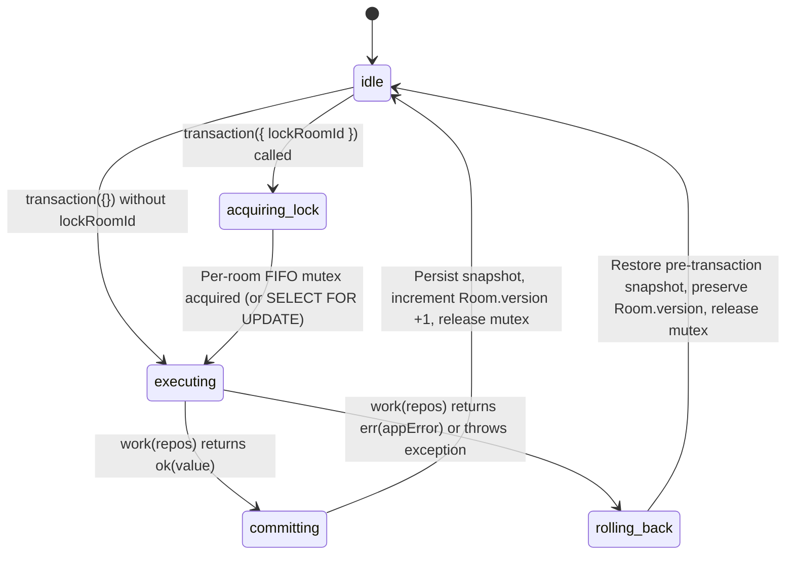
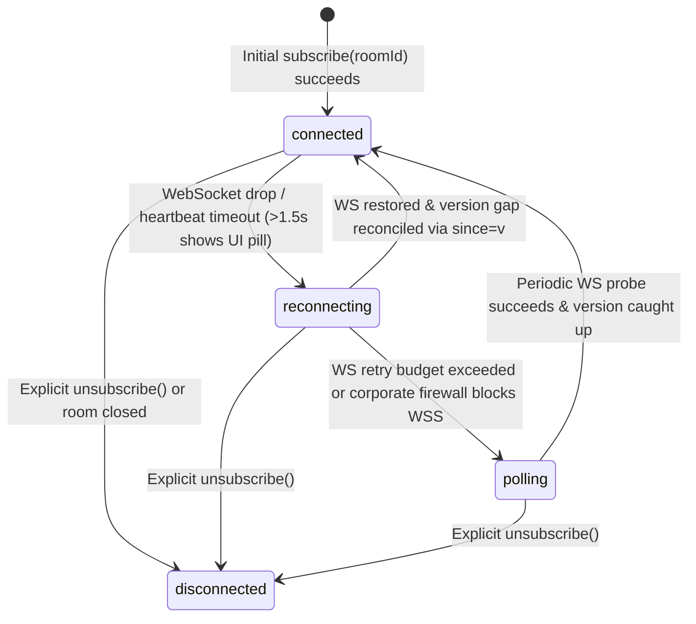

# Spec: `ports-and-testing-fakes` — Application Ports (`Persistence`, `Realtime`, `Auth`, `IssueTracker`, `Exporter`, `RateLimiter`, `Clock`, `IdGenerator`) and `packages/testing` Fakes & Contract Suites

**Slug:** `ports-and-testing-fakes`  
**Release:** `R0` (Foundation & Hexagonal Core)  
**Priority:** `M` (*Must have*)  
**Depends On:** `monorepo-foundation`  
**Depended On By:** `application-room-and-voting`, `adapters-r1-infrastructure`, `auth-teams-and-claiming`, `aggregated-history-and-audit`, `domain-and-app-sprints`, `adapters-clickup-and-jira`

---

## Traceability & Scope

| Dimension | Specification Details |
| :--- | :--- |
| **Release Milestone** | `R0` — Architectural Foundation |
| **MoSCoW Priority** | `M` (*Must have*) |
| **Requirements Covered** | `RNF-05` (Resilience, `clientOpId` idempotency & `Room.version` reconciliation), `RNF-16` (Clean Hexagonal Architecture — `application` depends only on `domain`), `RNF-17` (Infrastructure Portability via Application Ports & Reusable Contract Suites in `packages/testing`), `RNF-18` (Strict TypeScript, `≥ 90%` test coverage, architectural boundary verification), `RNF-23` (Transactional Integrity & Room-Level Concurrency Serialization via `lockRoomId` and `Room.version`), `RF-90` (Agnostic `IssueTracker` Port for external item import) |
| **Related ADRs** | `ADR-01` (Pure `npm workspaces`), `ADR-04` (Explicit transactional room locking), `ADR-05` (Versioned Realtime events + HTTP polling fallback), `ADR-07` (Vitest + reusable `describe*Contract` suites) |
| **Architectural Layer** | `@fibonaipe/application` (`packages/application/src/ports/*`, `packages/application/src/projections/events.ts`) and `@fibonaipe/testing` (`packages/testing/src/fakes/*`, `packages/testing/src/contracts/*`) |
| **Out of Scope** | Concrete network/database adapters (`@fibonaipe/adapter-*` in `R1`/`R2`/`R4`), full domain business rules (`domain-scales-and-stats`, `domain-policy-and-room`, `domain-item-round-vote`), and Hono HTTP routes (`api-and-room-entry-ui`). |

---

## Functionalities & Core Capabilities

### 1. System Architecture (SA) Perspective — Hexagonal Port Isolation & Concurrency Guarantees

1. **Complete Application Port Surface (`packages/application/src/ports`):**
   Defines the boundary interfaces that decouple `@fibonaipe/application` use cases from infrastructure concerns (`RNF-16`, `RNF-17`). `@fibonaipe/application` imports **only** `@fibonaipe/domain` and has **zero third-party runtime dependencies**. The port catalog comprises:
   - **`Clock` (`clock.port.ts`):** Deterministic time source (`now(): Date`) replacing forbidden `Date.now()` and zero-arg `new Date()` calls.
   - **`IdGenerator` (`id-generator.port.ts`):** Deterministic/CSPRNG identifier and token generator (`newId` for ULIDs, `newRoomCode` for 8-character unambiguous room codes excluding `0/O/1/I/L`, `newToken` for 256-bit opaque secrets, and `sha256` hashing).
   - **`Persistence` (`persistence.port.ts`):** Unit-of-Work transaction coordinator (`transaction(options, work)`) and scoped repository interfaces (`RoomRepository`, `IdempotencyRepository`, `TeamRepository`, `HistoryRepository`, `SprintRepository`, `UserRepository`) supporting room-level locking (`lockRoomId`) and monotonic `Room.version` increments (`RNF-23`).
   - **`RealtimePublisher` & `RealtimeClient` (`realtime.port.ts`):** Server-side post-commit event broadcaster (`RealtimePublisher`) and client-side subscription/reconciliation transport (`RealtimeClient`) with automatic connection state transitions (`connected`, `reconnecting`, `polling`, `disconnected`) and version gap detection (`RNF-01`, `RNF-04`, `RNF-05`).
   - **`AuthProvider` (`auth-provider.port.ts`):** Identity lifecycle port for passwordless Magic Link initiation/verification, Google OAuth code exchange, session token verification, and account revocation.
   - **`IssueTracker` (`issue-tracker.port.ts`):** Agnostic external backlog import port (`importItems`) supporting manual text/CSV (`RF-90`), ClickUp (`RF-91`), and Jira (`RF-92`), plus the Post-MVP `writeEstimate` extensibility seam (`RF-93`).
   - **`Exporter` (`exporter.port.ts`):** Structured dataset serialization port for `csv` (UTF-8 with BOM `\uFEFF` and formula-injection escaping) and `json` formats (`RF-63`, `RF-64`, `RNF-12`).
   - **`RateLimiter` (`rate-limiter.port.ts`):** Sliding-window quota enforcement port (`hit(key, rule)`) returning remaining quota and `retryAfterSec` for room creation (`10/h/IP`), join attempts (`20/min/IP`), and participant mutations (`60/min/participant`).
   - **`CryptoVault` & `StructuredLogger` (`crypto-vault.port.ts`, `logger.port.ts`):** Server-side credential encryption port (`AES-256-GCM` for integration tokens per `RNF-26`) and zero-PII/zero-vote structured JSON telemetry logger (`RNF-19`).

2. **Transactional Room Locking & Monotonic Versioning (`lockRoomId` + `Room.version`):**
   - Every mutating operation on a room executes inside `Persistence.transaction({ lockRoomId: roomId }, async (repos) => Result<T, AppError>)`.
   - When `lockRoomId` is supplied, the persistence implementation acquires an exclusive lock on that `roomId` before invoking the callback (`SELECT ... FOR UPDATE` in PostgreSQL; per-room FIFO async mutex in `InMemoryPersistence`).
   - Mutations on different rooms (`roomA` vs. `roomB`) execute concurrently without blocking each other.
   - If the callback returns `ok(value)` and modifies the locked room, `Room.version` is incremented by exactly `+1` upon commit. If the callback returns `err(appError)` or throws an unexpected error, all repository writes made inside the transaction are rolled back and `Room.version` remains unchanged.

3. **Deterministic Fakes (`packages/testing/src/fakes`):**
   Provides fast, zero-I/O, in-memory implementations of all ports so unit and application use-case suites run in milliseconds without external databases or network sockets:
   - `InMemoryPersistence`: Snapshot-isolated transactional store with per-room async mutex queues, rollback on `err` or exception, and `Room.version` auto-increment.
   - `FakeRealtime`: Paired `RealtimePublisher` and `RealtimeClient` hub with controllable network simulation (`simulateDisconnect`, `simulatePollingFallback`, `simulateReconnect`, out-of-order/dropped event buffering, and `sinceVersion` catch-up).
   - `FakeClock`: Deterministic clock initialized at a fixed UTC timestamp (`2026-10-26T12:00:00.000Z` default) with `advanceMs(ms)`, `advanceSeconds(sec)`, and `set(date)` mutators.
   - `SequentialIdGenerator`: Predictable generator producing sequential ULID-formatted IDs (`01J00000000000000000000001`, ...), valid 8-char unambiguous room codes (`23456789`, ...), and deterministic tokens/hashes.
   - `InMemoryRateLimiter` (`FakeRateLimiter`): Deterministic sliding-window rate limiter coupled to an injected `Clock` (such as `FakeClock`) to test quota exhaustion and window expiration without `setTimeout`.
   - `FakeAuthProvider`, `FakeIssueTracker`, `FakeExporter`, `FakeCryptoVault`, `FakeLogger`: Deterministic in-memory doubles for authentication, backlog import, CSV/JSON export, token encryption, and log-scrubbing assertions.

4. **Reusable Contract Test Suites (`packages/testing/src/contracts`):**
   Exports parameterized Vitest suites (`describePersistenceContract`, `describeRealtimeContract`, `describeRateLimiterContract`, `describeAuthProviderContract`, `describeIssueTrackerContract`, `describeExporterContract`) that run against `packages/testing` fakes in `R0` and are reused verbatim against `@fibonaipe/adapter-*` in `R1`–`R4` (`RNF-17`).

### 2. UX / Sensory & Accessibility Perspective — Connection State & Error Feedback Linkage

Although `@fibonaipe/application` and `@fibonaipe/testing` contain no UI components, their contracts directly drive the sensory and accessibility guarantees specified in `.docs/ui-ux.md` and `.docs/requirements.md`:
1. **`RealtimeClient` Connection State Machine → `ConnectionStatusPill` (`RNF-04`, `RNF-05`, `RNF-09`):**
   - `RealtimeClient.onConnectionStateChange` emits typed state transitions (`connected`, `reconnecting`, `polling`, `disconnected`) along with `pendingOpCount` and `lastSyncedVersion`.
   - This contract enables the header `ConnectionStatusPill` (`role="status"`, `aria-live="polite"`) to display *"Conectado"*, *"Sincronizando voto..."*, or *"Reconectando / Acordando servidor..."* after `1.5s` of cold-start/disconnect while keeping local votes preserved in the `clientOpId` idempotency queue.
2. **Idempotent Mutation Replay (`clientOpId`):**
   - `IdempotencyRepository` records `{ participantId, clientOpId, processedAt }` inside the same room transaction as the domain mutation, guaranteeing that automatic client retries during unstable mobile 4G connections never duplicate votes or advance rounds twice.
3. **Localized & Actionable Rate-Limit Feedback (`RATE_LIMITED`):**
   - `RateLimiter.hit` returns `{ allowed: false, retryAfterSec }` which maps to `AppError` with `code: 'RATE_LIMITED'`, `messageKey: 'errors.RATE_LIMITED'`, and `params: { retryAfterSec }`, allowing the UI to announce localized retry countdowns via `t('errors.RATE_LIMITED', { retryAfterSec })` with zero hardcoded strings (`RNF-11`).
4. **Vote Secrecy on the Wire (`RNF-13`):**
   - The `RoomEvent` union in `packages/application/src/projections/events.ts` structurally forbids individual vote card values or suits on `EVT-08` (`vote.changed` carries only `{ participantId, hasVoted: boolean }`), ensuring no network listener can inspect secret ballots prior to `Round.status === 'revealed'`.

---

## Use Cases & Scenarios

### UC-1: Concurrent Room Mutations Serialized via `lockRoomId` Mutex with Monotonic `Room.version` Increment
- **Actors:** 30 concurrent participants (or 100 rapid parallel mutations in a stress test) targeting the same `roomId`.
- **Preconditions:** Room `room-1` exists in `Persistence` at `version = 1` with `status = 'open'`.
- **Trigger:** 100 parallel calls invoke `persistence.transaction({ lockRoomId: 'room-1' }, async (repos) => ...)` simultaneously, each reading the current room snapshot, applying a state update, and calling `repos.rooms.save(updatedRoom)`.
- **Execution Flow:**
  1. The first transaction acquires the per-room async lock for `'room-1'` (`idle -> acquiring_lock -> executing`).
  2. The remaining 99 transactions queue in strict FIFO order on the `'room-1'` mutex while transactions targeting `'room-2'` proceed in parallel without waiting on `'room-1'`.
  3. Transaction 1 reads `version = 1`, saves the updated room, and commits (`executing -> committing`), incrementing `room-1.version` to `2` and releasing the mutex.
  4. Transaction 2 wakes up, reads the freshly committed state at `version = 2`, applies its mutation, and commits at `version = 3`.
  5. All 100 transactions complete sequentially for `'room-1'`.
- **Postconditions:** Zero lost updates occur; `room-1.version` equals `101`; the sequence of committed versions is strictly `[2, 3, ..., 101]` with no duplicates or gaps.

### UC-2: Transaction Rollback Preserving State and `Room.version` on Domain Error or Unhandled Exception
- **Actors:** Application Use Case (`CastVote` or `ImportItems`) executing inside `Persistence.transaction({ lockRoomId: 'room-1' }, work)`.
- **Preconditions:** Room `room-1` is at `version = 5` with 2 items in its queue and 0 idempotency records for `clientOpId = 'op-99'`.
- **Trigger:** Inside the transaction callback, the use case saves a new item (`repos.rooms.save(...)`) and records `clientOpId = 'op-99'` (`repos.idempotency.record(...)`), but a subsequent invariant check fails and returns `err({ code: 'ROUND_NOT_VOTING', messageKey: 'errors.ROUND_NOT_VOTING' })` (or throws an unexpected runtime error).
- **Execution Flow:**
  1. `InMemoryPersistence` captures a deep structural clone of the store partition prior to executing `work(repos)` (or buffers writes in a transaction-local staging map).
  2. When `work(repos)` returns `{ ok: false, error }` (or rejects), the transaction transitions from `executing -> rolling_back`.
  3. All staged changes to `rooms`, `idempotency`, `history`, and `sprints` made during the callback are discarded.
  4. The per-room mutex for `'room-1'` is released in a `finally` block so subsequent transactions are never deadlocked.
- **Postconditions:** `room-1` remains at `version = 5` with exactly 2 items; `repos.idempotency.hasProcessed(..., 'op-99')` returns `false`; the caller receives the exact `err(appError)` result.

### UC-3: Simulated Realtime Disconnect, Out-of-Order Event Buffering, and Reconnect Reconciliation in `FakeRealtime`
- **Actors:** Server Use Case publishing via `RealtimePublisher` and Browser Client subscribed via `RealtimeClient`.
- **Preconditions:** Client is subscribed to `room-1` at `lastSyncedVersion = 4` with connection state `'connected'`.
- **Trigger:** Network instability occurs (`fakeRealtime.simulateDisconnect('room-1')` or `simulatePollingFallback('room-1')`), while the server commits mutations for `version = 5` (`EVT-08 vote.changed`) and `version = 6` (`EVT-09 round.revealed`).
- **Execution Flow:**
  1. Upon `simulateDisconnect`, `RealtimeClient` transitions from `'connected' -> 'reconnecting'` and invokes registered `onConnectionStateChange` listeners.
  2. If WebSocket restoration fails within the fallback threshold (or `simulatePollingFallback` is triggered), `RealtimeClient` transitions `'reconnecting' -> 'polling'`.
  3. While disconnected or when an out-of-order event arrives (e.g., client at `version = 4` receives `version = 6`, skipping `version = 5`), `RealtimeClient` detects a version gap (`event.version !== localVersion + 1`) and triggers the registered `onVersionGap(roomId, { expectedVersion: 5, receivedVersion: 6 })` callback so the client reconciles via snapshot fetch (`since = 4`).
  4. Upon `fakeRealtime.simulateReconnect('room-1')`, buffered events since `lastSyncedVersion` are replayed in strict ascending `version` order, and connection state transitions back to `'connected'`.
- **Postconditions:** Client state converges deterministically to `version = 6`; connection status listeners observe the exact transition path `connected -> reconnecting -> polling -> connected`.

### UC-4: Deterministic Sliding-Window Rate Limiting with `FakeClock`
- **Actors:** Public user calling `CreateRoom` (`10 / hour / IP`) or participant calling `CastVote` (`60 / min / participant`).
- **Preconditions:** `InMemoryRateLimiter` is initialized with `FakeClock` at `T = 0s`. Rule `create_room` specifies `limit: 10, windowSeconds: 3600`.
- **Trigger:** Caller invokes `rateLimiter.hit('ip:203.0.113.5', { id: 'create_room', limit: 10, windowSeconds: 3600 })` 11 times at `T = 0s`, then advances `FakeClock` by `3601s` and calls `hit` again.
- **Execution Flow:**
  1. Calls 1 through 10 return `ok({ allowed: true, remaining: 9..0, retryAfterSec: 0, resetAt })`.
  2. Call 11 at `T = 0s` returns `err({ code: 'RATE_LIMITED', messageKey: 'errors.RATE_LIMITED', params: { retryAfterSec: 3600 } })` (or `{ allowed: false, remaining: 0, retryAfterSec: 3600 }`).
  3. `fakeClock.advanceSeconds(3601)` advances virtual time past the window without sleeping.
  4. Call 12 at `T = 3601s` prunes expired hits and succeeds with `remaining: 9`.
- **Postconditions:** Rate limiting is 100% deterministic and verified in `< 5ms` with zero real-time delays.

---

## Interface Contracts (Inputs, Outputs & Error Codes)

### 1. Application Ports (`packages/application/src/ports`)

| Port Interface | File Path | Method Signature | Input Parameters & Constraints | Output / Return Type | Error Codes & Invariants |
| :--- | :--- | :--- | :--- | :--- | :--- |
| **`Clock`** | `ports/clock.port.ts` | `now(): Date` | None | `Date` (UTC timestamp instance) | Never throws. Used for all timestamps, TTL calculations (`ANON_ROOM_TTL_MINUTES`), and `serverTime` synchronization. |
| **`IdGenerator`** | `ports/id-generator.port.ts` | `newId(): string` `newRoomCode(): string` `newToken(): string` `sha256(input: string): string` | `input`: non-empty string for hashing | `newId`: 26-char Crockford Base32 ULID string `newRoomCode`: 8-char string from `23456789ABCDEFGHJKMNPQRSTUVWXYZ` `newToken`: 64-char hex (256-bit secret) `sha256`: 64-char lowercase hex digest | `newRoomCode` **must never** contain ambiguous characters `0`, `O`, `1`, `I`, or `L` (`RF-21`). |
| **`Persistence`** | `ports/persistence.port.ts` | `transaction<T>(options: TransactionOptions, work: (repos: TransactionRepos) => Promise<Result<T, AppError>>): Promise<Result<T, AppError>>` `ping(): Promise<Result<{ ok: true }, AppError>>` | `options`: `{ readonly lockRoomId?: RoomId; readonly isolation?: 'read_committed' \| 'serializable' }` `work`: async callback receiving transactional repositories | `Promise<Result<T, AppError>>` | Serializes concurrent execution per `lockRoomId` (`RNF-23`). Auto-increments `Room.version` by `+1` when a locked room is saved and `work` returns `ok`. Rolls back all writes if `work` returns `err` or throws. |
| **`TransactionRepos`** *(within `Persistence`)* | `ports/persistence.port.ts` | Scoped repository properties: - `rooms`: `RoomRepository` - `idempotency`: `IdempotencyRepository` - `teams`: `TeamRepository` - `history`: `HistoryRepository` - `sprints`: `SprintRepository` - `users`: `UserRepository` | `rooms`: `findById(id)`, `findByCode(code)`, `save(room)`, `deleteExpiredAnonymous(before: Date)` `idempotency`: `hasProcessed(actorId, clientOpId, now)`, `record(actorId, clientOpId, now)` `history`: `appendAggregated(entry)`, `query(filter)`, `findById(id)`, `saveAudit(audit)` | Async methods returning domain DTOs/entities or `void` inside active transaction | **Privacy Invariant (`RF-61`, `INV-13`):** `HistoryRepository.appendAggregated` type signature structurally accepts only `AggregatedHistoryRecord` (round statistics + dominant suit) and never individual `Vote` or `shortComment` fields. |
| **`RealtimePublisher`** | `ports/realtime.port.ts` | `publish(roomId: RoomId, event: RoomEvent): Promise<Result<void, AppError>>` | `roomId`: target room ID `event`: versioned `RoomEvent` envelope (`{ type, roomId, version, at, payload }`) | `Promise<Result<void, AppError>>` | Called **strictly after** `Persistence.transaction` commits. **Security Invariant (`RNF-13`):** `EVT-08` (`vote.changed`) payload contains only `{ participantId, hasVoted: boolean }`. |
| **`RealtimeClient`** | `ports/realtime.port.ts` | `subscribe(roomId: RoomId, handlers: RealtimeSubscriptionHandlers): RealtimeSubscription` `getConnectionState(): RealtimeConnectionState` | `handlers`: `{ onEvent(event: RoomEvent): void; onVersionGap?(gap: VersionGapInfo): void; onConnectionStateChange?(state: RealtimeConnectionState): void }` | `RealtimeSubscription` with `unsubscribe(): void` and `getLastVersion(): number` | Tracks `localVersion`. If `event.version > localVersion + 1`, emits `onVersionGap({ expectedVersion: localVersion + 1, receivedVersion: event.version })` instead of applying out-of-order state. |
| **`AuthProvider`** | `ports/auth-provider.port.ts` | `sendMagicLink(email: string, redirectUrl: string): Promise<Result<{ challengeId: string }, AppError>>` `verifyMagicLink(token: string): Promise<Result<AuthenticatedIdentity, AppError>>` `getGoogleAuthUrl(state: string, redirectUrl: string): Result<{ url: string }, AppError>` `exchangeGoogleCode(code: string, redirectUrl: string): Promise<Result<AuthenticatedIdentity, AppError>>` `verifySessionToken(token: string): Promise<Result<AuthenticatedIdentity, AppError>>` `revokeUserSessions(userId: UserId): Promise<Result<void, AppError>>` | `email`: normalized email string `token` / `code`: auth credentials | `Result<AuthenticatedIdentity, AppError>` where `AuthenticatedIdentity` has `{ userId, email, displayName, emailVerifiedAt }` | Returns `err({ code: 'VALIDATION', ... })` for malformed email, `err({ code: 'AUTH_LINK_INVALID', messageKey: 'errors.AUTH_LINK_INVALID' })` for expired/invalid/reused magic links or OAuth codes, and `err({ code: 'ACCOUNT_SUSPENDED', ... })` when suspended. |
| **`IssueTracker`** | `ports/issue-tracker.port.ts` | `readonly provider: 'manual' \| 'clickup' \| 'jira'` `importItems(input: IssueTrackerImportInput): Promise<Result<ImportedBacklogBatch, AppError>>` | `input`: discriminated union by source (`{ kind: 'text', rawText }`, `{ kind: 'csv', csvContent, delimiter? }`, or `{ kind: 'external', encryptedToken, workspaceOrProjectKey, queryOrListId, maxItems }`) | `Result<ImportedBacklogBatch, AppError>` containing `items: readonly ImportedItemCandidate[]` and `warnings: readonly ImportRowWarning[]` | Enforces `MAX_ITEMS_PER_ROOM = 500` (`LIMIT_EXCEEDED`), `MAX_ITEM_TITLE_LENGTH = 200`, and `MAX_ITEM_DESC_LENGTH = 2000` (`VALIDATION`). |
| **`Exporter`** | `ports/exporter.port.ts` | `exportCsv(input: CsvExportInput): Result<ExportArtifact, AppError>` `exportJson(input: JsonExportInput): Result<ExportArtifact, AppError>` | `CsvExportInput`: `{ filenameBase: string; headers: readonly string[]; rows: readonly (readonly (string \| number \| boolean \| null)[])[] }` `JsonExportInput`: `{ filenameBase: string; schemaVersion: '1.0'; data: unknown }` | `Result<ExportArtifact, AppError>` with `{ filename: string; mimeType: string; content: string }` | CSV output **must** start with UTF-8 BOM (`\uFEFF`) and prefix any cell whose string representation begins with `=`, `+`, `-`, `@`, `\t`, or `\r` with a single quote (`'`) to prevent CSV Formula Injection (`RNF-12`). |
| **`RateLimiter`** | `ports/rate-limiter.port.ts` | `hit(key: string, rule: RateLimitRule): Promise<Result<RateLimitStatus, AppError>>` `reset(key: string, ruleId: string): Promise<void>` | `key`: actor identifier (`ip:<addr>` or `participant:<id>`) `rule`: `{ id: string; limit: number; windowSeconds: number }` | `Result<RateLimitStatus, AppError>`: returns `ok({ allowed: true, remaining, limit, resetAt, retryAfterSec: 0 })` when within quota, or `err({ code: 'RATE_LIMITED', messageKey: 'errors.RATE_LIMITED', params: { retryAfterSec } })` when exceeded | Enforces `RATE_LIMIT_CREATE_ROOM` (`10/3600s`), `RATE_LIMIT_JOIN_ATTEMPTS` (`20/60s`), and `RATE_LIMIT_MUTATIONS` (`60/60s`). |
| **`CryptoVault`** & **`StructuredLogger`** | `ports/crypto-vault.port.ts` `ports/logger.port.ts` | `CryptoVault.encrypt(plaintext: string): Result<string, AppError>` `CryptoVault.decrypt(ciphertext: string): Result<string, AppError>` `StructuredLogger.info/warn/error(entry: LogEntry): void` | `LogEntry`: strictly typed `{ requestId?: string; roomId?: string; useCase?: string; errorCode?: ErrorCode; durationMs?: number; event: string }` | Encrypted payload or structured log record | `LogEntry` type and logger implementation forbid arbitrary PII fields (`nickname`, `email`, `token`, `card`, `suit`, `comment`) (`RNF-19`). |

### 2. Realtime Event Envelope (`packages/application/src/projections/events.ts`)

Every event published through `RealtimePublisher` and received by `RealtimeClient` conforms to `RoomEvent<TPayload>`:
- `type`: `'room.settings_updated' | 'participant.joined' | 'participant.updated' | 'participant.disconnected' | 'host.transferred' | 'item.queue_updated' | 'round.started' | 'vote.changed' | 'round.revealed' | 'item.estimate_finalized' | 'timer.updated' | 'room.claimed'` (`EVT-01` through `EVT-12`).
- `roomId`: `RoomId`
- `version`: positive integer matching the committed `Room.version` after the mutation.
- `at`: ISO-8601 UTC timestamp string (`Clock.now().toISOString()`).
- `payload`: event-specific read-only payload. Specifically, `EVT-08` (`vote.changed`) has payload `{ readonly participantId: ParticipantId; readonly hasVoted: boolean }` and **never** includes card, suit, or comment values (`RF-40`, `RNF-13`).

---

## Flow & states

### 1. Transaction & Room Mutex Lifecycle (`Persistence.transaction`)

- **State Invariants:**
  - **`idle`:** No active transaction for the execution context; mutex queue for `roomId` is empty.
  - **`acquiring_lock`:** Call awaits the promise tail of the per-room mutex map `Map<RoomId, Promise<void>>`. Other rooms are unaffected.
  - **`executing`:** Exclusive lock held for `lockRoomId`. All repository reads and writes operate on an isolated transactional working copy.
  - **`committing`:** Working copy replaces committed state atomically; if the locked room was saved, its `version` increases by `+1` and `lastActivityAt` updates. Post-commit realtime publishing runs **after** leaving `committing`.
  - **`rolling_back`:** Working copy is discarded; committed store and `Room.version` are untouched; mutex is always released before returning `err(appError)`.

### 2. Realtime Client Connection & Reconciliation State Machine (`RealtimeClient`)

- **Version Gap Reconciliation Flow:**
  1. Client maintains `lastSyncedVersion` (initialized from the HTTP snapshot).
  2. When an incoming `RoomEvent` has `event.version === lastSyncedVersion + 1`, the client advances `lastSyncedVersion = event.version` and delivers the event to `onEvent`.
  3. When `event.version <= lastSyncedVersion`, the duplicate/stale event is ignored idempotently.
  4. When `event.version > lastSyncedVersion + 1`, `RealtimeClient` buffers the event, invokes `onVersionGap({ roomId, expectedVersion: lastSyncedVersion + 1, receivedVersion: event.version })`, and once reconciled to the missing version, flushes any subsequent contiguous buffered events in order.

---

## Technical design / how-to

### Step 1: Workspace Configuration for `@fibonaipe/application` and `@fibonaipe/testing`
1. Create `packages/application/package.json` with name `"@fibonaipe/application"`, `"type": "module"`, and `"dependencies": { "@fibonaipe/domain": "*" }`. Ensure zero external runtime packages are added (`RNF-16`).
2. Create `packages/testing/package.json` with name `"@fibonaipe/testing"`, `"type": "module"`, and `"dependencies": { "@fibonaipe/domain": "*", "@fibonaipe/application": "*" }` (with `vitest` available from workspace root devDependencies).
3. Configure `packages/application/tsconfig.json` and `packages/testing/tsconfig.json` extending `../../tsconfig.base.json` (`strict: true`, `noUncheckedIndexedAccess: true`).

### Step 2: Implementing the Application Ports & Event Projections (`packages/application`)
1. Define the `RoomEvent` discriminated union (`EVT-01`..`EVT-12`) in `packages/application/src/projections/events.ts`. Enforce readonly properties and verify that `VoteChangedEvent` (`EVT-08`) carries only `{ participantId, hasVoted }`.
2. Define each Port interface in `packages/application/src/ports/*.port.ts`:
   - Use branded IDs (`RoomId`, `ParticipantId`, `ItemId`, `RoundId`, `SprintId`, `TeamId`, `UserId`) and `Result<T, AppError>` imported from `@fibonaipe/domain`.
   - Define repository record types in `persistence.port.ts` (`PersistedRoomRecord`, `IdempotencyRecord`, `AggregatedHistoryRecord`, `EstimateAuditRecord`, `PersistedSprintRecord`, `PersistedTeamRecord`, `PersistedUserRecord`) so that `Persistence` can be contract-tested immediately in `R0` and seamlessly store domain aggregates in `R1`–`R4`.
   - Re-export all ports and event types cleanly from `packages/application/src/index.ts`.

### Step 3: Implementing Deterministic Fakes (`packages/testing/src/fakes`)
1. **`FakeClock` (`fake-clock.ts`):**
   - Accept an initial ISO string or `Date` in the constructor (defaulting to `2026-10-26T12:00:00.000Z`).
   - Store internal epoch milliseconds (`currentMs`). Return `new Date(this.currentMs)` on `now()`.
   - Provide `advanceMs(ms: number): Date`, `advanceSeconds(seconds: number): Date`, and `set(date: Date | string): void`.
2. **`SequentialIdGenerator` (`sequential-id-generator.ts`):**
   - Maintain internal counters (`idCounter`, `roomCodeCounter`, `tokenCounter`) with a `reset()` method.
   - `newId()`: Format counter into a valid 26-character Crockford Base32 ULID (`01J00000000000000000000001`, etc.).
   - `newRoomCode()`: Generate deterministic 8-character codes using exclusively the 31-character unambiguous alphabet `23456789ABCDEFGHJKMNPQRSTUVWXYZ`.
   - `newToken()`: Generate deterministic 64-character hex tokens.
   - `sha256(input)`: Compute deterministic SHA-256 hex digest using Node's built-in `node:crypto` `createHash('sha256')` (pure built-in, zero external dependencies).
3. **`InMemoryPersistence` (`in-memory-persistence.ts`):**
   - Maintain an internal state store containing maps for `rooms`, `idempotency`, `teams`, `history`, `audits`, `sprints`, and `users`, plus a mutex queue map `roomLocks: Map<RoomId, Promise<void>>`.
   - Implement a private helper `acquireRoomLock(roomId: RoomId): Promise<() => void>` that chains onto the existing `Promise<void>` for `roomId` and returns an `unlock` function.
   - In `transaction(options, work)`:
     1. If `options.lockRoomId` is provided, await `acquireRoomLock(options.lockRoomId)`.
     2. Inside a `try / finally` block, take a deep structural clone (`structuredClone`) of the store maps as the working state and track whether `repos.rooms.save` was called for `options.lockRoomId`.
     3. Execute `await work(scopedRepos)`.
     4. If the returned `Result` has `ok === true`: if the locked room was saved during the transaction, set its `version = previousCommittedVersion + 1`; then atomically swap the committed store maps with the working state and return `result`.
     5. If `ok === false` or an exception is thrown: discard the working state (preserving the original committed maps and `Room.version`) and return the `err` result (or rethrow unexpected non-Result defects after restoring state).
     6. Always invoke `unlock()` in `finally`.
4. **`FakeRealtime` (`fake-realtime.ts`):**
   - Implement both `RealtimePublisher` and `RealtimeClient` (and expose `createClient()` for multi-viewer testing).
   - Maintain per-room subscriber sets, event history logs, per-room connection state (`connected` | `reconnecting` | `polling` | `disconnected`), and an optional delivery interceptor (`pauseDelivery`, `deliverOutOfOrder`, `flushBuffered`).
   - When `publish(roomId, event)` is called: append to history; if the room or client is currently `connected`, deliver to subscribers checking `event.version === subscriber.lastVersion + 1` (triggering `onVersionGap` if `event.version > subscriber.lastVersion + 1`).
5. **`InMemoryRateLimiter` (`fake-rate-limiter.ts`):**
   - Inject `Clock` in constructor. Maintain `Map<string, number[]>` mapping `${rule.id}:${key}` to timestamps in milliseconds.
   - On `hit(key, rule)`: prune timestamps older than `nowMs - rule.windowSeconds * 1000`. If `timestamps.length >= rule.limit`, calculate `retryAfterSec = Math.ceil((oldestTimestamp + rule.windowSeconds * 1000 - nowMs) / 1000)` and return `err({ code: 'RATE_LIMITED', messageKey: 'errors.RATE_LIMITED', params: { retryAfterSec } })`. Otherwise push `nowMs` and return `ok({ allowed: true, remaining: rule.limit - timestamps.length, limit: rule.limit, resetAt: new Date(nowMs + rule.windowSeconds * 1000), retryAfterSec: 0 })`.
6. **`FakeAuthProvider`, `FakeIssueTracker`, `FakeExporter`, `FakeCryptoVault`, `FakeLogger`:**
   - Implement deterministic in-memory behaviors honoring all error codes (`AUTH_LINK_INVALID`, `ACCOUNT_SUSPENDED`, `LIMIT_EXCEEDED`, `VALIDATION`), UTF-8 BOM + CSV injection escaping (`'`), and zero-PII log validation.

### Step 4: Implementing Reusable Contract Suites (`packages/testing/src/contracts`)
1. **`describePersistenceContract(name, factory)` (`persistence.contract.ts`):**
   - Tests CRUD round-trips for rooms, idempotency keys, and aggregated history.
   - Tests the **100-concurrent-transactions stress test** on the same `lockRoomId`, asserting strict serialization and `Room.version` advancing from `1` to `101` with zero gaps.
   - Tests parallel transactions on different `lockRoomId`s executing without cross-blocking.
   - Tests **transaction rollback** on both `err(appError)` return and thrown exception, verifying state and `Room.version` remain unchanged.
   - Tests `deleteExpiredAnonymous(before)` deleting only guest rooms whose `expiresAt <= before` while leaving active guest rooms and persistent team rooms untouched.
2. **`describeRealtimeContract(name, factory)` (`realtime.contract.ts`):**
   - Tests ordered delivery of sequential `RoomEvent` envelopes (`version = 1, 2, 3`).
   - Tests duplicate event deduplication (`version <= lastSyncedVersion`).
   - Tests out-of-order event detection (`version = 1` then `version = 3` triggers `onVersionGap({ expectedVersion: 2, receivedVersion: 3 })`).
   - Tests disconnect/polling/reconnect state transitions (`connected -> reconnecting -> polling -> connected`) and catch-up reconciliation.
3. **`describeRateLimiterContract(name, factory)` (`rate-limiter.contract.ts`):**
   - Tests quota allowance up to `rule.limit`, rejection with `RATE_LIMITED` and accurate `retryAfterSec` on `limit + 1`, key isolation (`ip:1` vs `ip:2`), and quota recovery after advancing the clock past `windowSeconds`.
4. **`describeAuthProviderContract`, `describeIssueTrackerContract`, `describeExporterContract`:**
   - Verify magic-link one-time token consumption, OAuth exchange, 500-item import limit (`LIMIT_EXCEEDED`), and CSV UTF-8 BOM + formula-injection prefixing (`=SUM(A1)` → `'=SUM(A1)`).

---

## Files to touch

| File Path | Action | Responsibility |
| :--- | :---: | :--- |
| `packages/application/package.json` | Create / Update | Workspace manifest for `@fibonaipe/application` depending only on `@fibonaipe/domain`. |
| `packages/application/tsconfig.json` | Create / Update | Strict TypeScript configuration for `@fibonaipe/application`. |
| `packages/application/src/index.ts` | Create / Update | Barrel export for all Application Ports and Realtime Event definitions. |
| `packages/application/src/projections/events.ts` | Create | `RoomEvent` envelope and `EVT-01`..`EVT-12` payload contracts (enforcing secret ballot on `EVT-08`). |
| `packages/application/src/ports/clock.port.ts` | Create | `Clock` port interface (`now(): Date`). |
| `packages/application/src/ports/id-generator.port.ts` | Create | `IdGenerator` port interface (`newId`, `newRoomCode`, `newToken`, `sha256`). |
| `packages/application/src/ports/persistence.port.ts` | Create | `Persistence` port (`transaction` with `lockRoomId`), `TransactionRepos`, and repository contracts. |
| `packages/application/src/ports/realtime.port.ts` | Create | `RealtimePublisher` and `RealtimeClient` interfaces, connection states, and version gap contracts. |
| `packages/application/src/ports/auth-provider.port.ts` | Create | `AuthProvider` port interface (Magic Link, Google OAuth, session verification, revocation). |
| `packages/application/src/ports/issue-tracker.port.ts` | Create | `IssueTracker` port interface (`importItems`, validation warnings, Post-MVP `writeEstimate` seam). |
| `packages/application/src/ports/exporter.port.ts` | Create | `Exporter` port interface (`exportCsv`, `exportJson`). |
| `packages/application/src/ports/rate-limiter.port.ts` | Create | `RateLimiter` port interface (`hit`, `reset`, `RateLimitRule`, `RateLimitStatus`). |
| `packages/application/src/ports/crypto-vault.port.ts` | Create | `CryptoVault` port interface (`encrypt`, `decrypt` for integration credentials). |
| `packages/application/src/ports/logger.port.ts` | Create | `StructuredLogger` and `ErrorReporter` zero-PII port interfaces. |
| `packages/testing/package.json` | Create / Update | Workspace manifest for `@fibonaipe/testing`. |
| `packages/testing/tsconfig.json` | Create / Update | Strict TypeScript configuration for `@fibonaipe/testing`. |
| `packages/testing/src/index.ts` | Create / Update | Barrel export for all fakes and reusable `describe*Contract` test suites. |
| `packages/testing/src/fakes/fake-clock.ts` | Create | Deterministic `FakeClock` with `advanceMs`, `advanceSeconds`, and `set`. |
| `packages/testing/src/fakes/sequential-id-generator.ts` | Create | Deterministic `SequentialIdGenerator` with unambiguous 8-char room codes and SHA-256. |
| `packages/testing/src/fakes/in-memory-persistence.ts` | Create | `InMemoryPersistence` with per-room async mutex, snapshot rollback, and `Room.version` increment. |
| `packages/testing/src/fakes/fake-realtime.ts` | Create | `FakeRealtime` pub/sub hub with disconnect, polling fallback, and out-of-order buffering simulation. |
| `packages/testing/src/fakes/fake-rate-limiter.ts` | Create | `InMemoryRateLimiter` (`FakeRateLimiter`) coupled to `Clock`. |
| `packages/testing/src/fakes/fake-auth-provider.ts` | Create | `FakeAuthProvider` in-memory Magic Link, Google OAuth, and session lifecycle fake. |
| `packages/testing/src/fakes/fake-issue-tracker.ts` | Create | `FakeIssueTracker` deterministic backlog import fake. |
| `packages/testing/src/fakes/fake-exporter.ts` | Create | `FakeExporter` with UTF-8 BOM and CSV formula-injection escaping. |
| `packages/testing/src/fakes/fake-crypto-vault.ts` | Create | `FakeCryptoVault` deterministic reversible cipher fake. |
| `packages/testing/src/fakes/fake-logger.ts` | Create | `FakeLogger` in-memory structured log collector with PII/vote leak assertion helpers. |
| `packages/testing/src/contracts/persistence.contract.ts` | Create | Reusable `describePersistenceContract` suite (including 100-tx concurrency stress test & rollback). |
| `packages/testing/src/contracts/realtime.contract.ts` | Create | Reusable `describeRealtimeContract` suite (ordered pub/sub, version gap, disconnect/reconnect). |
| `packages/testing/src/contracts/rate-limiter.contract.ts` | Create | Reusable `describeRateLimiterContract` suite (sliding window, `RATE_LIMITED`, clock recovery). |
| `packages/testing/src/contracts/auth-provider.contract.ts` | Create | Reusable `describeAuthProviderContract` suite. |
| `packages/testing/src/contracts/issue-tracker.contract.ts` | Create | Reusable `describeIssueTrackerContract` suite. |
| `packages/testing/src/contracts/exporter.contract.ts` | Create | Reusable `describeExporterContract` suite (BOM + CSV formula-injection protection). |
| `packages/testing/src/__tests__/fakes-contracts.test.ts` | Create | Vitest runner executing all contract suites and unit tests against `packages/testing` fakes. |

---

## Acceptance Criteria & TDD Plan (`QA-red → SE-green → QA-verify`)

### Acceptance Criteria Checklist
1. **Complete Port Coverage (`RNF-17`):** All Application Ports (`Clock`, `IdGenerator`, `Persistence`, `RealtimePublisher`, `RealtimeClient`, `AuthProvider`, `IssueTracker`, `Exporter`, `RateLimiter`, `CryptoVault`, `StructuredLogger`) are exported from `@fibonaipe/application` with strict TypeScript signatures returning `Result<T, AppError>`.
2. **Hexagonal Boundary Purity (`RNF-16`):** `packages/application` depends exclusively on `@fibonaipe/domain`, imports zero adapters or Node I/O modules, and never invokes `Date.now()`, `new Date()` (0 args), or `Math.random()`. Verified by `npm run check:boundaries` and `npm run lint`.
3. **100-Concurrent-Transactions Room Lock Stress Test (`RNF-23`):** Launching 100 concurrent `persistence.transaction({ lockRoomId })` operations against the same room in `InMemoryPersistence` serializes execution in FIFO order, produces zero lost updates, and increments `Room.version` monotonically from `1` to `101`.
4. **Atomic Rollback Verification (`RNF-23`):** Any transaction whose callback returns `err(appError)` or throws an exception leaves all repositories and `Room.version` completely unchanged and releases the room mutex without deadlocking subsequent calls.
5. **Realtime Resilience & Secret Ballot Contract (`RNF-05`, `RNF-13`):** `FakeRealtime` accurately simulates `connected -> reconnecting -> polling -> connected` state transitions, detects out-of-order version gaps (`event.version > localVersion + 1`), and `EVT-08` (`vote.changed`) structurally excludes vote values.
6. **Deterministic Fakes & Contract Suites Green (`RNF-17`, `RNF-18`):** `describePersistenceContract`, `describeRealtimeContract`, `describeRateLimiterContract`, `describeAuthProviderContract`, `describeIssueTrackerContract`, and `describeExporterContract` execute against all `packages/testing` fakes and pass with `≥ 90%` coverage.

### TDD Execution Plan

| Phase | Agent Role | Concrete Actions & Verification Targets |
| :--- | :---: | :--- |
| **Phase 1: `QA-red`** *(Failing Spec Tests)* | **QA Engineer** | 1. Author `packages/testing/src/contracts/persistence.contract.ts` including the 100-concurrent-transactions stress test on a single `lockRoomId`, multi-room non-blocking concurrency test, rollback preservation of `Room.version` on `err` and thrown exceptions, idempotency deduplication (`clientOpId`), and expired anonymous room purge. 2. Author `realtime.contract.ts` testing sequential version delivery, duplicate filtering, out-of-order version gap detection, and `connected -> reconnecting -> polling -> connected` transitions. 3. Author `rate-limiter.contract.ts`, `auth-provider.contract.ts`, `issue-tracker.contract.ts`, `exporter.contract.ts`, and `packages/testing/src/__tests__/fakes-contracts.test.ts` (including `FakeClock` and `SequentialIdGenerator` unambiguous room-code tests). 4. Confirm tests fail (`RED`) prior to implementation. |
| **Phase 2: `SE-green`** *(Minimal Implementation)* | **Software Engineer** | 1. Implement all Port interfaces in `packages/application/src/ports/*` and `RoomEvent` definitions in `packages/application/src/projections/events.ts`. 2. Implement `FakeClock`, `SequentialIdGenerator`, `InMemoryPersistence` (with per-room async mutex and snapshot rollback), `FakeRealtime`, `InMemoryRateLimiter`, `FakeAuthProvider`, `FakeIssueTracker`, `FakeExporter`, `FakeCryptoVault`, and `FakeLogger` in `packages/testing/src/fakes/*`. 3. Wire barrel exports in `packages/application/src/index.ts` and `packages/testing/src/index.ts`. |
| **Phase 3: `QA-verify`** *(Gate & Boundary Verification)* | **QA Engineer** | 1. Run `npm run test:unit` and verify 100% of contract suites and fake unit tests pass (`GREEN`). 2. Run `npm run typecheck`, `npm run lint`, `npm run check:boundaries`, and `npm run check:licenses` to confirm zero boundary violations, zero `any` types, and zero native C++ addons. |
