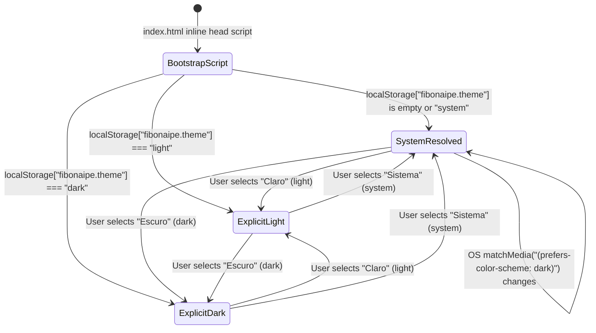

# Spec: `web-pwa-shell` — React 19 + TanStack Router & Query + Vite mobile-first PWA shell (`360px`), Light/Dark CSS tokens, `pt-BR` i18n engine, and `/api/healthz`

**Slug:** `web-pwa-shell`  
**Release:** `R0` (Foundation & Hexagonal Core)  
**Priority:** `M` (*Must have*)  
**Depends On:** `monorepo-foundation` (`ports-and-testing-fakes` for Composition Root in-memory wiring)  
**Status:** Ready for Implementation (`QA-red` → `SE-green` → `QA-verify`)

---

## Traceability & Scope

| Dimension | Specification Details |
| :--- | :--- |
| **Release** | `R0` — Architectural Foundation |
| **MoSCoW Priority** | `M` (*Must have* — blocks all R1–R4 UI and HTTP API work) |
| **Depends On** | `monorepo-foundation` |
| **Downstream Dependents** | `api-and-room-entry-ui`, `poker-table-and-projector-ui`, `auth-teams-and-claiming`, `sprint-and-observability-ui` |

### Requirements Coverage Matrix

| Req ID | Category | Requirement Summary | How `web-pwa-shell` Satisfies It |
| :--- | :--- | :--- | :--- |
| **`RF-95`** | i18n & Visual Theme | Multi-language (`pt-BR` default, prepared for `en-US` and `es-ES`) and visual theme selector (`Claro`, `Escuro`, `Automático do Sistema`) persisted in `localStorage`. | Provides `ThemeProvider` (`light`, `dark`, `system` with `matchMedia` listener) and `I18nProvider` (`pt-BR` default, `en-US`, `es-ES`) with header controls and `localStorage` persistence. |
| **`RNF-02`** | Performance & Bundle Budget | Initial LCP `< 2.5s` on 4G mobile; initial JS bundle for room route `<= 150 KB` gzipped. | Configures Vite 6 code-splitting, zero runtime CSS-in-JS (`*.module.css`), zero external font blocking, and `tools/check-bundle-budget.mjs` gate in CI. |
| **`RNF-06`** | Mobile First | Designed from `360px` viewport width with zero horizontal scroll (`scrollWidth <= clientWidth`) and minimum `44×44px` (`--touch-min: 2.75rem`) touch targets with `>= 8px` gap. | Enforces `360px` fluid layout in `AppShell`, `overflow-x: hidden` on root canvas, and `min-width: 44px; min-height: 44px` on all interactive controls. |
| **`RNF-07`** | Multi-Screen Responsiveness | Fluid adaptation across smartphones (`360px+`), tablets (`768px+`), desktops (`1280px+`), and Full HD projectors (`1920×1080`). | Establishes responsive CSS Grid/Flexbox shell breakpoints (`360px`, `768px`, `1280px`) and route-level shell layout variants (standard vs. chromeless projector `/r/$code/screen`). |
| **`RNF-08`** | Accessibility (WCAG 2.2 AA) | Full WCAG 2.2 AA compliance: verified Light/Dark contrast (`>= 4.5:1` text, `>= 3:1` UI), crisp `:focus-visible` ring (`3px solid`), 100% keyboard operation, and screen-reader landmarks. | Implements `tokens.css` with AA/AAA verified palettes, global `:focus-visible` outline (`3px solid var(--focus-ring)`), semantic HTML landmarks (`header`, `main`, `nav`, `footer`), and skip-to-content link. |
| **`RNF-09`** | Visual & Assistive Semantics | No information conveyed by color/symbol alone; global `aria-live` announcer region (`polite` / `assertive`); strict adherence to `prefers-reduced-motion` and `prefers-color-scheme`. | Provides `LiveAnnouncerProvider` with debounced `polite`/`assertive` regions, reduced-motion token overrides (`--dur-instant: 0ms`, `--dur-state: 100ms`), and visible text labels alongside icons. |
| **`RNF-10`** | Automated A11y Verification | Automated `@axe-core/playwright` execution on all screens in CI across Light and Dark themes. | Configures `playwright.config.ts` (`360×640` and `1280×720`) and E2E accessibility test suite verifying zero serious/critical Axe violations in both themes. |
| **`RNF-11`** | Strict Internationalization | Prohibition of hardcoded strings in JSX components, accessibility attributes (`aria-label`, `title`, `alt`), or error messages; native `Intl` formatting for numbers/dates. | Implements typed `t(key, params)` catalog resolver, `Intl.NumberFormat` / `Intl.DateTimeFormat` helpers, and `tools/check-i18n.mjs` AST/regex verifier in `npm run verify`. |
| **`RNF-20`** | Zero-Cost MVP Operation | 100% operation within cloud free tiers (Cloudflare Pages/Workers, Vercel, Render) with documented limits. | Uses Web Standard `Request`/`Response` via Hono v4 and Vite static output so the entire app deploys without modification to serverless/edge free tiers. |
| **`RNF-21`** | Browser Compatibility | Official support for the last two stable versions of Chrome, Edge, Firefox, and Safari (desktop and mobile). | Configures Vite build target (`ES2022` / modern evergreen browsers), standard CSS Custom Properties, and standard Service Worker / Web App Manifest APIs. |
| **`RNF-22`** | Progressive Web App (PWA) | Valid `manifest.webmanifest` and Service Worker for home-screen installation and static asset caching, strictly excluding `/api/*` responses from cache. | Configures `vite-plugin-pwa` (or deterministic static SW) with `NetworkOnly` rule for `/api/*` and `/healthz`, caching only fingerprinted static assets (`/assets/*`, icons, manifest). |

---

## Functionalities & Core Capabilities

### 1. Vite 6 + React 19 + TanStack Router & Query Foundation
- **React 19 Entry & Providers (`apps/web/src/client/main.tsx`):** Mounts the application into `#root` inside `React.StrictMode`, wrapping the route tree in a deterministic provider hierarchy:
  1. `I18nProvider` (loads locale catalog and syncs `<html lang="...">`).
  2. `ThemeProvider` (resolves `light` | `dark` | `system` and syncs `<html data-theme="...">`).
  3. `LiveAnnouncerProvider` (mounts polite/assertive screen-reader announcement regions).
  4. `QueryClientProvider` (TanStack Query v5 client configured for resilient retries and future `clientOpId` mutation queueing).
  5. `RouterProvider` (TanStack Router instance with type-safe route definitions).
- **Type-Safe Route Tree (`apps/web/src/client/router.tsx`):**
  - `__root`: Renders the `SkipToContentLink`, `AppHeader` (brand mark, `ConnectionStatusPill` slot, `LocaleSelector`, `ThemeToggle`), `<main id="main-stage" tabIndex={-1}>`, and `LiveAnnouncer` regions.
  - `/`: Home/Landing shell view presenting the Fibonaipe title, subtitle, and structural entry cards (Create Room / Join Room by 8-char code placeholders ready for R1 wiring).
  - `/r/$code` & `/r/$code/screen`: Structural route placeholders registered in the router tree so code-splitting boundaries and bundle budget checks (`check-bundle-budget.mjs`) evaluate the room chunk from R0 onward.

### 2. Design Tokens (`tokens.css`) & Global Accessibility Styles (`global.css`)
- **Complete Token System:** Implements all CSS Custom Properties defined in `.docs/ui-ux.md §2`:
  - **Surfaces & Ink:** `--bg-canvas`, `--bg-surface`, `--bg-elevated`, `--bg-overlay`, `--bg-table-felt`, `--border-table-rim`, `--text-primary`, `--text-secondary`, `--text-muted`, `--text-on-accent`.
  - **Borders & Focus:** `--border-subtle`, `--border-control`, `--accent-primary`, `--accent-primary-hover`, `--accent-primary-subtle`, `--focus-ring`.
  - **Semantic Status:** `--status-success-{fg,bg,border}`, `--status-warning-{fg,bg,border}`, `--status-danger-{fg,bg,border}`.
  - **Suit Hierarchy Tokens (`RF-52`):** `--suit-clubs-{fg,bg,border}` (Level 4 High), `--suit-hearts-{fg,bg,border}` (Level 3 Medium), `--suit-spades-{fg,bg,border}` (Level 2 Low), `--suit-diamonds-{fg,bg,border}` (Level 1 Insignificant), `--suit-joker-{fg,bg,border}` (Level 0 Neutral).
  - **Figure Tag Tokens (`RF-56`):** `--tag-ace-{fg,bg}`, `--tag-king-{fg,bg}`, `--tag-queen-{fg,bg}`, `--tag-jack-{fg,bg}`.
  - **Typography & Tabular Numerals:** `--font-sans`, `--font-mono`, and `font-variant-numeric: tabular-nums` utility rules.
  - **Spacing & Touch Targets (`RNF-06`):** 4px grid (`--space-1` through `--space-10`) and `--touch-min: 2.75rem` (`44px`).
  - **Motion & Reduced-Motion Overrides (`RNF-09`):** `--dur-instant` (`90ms` → `0ms`), `--dur-state` (`180ms` → `100ms`), `--dur-reveal` (`320ms` → `120ms`), `--dur-reveal-cap` (`450ms` → `120ms`).
- **Global Reset & Focus Ring (`global.css`):**
  - Enforces `box-sizing: border-box`, `overflow-x: hidden` on `html, body`, and `min-width: 360px`.
  - Applies universal `:focus-visible { outline: 3px solid var(--focus-ring); outline-offset: 2px; }` on all interactive elements.
  - Disables spatial transforms (`translateY`, `scale`, `rotateY`) when `@media (prefers-reduced-motion: reduce)` is active.

### 3. Typed `pt-BR` i18n Engine, `Intl` Formatters & CI Verifier (`check-i18n.mjs`)
- **Catalogs (`apps/web/src/client/i18n/locales/`):**
  - `pt-BR.json` (Primary/Default source of truth for schema types).
  - `en-US.json` and `es-ES.json` (Complete structural parity with `pt-BR.json` for R0 shell keys and all `AppError` message keys).
- **Typed `t(key, params)` & `Intl` Helpers:**
  - Compile-time type safety: `TranslationKey` is derived from the nested or dot-flattened keys of `pt-BR.json`.
  - Parameter interpolation: Replaces `{paramName}` tokens deterministically with values passed in `params`.
  - Native `Intl` formatters: `formatNumber(value, options)` (`1` decimal for averages, `2` decimals for pace) and `formatDate(date, options)` bound to the active locale (`pt-BR`, `en-US`, `es-ES`).
- **CI Static Verifier (`tools/check-i18n.mjs`):**
  - Verifies key parity across `pt-BR.json`, `en-US.json`, and `es-ES.json`.
  - Scans all `apps/web/src/client/**/*.{ts,tsx}` files to verify every `t('...')` call references an existing key in `pt-BR.json` and flags any orphan keys not used in source or error mappings.
  - Scans JSX/TSX trees to reject raw hardcoded text nodes inside JSX elements and hardcoded string literals in `aria-label`, `aria-description`, `placeholder`, `title`, and `alt` attributes (`RNF-11`).

### 4. PWA Web App Manifest & Static-Only Service Worker (`RNF-22`)
- **Web App Manifest (`apps/web/public/manifest.webmanifest`):**
  - Declares `"name": "Fibonaipe — Planning Poker & Previsão de Sprints"`, `"short_name": "Fibonaipe"`, `"lang": "pt-BR"`, `"display": "standalone"`, `"start_url": "/"`, `"theme_color": "#0F52BA"`, `"background_color": "#0B0F17"`, and SVG/PNG app icons (`192x192`, `512x512`, `maskable`).
- **Service Worker Policy:**
  - Precaches and serves only static build artifacts (`/index.html` app shell, `/assets/*`, `/icons/*`, `/manifest.webmanifest`).
  - **Strict API Exclusion (`RNF-22`, `RNF-13`):** Any request matching `/api/*` or `/healthz` bypasses Service Worker caching completely (`NetworkOnly`) so real-time room snapshots, votes, and session cookies are never cached by the Service Worker.

### 5. Hono HTTP Server, `/api/healthz` (`GET /healthz`), & Composition Root (`composition.ts`)
- **Composition Root (`apps/web/src/server/composition.ts`):**
  - The **only** module in the entire monorepo permitted by `tools/check-boundaries.mjs` to import concrete `@fibonaipe/adapter-*` or `@fibonaipe/testing` implementations and wire them into `@fibonaipe/application` ports and use cases.
  - Reads validated environment configuration from `apps/web/src/server/env.ts` (Zod schema) and instantiates the `AppContainer` (`clock`, `idGenerator`, `persistence`, `realtime`, `authProvider`, `rateLimiter`, `logger`). In `R0` (`PERSISTENCE_DRIVER=in-memory`, `REALTIME_DRIVER=fake`), wires the deterministic fakes from `@fibonaipe/testing`.
- **Hono Application (`apps/web/src/server/app.ts`):**
  - Mounts request ID & structured JSON logging middleware (`RNF-19`), `Origin` CSRF validation middleware for mutating methods (`POST`, `PUT`, `PATCH`, `DELETE`), standard `AppError` → HTTP status mapper (`§7.1` of `technologies.md`), and healthcheck routes.
  - Exposes both `GET /healthz` and `GET /api/healthz` returning `200 OK` with JSON `{ status: "ok", version: "0.1.0", timestamp: "<ISO-8601 UTC>", checks: { persistence: "ok" } }` and `Cache-Control: no-store`.

---

## Use Cases & Scenarios

### UC-1: Opening the App on a `360×640` Mobile Screen with Zero Horizontal Scroll and Accessible Controls
- **Actors:** Anonymous User / Team Member on a mobile device (`360×640` viewport) or screen reader user (TalkBack / VoiceOver / NVDA).
- **Preconditions:** User navigates to `GET /` for the first time with an empty `localStorage`.
- **Main Success Scenario:**
  1. The browser loads `/` with `<html lang="pt-BR" data-theme="light">` (or `"dark"` if the OS reports `prefers-color-scheme: dark`).
  2. The `AppShell` renders within a `360×640` viewport with `document.documentElement.scrollWidth === document.documentElement.clientWidth` (`360px`, zero horizontal overflow).
  3. Pressing `Tab` once focuses the visible `"Pular para o conteúdo principal"` skip link (`min-height: 44px`, `3px solid var(--focus-ring)` outline). Pressing `Enter` moves focus directly to `<main id="main-stage">`.
  4. All header interactive controls (Brand home link, `ConnectionStatusPill`, `LocaleSelector`, `ThemeToggle`) have bounding boxes of at least `44×44px` with at least `8px` (`--space-2`) separation between adjacent controls.
  5. `@axe-core/playwright` scans the rendered DOM and reports `0` violations for WCAG 2.2 Level A and AA rules.

### UC-2: Switching Between Light, Dark, and System Themes with `localStorage` Persistence
- **Actors:** Any User interacting with the `ThemeToggle` control in the `AppHeader`.
- **Preconditions:** User is on `/` with default `themeMode = "system"`.
- **Main Success Scenario:**
  1. User activates the `ThemeToggle` control (via click or `Enter`/`Space` key) and selects `"Escuro"` (`dark`).
  2. Immediately (`< 100ms`), `ThemeProvider` sets `document.documentElement.dataset.theme = "dark"`, updates `<meta name="theme-color" content="#0B0F17">`, and writes `"dark"` to `localStorage.getItem("fibonaipe.theme")`.
  3. The `LiveAnnouncer` polite region announces `"Tema alterado para Escuro"` in the active locale.
  4. `@axe-core/playwright` runs against the Dark theme DOM and verifies all surface/text combinations (`--bg-canvas: #0B0F17`, `--bg-surface: #131B2E`, `--text-primary: #F8FAFC`) pass WCAG 2.2 AA contrast thresholds with `0` violations.
  5. User reloads the page (`F5`); the inline theme bootstrap script in `index.html` applies `data-theme="dark"` before first paint (zero flash of unstyled/wrong-theme content — FOUC), and `ThemeToggle` reflects `"Escuro"` as active.
  6. User selects `"Automático do Sistema"` (`system`); `ThemeProvider` persists `"system"` in `localStorage` and dynamically follows OS ` (prefers-color-scheme: dark)` media query changes in real time.

### UC-3: Switching Locale with Zero Hardcoded Strings and Probing `/api/healthz` Readiness
- **Actors:** User switching UI language + Cloud Platform Load Balancer / CI Readiness Probe querying `/api/healthz` (and `/healthz`).
- **Preconditions:** App server and client are running.
- **Main Success Scenario:**
  1. User opens `LocaleSelector` in `AppHeader` (default `"Português (BR)"` / `pt-BR`) and selects `"English"` (`en-US`) or `"Español"` (`es-ES`).
  2. `I18nProvider` updates `<html lang="en-US">`, persists `"en-US"` to `localStorage.getItem("fibonaipe.locale")`, and re-renders all visible headings, button labels, `aria-label` attributes, and status indicators from `en-US.json` without a page reload.
  3. Every formatted number or date on screen updates its decimal/thousands separators via native `Intl.NumberFormat(locale)` (e.g., `5,4` in `pt-BR` vs. `5.4` in `en-US`).
  4. In parallel, a monitoring probe sends `GET /api/healthz` (and `GET /healthz`).
  5. The Hono server executes a lightweight readiness check via the `CompositionRoot` container (`clock.now()` and persistence connectivity check) and responds within `< 50ms` with HTTP `200 OK`, `Content-Type: application/json`, `Cache-Control: no-store`, and payload `{ "status": "ok", "version": "0.1.0", "timestamp": "...", "checks": { "persistence": "ok" } }`.

---

## Interface Contracts (Inputs, Outputs & Error Codes)

### 1. Theme Provider Contract (`apps/web/src/client/providers/theme-provider.tsx`)

| Property / Method | Type Signature | Description |
| :--- | :--- | :--- |
| `ThemeMode` | `'light' \| 'dark' \| 'system'` | User-selected theme preference stored under `localStorage` key `"fibonaipe.theme"`. |
| `ResolvedTheme` | `'light' \| 'dark'` | Effective theme applied to `document.documentElement.dataset.theme`. |
| `useTheme().mode` | `ThemeMode` | Current user preference (`'system'` by default when unset or invalid in `localStorage`). |
| `useTheme().resolvedTheme` | `ResolvedTheme` | Active visual theme (`'light'` or `'dark'`). |
| `useTheme().setMode` | `(mode: ThemeMode) => void` | Updates state, writes to `localStorage` (catching `QuotaExceededError` / private-browsing exceptions gracefully), updates `data-theme` attribute, updates `<meta name="theme-color">`, and triggers a polite `aria-live` announcement. |

### 2. i18n Provider & `t(key, params)` Contract (`apps/web/src/client/i18n/index.ts`)

| Property / Method | Type Signature | Description |
| :--- | :--- | :--- |
| `SupportedLocale` | `'pt-BR' \| 'en-US' \| 'es-ES'` | Supported UI locales; defaults to `'pt-BR'`, persisted under `localStorage` key `"fibonaipe.locale"`. |
| `TranslationKey` | `LeafKeys<typeof ptBR>` | Compile-time union of all dot-separated leaf keys in `pt-BR.json` (e.g., `'app.title'`, `'header.theme.light'`, `'errors.ROOM_FULL'`). |
| `t` | `(key: TranslationKey, params?: Readonly<Record<string, string \| number>>) => string` | Resolves the localized string for the active locale, interpolating `{key}` placeholders. Falls back to `pt-BR` if a key is missing at runtime. |
| `formatNumber` | `(value: number, options?: Intl.NumberFormatOptions) => string` | Formats numbers using `new Intl.NumberFormat(locale, options).format(value)`. |
| `formatDate` | `(value: Date \| number \| string, options?: Intl.DateTimeFormatOptions) => string` | Formats dates using `new Intl.DateTimeFormat(locale, options).format(new Date(value))`. |
| `setLocale` | `(locale: SupportedLocale) => void` | Switches active locale, updates `document.documentElement.lang`, persists to `localStorage`, and announces change via `aria-live="polite"`. |

### 3. Live Announcer Contract (`apps/web/src/client/providers/live-announcer.tsx`)

| Property / Method | Type Signature | Description |
| :--- | :--- | :--- |
| `Politeness` | `'polite' \| 'assertive'` | `polite` for standard state transitions (theme/locale switch, card reveal, connection changes); `assertive` reserved for critical alerts (`00:00` timer expiry or fatal disconnect). |
| `announce` | `(message: string, politeness?: Politeness) => void` | Debounces rapid announcements (`150ms` window) and toggles dual visually-hidden `
` nodes so screen readers reliably announce consecutive identical messages. |

### 4. `/api/healthz` & `/healthz` HTTP Endpoint Contract (`apps/web/src/server/routes/health.ts`)

| Aspect | Specification |
| :--- | :--- |
| **Routes** | `GET /healthz` and `GET /api/healthz` (both aliased to the same handler for platform & proxy compatibility) |
| **Authentication** | Public (no session cookie or bearer token required) |
| **Response Headers** | `Content-Type: application/json; charset=utf-8`, `Cache-Control: no-store, no-cache, must-revalidate`, `X-Request-Id: <ULID>` |
| **Success Status (`200 OK`)** | `{ "status": "ok", "version": "0.1.0", "timestamp": "2026-10-26T18:00:00.000Z", "checks": { "persistence": "ok" } }` |
| **Degraded Status (`503 Service Unavailable`)** | `{ "status": "error", "version": "0.1.0", "timestamp": "2026-10-26T18:00:00.000Z", "checks": { "persistence": "failed" }, "error": { "code": "SERVICE_UNAVAILABLE", "messageKey": "errors.SERVICE_UNAVAILABLE" } }` |

### 5. Server Composition Root Contract (`apps/web/src/server/composition.ts`)

| Property / Method | Type Signature | Description |
| :--- | :--- | :--- |
| `ServerEnv` | Zod-validated object (`apps/web/src/server/env.ts`) | Validates `NODE_ENV`, `PORT`, `PUBLIC_APP_URL`, `PERSISTENCE_DRIVER` (`'in-memory' \| 'postgres'`), `REALTIME_DRIVER` (`'fake' \| 'supabase' \| 'polling-only'`), `SESSION_SECRET`, `CRON_SECRET`. |
| `AppContainer` | `{ readonly env: ServerEnv; readonly clock: Clock; readonly idGenerator: IdGenerator; readonly persistence: Persistence; readonly realtime: RealtimePublisher; readonly authProvider: AuthProvider; readonly rateLimiter: RateLimiter; readonly logger: StructuredLogger; }` | Immutable dependency container created by `createAppContainer(envOverrides?)`. |
| `createApp` | `(container?: AppContainer) => Hono` | Factory returning a configured Hono instance bound to the given `AppContainer` (enabling isolated per-test server instances in Vitest/Playwright). |

### 6. Standard HTTP Error Mapping Contract (`apps/web/src/server/app.ts`)

Every `AppError` returned as `Result.err(error)` from domain/application or thrown by boundary validation maps deterministically to `{ "error": { "code": ErrorCode, "messageKey": string, "params"?: Record<string, string | number> } }`:

| `AppError.code` | HTTP Status | `messageKey` Prefix |
| :--- | :---: | :--- |
| `VALIDATION` | `400 Bad Request` | `errors.VALIDATION` |
| `AUTH_LINK_INVALID` | `401 Unauthorized` | `errors.AUTH_LINK_INVALID` |
| `FORBIDDEN` / `ACCOUNT_SUSPENDED` | `403 Forbidden` | `errors.FORBIDDEN` / `errors.ACCOUNT_SUSPENDED` |
| `NOT_FOUND` | `404 Not Found` | `errors.NOT_FOUND` |
| `NICKNAME_TAKEN` / `ROOM_FULL` / `ROUND_NOT_VOTING` / `LAST_ADMIN` / `INSUFFICIENT_DATA` | `409 Conflict` | `errors.<CODE>` |
| `LIMIT_EXCEEDED` | `422 Unprocessable Entity` | `errors.LIMIT_EXCEEDED` |
| `RATE_LIMITED` | `429 Too Many Requests` (+ `Retry-After` header) | `errors.RATE_LIMITED` |

---

## Flow & states

### 1. Responsive App Shell Layout States

| Viewport Range | Breakpoint Name | Header Layout (`AppHeader`) | Main Stage Layout (`#main-stage`) | Touch & Overflow Invariants |
| :--- | :--- | :--- | :--- | :--- |
| **`360px – 767px`** | Mobile-First Base (`RNF-06`) | Single compact row (`min-height: 56px`, `padding: 0 var(--space-3)`): Brand logo/wordmark on left; compact `ConnectionStatusPill`, `LocaleSelector`, and `ThemeToggle` on right (`gap: var(--space-2)`). | Single-column fluid vertical stack (`width: 100%`, `padding: var(--space-4)`). Cards and action sections stack vertically at 100% width. | `scrollWidth <= clientWidth` (`360px`); every button/select is `>= 44×44px` (`--touch-min`) with `>= 8px` gap. |
| **`768px – 1279px`** | Tablet (`RNF-07`) | Expanded header (`padding: 0 var(--space-6)`) displaying full localized labels alongside icons inside `LocaleSelector` and `ThemeToggle`. | Centered container (`max-width: 960px`, 2-column action grid for Create/Join room cards). | Zero horizontal scroll; keyboard focus order matches visual reading order (`DOM order === visual order`). |
| **`1280px – 1919px`** | Desktop (`RNF-07`) | Full workspace bar (`max-width: 1440px` centered or full-bleed in room view) with spacious control cluster. | Centered container (`max-width: 1200px` on `/`; 2-zone `1fr 360px` grid on `/r/$code`). | Hover + `:focus-visible` states active; full keyboard navigation. |
| **`1920×1080`** (`/r/$code/screen`) | Projector Screen Mode (`RF-27`) | Standard `AppHeader` is **suppressed**; replaced by the dedicated broadcast top bar. | Forced `data-theme="dark"` (`#0B0F17`), read-only 16:9 broadcast grid with `>= 48px` primary typography. | Zero interactive voting controls; consumes `0` participant slots. |

### 2. Theme Lifecycle & State Machine

- **State Transition Guarantees:**
  - Every state transition synchronously updates `document.documentElement.setAttribute('data-theme', resolvedTheme)` and `<meta name="theme-color" content="...">` (`#0F52BA` in light, `#0B0F17` in dark).
  - Under `@media (prefers-reduced-motion: reduce)`, surface background and border color transitions execute instantaneously (`transition-duration: 0ms`).

### 3. Service Worker & Offline Shell Lifecycle (`RNF-22`)

1. **Registration (`production` build / E2E testable):** After `window` load, `registerServiceWorker()` registers `/sw.js` with scope `/`.
2. **Install & Activate:** Precaches the versioned static shell (`/`, `/index.html`, `/manifest.webmanifest`, `/icons/*`, `/assets/*`) and claims clients while purging outdated asset caches.
3. **Fetch Interception Rules:**
   - **Rule 1 (`url.pathname.startsWith('/api/') || url.pathname === '/healthz'`):** Strictly `NetworkOnly` (never reads from or writes to Cache Storage).
   - **Rule 2 (Hashed static assets `/assets/*`):** `CacheFirst` with network fallback.
   - **Rule 3 (Navigation requests `request.mode === 'navigate'`):** `NetworkFirst` falling back to cached `/index.html` so SPA routes (`/r/ABCD2345`) load the shell even during brief network blips while `ConnectionStatusPill` handles API reconnection.

---

## Technical design / how-to

### Step 1: Configure `apps/web` Workspace Package & Vite 6 Build
1. In `apps/web/package.json`, declare workspace name `@fibonaipe/web` (`"private": true`, `"type": "module"`), depending on `@fibonaipe/domain` (`"*"`), `@fibonaipe/application` (`"*"`), `@fibonaipe/testing` (`"*"`), `react` (`^19.0.0`), `react-dom` (`^19.0.0`), `@tanstack/react-router`, `@tanstack/react-query`, `hono` (`^4.0.0`), `@hono/node-server`, and `zod`.
2. Configure `apps/web/vite.config.ts`:
   - Enable the React plugin and configure CSS Modules (`localsConvention: 'camelCaseOnly'`).
   - Configure dev-server middleware or `/api` + `/healthz` proxy/plugin so `vite` and `vite preview` serve both the Hono HTTP routes (`apps/web/src/server/app.ts`) and the React SPA from the same origin during development and Playwright E2E runs.
   - Configure Rollup `manualChunks` so `react`/`react-dom`, `@tanstack/*`, and route views split cleanly, keeping the initial JS payload well below `150 KB` gzipped (`RNF-02`).

### Step 2: Implement FOUC-Free `index.html`, `manifest.webmanifest`, and Static SW
1. In `apps/web/index.html`:
   - Set `<html lang="pt-BR" data-theme="light">`.
   - Include `<meta name="viewport" content="width=device-width, initial-scale=1.0" />` (never set `maximum-scale=1` or `user-scalable=no`, which violate WCAG 2.2 AA zoom requirements).
   - Include `<link rel="manifest" href="/manifest.webmanifest" />` and `<meta name="theme-color" content="#0F52BA" />`.
   - Include a tiny synchronous `<script>` in `<head>` that reads `localStorage.getItem('fibonaipe.theme')` and `window.matchMedia('(prefers-color-scheme: dark)').matches` to set `document.documentElement.dataset.theme` (`'light'` or `'dark'`) and `document.documentElement.lang` (`localStorage.getItem('fibonaipe.locale') || 'pt-BR'`) before first paint.
2. Create `apps/web/public/manifest.webmanifest` and vector/PNG icons in `apps/web/public/icons/` (`icon-192.svg`, `icon-512.svg`).
3. Create `apps/web/public/sw.js` implementing the static-asset cache with an explicit early return (`if (url.pathname.startsWith('/api/') || url.pathname === '/healthz') return;`) so API responses are never cached (`RNF-22`).

### Step 3: Implement `tokens.css` and `global.css` (`ADR-06`, `RNF-06`, `RNF-08`, `RNF-09`)
1. Create `apps/web/src/client/styles/tokens.css` with the exact light (`:root, [data-theme='light']`), dark (`[data-theme='dark']`), and `@media (prefers-reduced-motion: reduce)` token definitions from `.docs/ui-ux.md §2.4`.
2. Create `apps/web/src/client/styles/global.css` importing `./tokens.css`:
   - Set `html, body { margin: 0; padding: 0; min-width: 360px; overflow-x: hidden; background-color: var(--bg-canvas); color: var(--text-primary); font-family: var(--font-sans); -webkit-font-smoothing: antialiased; }`.
   - Define `.tabular-nums { font-variant-numeric: tabular-nums; }`.
   - Define `.sr-only` for visually hidden screen-reader elements (`position: absolute; width: 1px; height: 1px; overflow: hidden; clip: rect(0, 0, 0, 0); white-space: nowrap; border: 0;`).
   - Define `.skip-link` that becomes visible at top-left (`z-index: 9999`, `min-height: var(--touch-min)`, `background: var(--bg-surface)`, `color: var(--text-primary)`, `outline: 3px solid var(--focus-ring)`) when focused via keyboard `:focus-visible`.

### Step 4: Implement Typed i18n Engine (`pt-BR`, `en-US`, `es-ES`) and `tools/check-i18n.mjs`
1. Create `apps/web/src/client/i18n/locales/pt-BR.json`, `en-US.json`, and `es-ES.json` containing structured keys for:
   - `app.*` (`title`, `subtitle`, `tagline`, `skipToMain`)
   - `header.*` (`status.connected`, `status.syncing`, `status.reconnecting`, `theme.label`, `theme.light`, `theme.dark`, `theme.system`, `locale.label`, `locale.ptBR`, `locale.enUS`, `locale.esES`)
   - `home.*` (`heroTitle`, `heroSubtitle`, `createRoomTitle`, `createRoomDescription`, `createRoomCta`, `joinRoomTitle`, `joinRoomDescription`, `joinRoomCodeLabel`, `joinRoomCodePlaceholder`, `joinRoomCta`, `features.suitsTitle`, `features.suitsBody`, `features.sprintsTitle`, `features.sprintsBody`, `features.privacyTitle`, `features.privacyBody`)
   - `announcements.*` (`themeChanged`, `localeChanged`)
   - `errors.*` (all `ErrorCode` keys from `packages/domain/src/shared/app-error.ts`: `VALIDATION`, `NOT_FOUND`, `FORBIDDEN`, `ROOM_FULL`, `NICKNAME_TAKEN`, `ROUND_NOT_VOTING`, `LIMIT_EXCEEDED`, `RATE_LIMITED`, `INSUFFICIENT_DATA`, `LAST_ADMIN`, `AUTH_LINK_INVALID`, `ACCOUNT_SUSPENDED`, `SERVICE_UNAVAILABLE`)
2. Create `apps/web/src/client/i18n/index.ts` exporting `I18nProvider`, `useI18n()`, `t()`, `formatNumber()`, and `formatDate()`.
3. Implement `tools/check-i18n.mjs`:
   - Loads `pt-BR.json`, `en-US.json`, and `es-ES.json`, flattens all keys, and asserts 100% key-set equality across all three files.
   - Scans `apps/web/src/client/**/*.{ts,tsx}` and `packages/{domain,application}/src/**/*.ts`:
     - Extracts all `t('...')` and `messageKey: '...'` string literals and verifies every referenced key exists in `pt-BR.json`.
     - Checks that no JSX element contains raw untranslated text children or raw string literals on `aria-label`, `placeholder`, `title`, or `alt` attributes.
   - Supports a `--self-test` or fixture verification mode so unit tests can assert that `check-i18n.mjs` catches missing keys and hardcoded JSX strings.

### Step 5: Build Shell Components & Providers (`AppShell`, `ThemeToggle`, `LocaleSelector`, `ConnectionStatusPill`, `LiveAnnouncer`)
1. `LiveAnnouncerProvider` (`apps/web/src/client/providers/live-announcer.tsx`): Renders `
` and `
`.
2. `ThemeProvider` (`apps/web/src/client/providers/theme-provider.tsx`): Manages `mode` (`light` | `dark` | `system`) and `resolvedTheme` (`light` | `dark`), listens to `window.matchMedia('(prefers-color-scheme: dark)')`, persists to `localStorage`, and announces changes via `useLiveAnnouncer()`.
3. `AppHeader` (`apps/web/src/client/components/shell/AppHeader.tsx` + `AppHeader.module.css`):
   - Renders semantic `<header role="banner">`.
   - Includes brand identity (`♠♣♥♦ Fibonaipe` with decorative `aria-hidden="true"` suit symbols), `ConnectionStatusPill` (`role="status"`), `LocaleSelector` (`<select>` or accessible segmented control with `min-height: 44px`, `min-width: 44px`, `aria-label={t('header.locale.label')}`), and `ThemeToggle` (accessible cycle or radiogroup buttons for `Claro`, `Escuro`, `Sistema` with `min-height: 44px`, `min-width: 44px`).
4. `HomePage` (`apps/web/src/client/pages/HomePage.tsx` + `HomePage.module.css`):
   - Mobile-first (`360px`) responsive landing view showcasing the two-dimensional Planning Poker value proposition (Fibonacci + Suit Risk hierarchy badges with explicit text labels `♣ Alto`, `♥ Médio`, `♠ Baixo`, `♦ Insignificante`) and accessible entry cards for creating or joining a room.

### Step 6: Implement Server `env.ts`, `composition.ts`, `app.ts`, and `/api/healthz`
1. `apps/web/src/server/env.ts`: Validates environment variables with Zod and provides safe defaults for `development` and `test` modes so `npm run verify` runs with zero external `.env` setup required.
2. `apps/web/src/server/composition.ts`: Imports the port interfaces from `@fibonaipe/application` and the fakes from `@fibonaipe/testing` (`InMemoryPersistence`, `FakeRealtime`, `FakeClock`, `SequentialIdGenerator`, `FakeAuthProvider`, `FakeRateLimiter`), returning a typed `AppContainer`.
3. `apps/web/src/server/routes/health.ts` & `apps/web/src/server/app.ts`:
   - Mounts `GET /healthz` and `GET /api/healthz`.
   - Mounts `Origin` validation middleware (verifying `Origin` header on `POST`/`PUT`/`PATCH`/`DELETE` requests against `env.PUBLIC_APP_URL` when present, returning `403 FORBIDDEN` on mismatch).
   - Exports `app` and `createApp(container)` for both Node server execution, Vite dev/preview integration, and direct `app.request('/api/healthz')` testing.

### Step 7: Implement Bundle Budget Guard (`tools/check-bundle-budget.mjs`)
1. After `npm run build`, `tools/check-bundle-budget.mjs` inspects `apps/web/dist/client/assets/*.js` (and the Vite manifest/index HTML entry chunks).
2. Computes the gzipped byte size (`zlib.gzipSync(buffer, { level: 9 }).length`) of the initial JS entry + room route chunks and asserts `totalGzipBytes <= 150 * 1024` (`153,600` bytes, `RNF-02`).
3. Prints a clear breakdown table of chunk sizes (raw and gzipped) and exits with code `1` if the budget is exceeded.

---

## Files to touch

| File Path | Action | Responsibility |
| :--- | :---: | :--- |
| `apps/web/package.json` | Create / Update | `@fibonaipe/web` workspace dependencies (`react`, `react-dom`, `@tanstack/react-router`, `@tanstack/react-query`, `hono`, `zod`) and build/dev scripts. |
| `apps/web/tsconfig.json` | Create / Update | Strict TypeScript configuration extending `../../tsconfig.base.json` with `jsx: "react-jsx"` and DOM + Node types. |
| `apps/web/vite.config.ts` | Create / Update | Vite 6 configuration, CSS Modules, chunk splitting, and Hono API server middleware integration for dev/preview/E2E. |
| `apps/web/index.html` | Create / Update | Root HTML shell (`lang="pt-BR"`, `data-theme="light"`), FOUC-free theme/locale bootstrap script, and PWA manifest link. |
| `apps/web/public/manifest.webmanifest` | Create | PWA Web App Manifest (`pt-BR`, standalone display, icons, theme colors). |
| `apps/web/public/sw.js` | Create | Static-only Service Worker caching app shell assets and strictly bypassing `/api/*` and `/healthz` (`RNF-22`). |
| `apps/web/public/icons/icon-192.svg` | Create | Vector app icon (`192×192`) for PWA manifest. |
| `apps/web/public/icons/icon-512.svg` | Create | Vector app icon (`512×512`) for PWA manifest. |
| `apps/web/src/client/styles/tokens.css` | Create | Complete Light & Dark WCAG 2.2 AA design tokens, suit tokens, `44px` touch target token, and `prefers-reduced-motion` overrides. |
| `apps/web/src/client/styles/global.css` | Create | CSS reset, `360px` zero-horizontal-scroll rules, `:focus-visible` `3px` outline, `.sr-only`, `.skip-link`, and `.tabular-nums`. |
| `apps/web/src/client/i18n/locales/pt-BR.json` | Create | Primary Brazilian Portuguese translation catalog (default locale). |
| `apps/web/src/client/i18n/locales/en-US.json` | Create | English translation catalog with 100% key parity. |
| `apps/web/src/client/i18n/locales/es-ES.json` | Create | Spanish translation catalog with 100% key parity. |
| `apps/web/src/client/i18n/index.ts` | Create | Typed `I18nProvider`, `useI18n`, `t(key, params)` helper, and `Intl` number/date formatters. |
| `apps/web/src/client/providers/theme-provider.tsx` | Create | `ThemeProvider` and `useTheme()` hook supporting `light`, `dark`, and `system` modes with `localStorage` persistence. |
| `apps/web/src/client/providers/live-announcer.tsx` | Create | `LiveAnnouncerProvider` and `useLiveAnnouncer()` hook managing `aria-live="polite"` and `aria-live="assertive"` regions. |
| `apps/web/src/client/components/shell/AppHeader.tsx` | Create | Responsive mobile-first header with brand link, `ConnectionStatusPill`, `LocaleSelector`, and `ThemeToggle` (`>= 44×44px` targets). |
| `apps/web/src/client/components/shell/AppHeader.module.css` | Create | Scoped CSS Modules for `AppHeader` across `360px`, `768px`, and `1280px`. |
| `apps/web/src/client/components/status/ConnectionStatusPill.tsx` | Create | Accessible `role="status"` connection pill (`Connected` / `Syncing` / `Reconnecting`) respecting `prefers-reduced-motion`. |
| `apps/web/src/client/components/status/ConnectionStatusPill.module.css` | Create | Scoped CSS Modules for `ConnectionStatusPill`. |
| `apps/web/src/client/pages/HomePage.tsx` | Create | Mobile-first landing view with semantic suit preview badges (`♣ Alto`, `♥ Médio`, `♠ Baixo`, `♦ Insignificante`) and Create/Join cards. |
| `apps/web/src/client/pages/HomePage.module.css` | Create | Scoped CSS Modules for `HomePage`. |
| `apps/web/src/client/pages/RoomPlaceholderPage.tsx` | Create | Route shell for `/r/$code` and `/r/$code/screen` ready for R1 expansion and R0 bundle-budget verification. |
| `apps/web/src/client/query-client.ts` | Create | TanStack Query v5 client factory. |
| `apps/web/src/client/router.tsx` | Create | TanStack Router configuration (`/`, `/r/$code`, `/r/$code/screen`). |
| `apps/web/src/client/main.tsx` | Create | Client bootstrap mounting providers, router, and Service Worker registration. |
| `apps/web/src/server/env.ts` | Create | Zod environment variable parser with safe dev/test defaults. |
| `apps/web/src/server/composition.ts` | Create | Hexagonal Composition Root wiring ports to adapters/fakes (`AppContainer`). |
| `apps/web/src/server/routes/health.ts` | Create | Hono route handler for `GET /healthz` and `GET /api/healthz`. |
| `apps/web/src/server/app.ts` | Create | Hono application factory, `Origin` CSRF guard, structured logger, and `AppError` status mapper. |
| `apps/web/src/server/index.ts` | Create | Standalone Node HTTP server entry point using `@hono/node-server`. |
| `tools/check-i18n.mjs` | Create / Update | Static verifier for translation key parity, missing/orphan keys, and zero hardcoded JSX/ARIA strings. |
| `tools/check-bundle-budget.mjs` | Create / Update | Build verifier enforcing `<= 150 KB` gzipped initial JS budget (`RNF-02`). |
| `playwright.config.ts` | Create / Update | Playwright configuration defining `mobile-360` (`360×640`) and `desktop-1280` (`1280×720`) projects and local webServer startup. |
| `apps/web/test/unit/i18n-and-theme.test.tsx` | Create | Vitest unit tests for `t(key, params)`, `Intl` formatters, `ThemeProvider`, `check-i18n.mjs`, and `/api/healthz` + `composition.ts`. |
| `apps/web/test/e2e/web-pwa-shell.spec.ts` | Create | Playwright E2E + `@axe-core/playwright` suite testing `360×640` & `1280×720`, Light & Dark themes, locale switching, PWA manifest, and `/api/healthz`. |

---

## Acceptance Criteria & TDD Plan (`QA-red → SE-green → QA-verify`)

### Acceptance Criteria Checklist
1. **AC-01 (`RNF-06`, `RNF-07`):** On both `360×640` and `1280×720` viewports, `document.documentElement.scrollWidth <= document.documentElement.clientWidth` (zero horizontal scroll), and every interactive element (`a`, `button`, `select`, `input`) on `/` has a rendered bounding box of at least `44×44px` (`width >= 44 && height >= 44`) with `>= 8px` gap between adjacent controls.
2. **AC-02 (`RF-95`, `RNF-08`):** Switching between `Claro` (`light`), `Escuro` (`dark`), and `Sistema` (`system`) immediately updates `<html data-theme="...">`, persists the choice in `localStorage["fibonaipe.theme"]`, restores without FOUC on page reload, and passes `@axe-core/playwright` (`wcag2a`, `wcag2aa`, `wcag21a`, `wcag21aa`, `wcag22aa`) with **zero violations** in both Light and Dark themes.
3. **AC-03 (`RF-95`, `RNF-11`):** Switching locale between `pt-BR`, `en-US`, and `es-ES` immediately updates `<html lang="...">`, persists in `localStorage["fibonaipe.locale"]`, re-renders all visible text and `aria-label` attributes, formats numbers/dates via `Intl`, and `node tools/check-i18n.mjs` exits `0` with zero missing keys, zero orphan keys, and zero hardcoded JSX strings.
4. **AC-04 (`RNF-08`, `RNF-09`):** Pressing `Tab` from the top of the document reveals and focuses the skip-to-content link; activating it moves focus to `#main-stage`. All interactive controls display a `3px solid` `:focus-visible` outline. Under `prefers-reduced-motion: reduce`, `--dur-instant` resolves to `0ms` and spatial transforms are disabled.
5. **AC-05 (`RNF-22`):** `GET /manifest.webmanifest` returns a valid JSON Web App Manifest (`display: "standalone"`, `lang: "pt-BR"`), and `/sw.js` never caches `/api/*` or `/healthz` requests.
6. **AC-06 (`R0 Health & Hexagonal Composition Root`):** `GET /api/healthz` and `GET /healthz` return `200 OK` with `Cache-Control: no-store` and `{ status: "ok", checks: { persistence: "ok" } }`. `node tools/check-boundaries.mjs` confirms only `apps/web/src/server/composition.ts` wires adapters/fakes into application ports.
7. **AC-07 (`RNF-02`):** `node tools/check-bundle-budget.mjs` confirms the initial gzipped JS payload for the application shell / room route is `<= 150 KB` (`153,600` bytes).

### TDD Execution Plan

| Phase | Owner | Concrete Actions & Verification |
| :--- | :---: | :--- |
| **Phase 1: `QA-red`** | `qa-engineer` | 1. Create `apps/web/test/unit/i18n-and-theme.test.tsx` testing: (a) `t(key, params)` interpolation & `Intl` number/date formatting across `pt-BR`, `en-US`, `es-ES`; (b) key-set equality across all 3 JSON locale files; (c) `check-i18n.mjs` rejecting synthetic hardcoded JSX strings and missing keys; (d) `createApp()` responding `200 OK` on `GET /api/healthz` and `GET /healthz` and rejecting cross-origin `POST` requests with `403 FORBIDDEN`. 2. Create `apps/web/test/e2e/web-pwa-shell.spec.ts` testing: (a) `360×640` mobile viewport zero horizontal scroll and `>= 44×44px` touch targets; (b) Light/Dark/System theme toggle + `localStorage` persistence + reload; (c) `@axe-core/playwright` zero violations on `360×640` and `1280×720` in both Light and Dark themes; (d) locale switching (`pt-BR` → `en-US` → `es-ES`); (e) skip-to-content keyboard navigation and `prefers-reduced-motion: reduce` token resolution; (f) `/manifest.webmanifest` and `/api/healthz` responses. 3. Run tests and confirm they fail (`RED`) because `apps/web` shell modules do not exist yet. |
| **Phase 2: `SE-green`** | `software-engineer` | 1. Implement `tokens.css`, `global.css`, `pt-BR.json`, `en-US.json`, `es-ES.json`, `i18n/index.ts`, `theme-provider.tsx`, and `live-announcer.tsx`. 2. Implement `AppHeader`, `ConnectionStatusPill`, `HomePage`, `RoomPlaceholderPage`, `router.tsx`, `query-client.ts`, `main.tsx`, `index.html`, `manifest.webmanifest`, and `sw.js`. 3. Implement `server/env.ts`, `server/composition.ts`, `server/routes/health.ts`, `server/app.ts`, `tools/check-i18n.mjs`, and `tools/check-bundle-budget.mjs`. |
| **Phase 3: `QA-verify`** | `qa-engineer` | 1. Run the full verification pipeline (`npm run verify`: `lint`, `typecheck`, `check:boundaries`, `check:i18n`, `check:licenses`, `test:unit`, `build`, `check:bundle`, `test:e2e`). 2. Confirm 100% of unit and Playwright E2E + Axe tests pass in both `360×640` and `1280×720` viewports across Light and Dark themes, and gzipped bundle size is `<= 150 KB`. |
