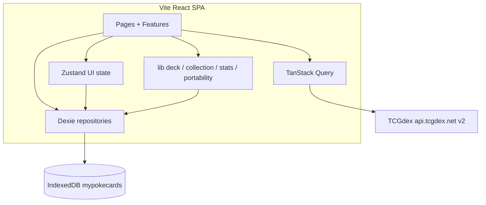

# MyPokeCards — Technology Decisions

Architecture decisions for the client-only SPA described in `.docs/requirements.md` and `.docs/specs/*.spec.md`. This document is the source of truth for stack, API, persistence, folders, testing, and import/export formats.

---

## 1. Technology Stack Decision Record (ADR)

| Concern | Choice | Rationale | Alternatives considered |
|---------|--------|-----------|-------------------------|
| Language | **TypeScript 5.x** (`strict`) | Matches NFR-6/7; typed domain rules for decks, missing cards, and IO parsers. | Plain JS — rejected (weaker testability for copy limits). |
| UI library | **React 19** | Component model fits catalog grid + deck tray; large ecosystem for SPA. | Vue / Svelte — fine, but React is the preferred default and does not contradict requirements. |
| Bundler / dev | **Vite 6.x** | Fast HMR, native ESM, simple `npm run dev` at app root. | CRA (deprecated), Next.js (SSR/backend not needed for v1). |
| Routing | **React Router 7** | Client-only routes for Buscar, Decks, Coleção, Favoritos, card detail. | TanStack Router — heavier; file-based Next routing — N/A. |
| Server state | **TanStack Query 5** | Cache/dedupe/retry for TCGdex; aligns with FR-API-5 and search debounce ownership in UI. | Manual `fetch` + useEffect — more boilerplate, weaker cache. |
| Client/UI state | **Zustand** | Lightweight active-deck, search draft, sheet UI; no Redux ceremony. | Redux Toolkit — overkill; Context-only — noisy re-renders. |
| Persistence | **Dexie 4** (IndexedDB) | Structured stores + schema versioning (NF-DB-3); fits decks/collection/cache size. | localStorage-only — weak for large collections; idb raw — more code. |
| Theme bootstrap | **localStorage** (`mypokecards.theme`) + Dexie | Tiny sync read before paint to avoid FOUC (NF-TH-2); Dexie remains canonical after hydrate. | Dexie-only — risk of flash before async open. |
| Styling | **CSS Modules + global design tokens** (`src/styles/tokens.css`) | Full control for TCG identity (NFR-10); light/dark via `data-theme`. | Tailwind — easy to look generic; CSS-in-JS — extra runtime. |
| Motion | **CSS transitions/keyframes only** | 2–3 intentional motions (theme crossfade, card press, tray slide) without bundle cost. | Framer Motion — optional later if complex choreography appears. |
| HTTP | **Native `fetch`** behind `src/lib/api` | No auth for TCGdex; thin wrapper for errors/backoff. | axios — unnecessary. |
| i18n UI copy | **Static pt-BR string modules** (`src/shared/i18n/pt-BR.ts`) | UI is pt-BR only in v1; no runtime locale switcher. | i18next — deferred until multi-locale product need. |
| Icons | **Inline SVG / lucide-react** (tree-shaken) | Accessible icon-only controls with pt-BR `aria-label`. | Icon font — worse a11y. |
| Package manager | **npm** | Default; lockfile committed when scaffolded. | pnpm/yarn — fine if team standardizes later. |
| Node | **Node 20 LTS+** | Matches Vite/React toolchain. | — |

**Lock-in notes**
- Dexie schemas imply migration discipline (`db.version(n)`); documented in §3.
- TCGdex locale path (`/v2/pt-br/...`) couples catalog IDs to that provider; JSON export must store provider card ids (see §7).
- No backend in v1: any future sync would be a new boundary, not a retrofit of secrets into the SPA.

---

## 2. Free API Choice & pt-BR Strategy

### Primary API: **TCGdex** (REST v2)

| Field | Decision |
|-------|----------|
| Provider | [TCGdex](https://tcgdex.dev/) — open-source, multilingual Pokémon TCG API |
| Base URL | `https://api.tcgdex.net/v2` |
| Locale segment | `pt-br` (primary), `en` (fallback) |
| Auth | **None** — no API key; safe for a static SPA (NFR-8, NF-API-3) |
| Search | `GET /v2/{lang}/cards?name={query}` (plus optional filters per TCGdex query docs) |
| Detail | `GET /v2/{lang}/cards/{id}` |
| Images | Asset URLs from card payloads (e.g. `image` + quality suffix such as `/high.webp`); respect CDN terms; attribute TCGdex/assets in UI footer or About |
| Rate limits | No published hard quota; **be considerate**: debounce ≤ 300 ms (UI), in-memory + IndexedDB response cache, backoff on HTTP 429/5xx |

**Why not the alternatives**

| Candidate | Verdict |
|-----------|---------|
| pokemontcg.io / Scrydex | Mature English catalog; **no first-class pt-BR**. Optional free `X-Api-Key` improves limits but keys must not ship in client bundles for abuse resistance. Rejected as primary because locale is a product requirement. |
| pokemontcgapi.com | Offers `?lang=pt`, but free access is a **one-time trial** (credits expire) — incompatible with “free forever” client-only v1. |
| Dual-API mashup | Deferred; increases id mapping complexity. v1 stays single-provider. |

### pt-BR resolution algorithm (FR-API-4)

```text
1. Request catalog data with lang = pt-br.
2. For each card field used in UI (name, and rules/ability text when present):
   a. If non-empty in pt-br → use it; upsert Dexie `localeCache` (cardId → displayName, updatedAt).
   b. Else if Dexie `localeCache` has a prior pt-BR name → use cache for display name.
   c. Else fetch/use English (`en`) for that card/field; show English name; UI chrome remains pt-BR.
3. Never fail the search/detail promise solely because pt-BR is incomplete.
4. Rules text: best-effort pt-BR; English fallback acceptable when missing (document in UI as content language, not chrome language).
```

### Catalog client responsibilities (`api-client` spec)

- Typed errors: `network` | `rateLimit` | `empty` | `notFound` | `unknown`.
- Memory cache (TanStack Query) + optional Dexie `apiCache` for recent detail payloads.
- Idempotent under rapid calls; UI owns debounce.
- Cost metric for deck-analysis (FR-DA-3): prefer **length of primary attack `cost` array** when present; else **retreat cost length**; else bucket **N/D**. Documented here as canonical for v1.

### Image & attribution

- Prefer high-quality web-friendly formats from TCGdex assets.
- On image error → placeholder (card-detail / card-search).
- Footer/About: credit TCGdex and note that Pokémon / card art © respective rights holders; app does not sell cards.

---

## 3. Persistence (Dexie / IndexedDB)

**Library:** Dexie 4  
**Database name:** `mypokecards`  
**Schema version:** start at `1`; bump with Dexie upgrade transactions (never silent wipe).

### Stores

| Store | Key | Value (conceptual) |
|-------|-----|---------------------|
| `decks` | `id` (uuid) | `{ id, name, cards: { cardId, quantity }[], isFavorite, rating: 1–5 \| null, createdAt, updatedAt }` |
| `collection` | `cardId` | `{ cardId, ownedCount: number ≥ 0, updatedAt }` |
| `favoriteCards` | `cardId` | `{ cardId, createdAt }` |
| `settings` | `key` | e.g. `theme` → `light` \| `dark`; `activeDeckId` → string \| null |
| `localeCache` | `cardId` | `{ cardId, displayNamePtBr, source: 'api' \| 'manual', updatedAt }` |
| `apiCache` | `cacheKey` | `{ cacheKey, payload, fetchedAt, expiresAt }` (optional; TTL e.g. 24h for detail) |

### Hybrid theme persistence

1. On theme change: write Dexie `settings.theme` **and** `localStorage['mypokecards.theme']`.
2. Inline bootstrap in `index.html` (or equivalent) reads localStorage and sets `data-theme` before React paint.
3. First visit: if no stored theme → `prefers-color-scheme: dark` ? `dark` : `light` (resolves theme-provider open question).

### Active deck

- Persist `activeDeckId` in `settings` so deck-builder context survives reload (resolves sticky vs explicit: **sticky across sessions**).

### Atomicity (FR-DB-7)

- Single-entity writes via Dexie transactions; multi-card deck replace uses one transaction per deck mutation.

---

## 4. State, Routing & Styling Approach

### State ownership

| Data | Owner |
|------|--------|
| Remote cards/search/detail | TanStack Query + `lib/api` |
| Decks, collection, favorites, ratings, locale cache | Dexie; features subscribe via small repositories/hooks |
| Active deck id, mobile deck sheet open, ephemeral toasts | Zustand |
| Theme | Theme provider (reads settings + applies `data-theme`) |

### Routes (pt-BR path segments optional; code ids in English)

| Path | Page | Specs |
|------|------|-------|
| `/` | Redirect → `/buscar` | — |
| `/buscar` | Card search grid | card-search |
| `/cartas/:cardId` | Card detail | card-detail |
| `/decks` | Deck list | deck-core, deck-personalization |
| `/decks/:deckId` | Deck builder + stats entry | deck-builder, deck-analysis |
| `/colecao` | Ownership + missing for active deck | collection-manager |
| `/favoritos` | Tabs: Cartas \| Decks | card-favorites |

### Styling

- Global tokens: `--color-bg`, `--color-surface`, `--color-ink`, `--color-accent`, `--font-display`, `--font-body`, radii, shadows — TCG-inspired (deep ink, energy accent, paper/foil contrast). **Avoid** purple-on-white template kits (NFR-10).
- Expressive fonts via Google Fonts or self-hosted (e.g. display + body pair); never Inter/Roboto/Arial as the brand face.
- Layout breakpoints: `360` / `768` / `1280` (NFR-3).
- Desktop: split/sticky deck tray where specified; mobile: bottom nav + sheet.

### Product rules locked for implementers

| Topic | v1 decision |
|-------|-------------|
| Copy limit | Max **4** per non-basic-Energy card id; **unlimited** basic Energy when `category`/`supertype` indicates Energy and name/subtype marks Basic |
| Deck size | **Advisory** soft warning if total ≠ 60; do not hard-block adds |
| Rating | Integer **1–5** or **null** (unrated); no half-stars |
| Favorites UI | **Two tabs/sections**: Cartas and Decks |
| Duplicate deck | Copy cards only; **do not** copy favorite/rating |
| Card detail | **Dedicated route** `/cartas/:cardId` |

---

## 5. Folder Structure (`src/`)

App root = repository root (`projectRoot=.`). Feature folders map 1:1 to `.docs/todo.md` / specs where practical.

```text
mypokecards/
├── index.html
├── package.json
├── vite.config.ts
├── tsconfig.json
├── tsconfig.app.json
├── vitest.config.ts
├── README.md
├── .docs/                    # requirements, technologies, specs, todo
└── src/
    ├── main.tsx              # bootstrap, QueryClient, Router
    ├── app/
    │   ├── App.tsx           # shell: nav, theme, outlet
    │   ├── router.tsx
    │   └── providers.tsx
    ├── pages/                # thin route wrappers
    │   ├── SearchPage.tsx
    │   ├── CardDetailPage.tsx
    │   ├── DecksPage.tsx
    │   ├── DeckDetailPage.tsx
    │   ├── CollectionPage.tsx
    │   └── FavoritesPage.tsx
    ├── features/
    │   ├── catalog/          # card-search, card-detail UI pieces
    │   ├── decks/            # deck-core, deck-builder, personalization, analysis
    │   ├── collection/       # ownership + missing-cards views
    │   ├── favorites/
    │   ├── theme/            # theme-provider
    │   └── portability/      # import/export UI
    ├── lib/
    │   ├── api/              # TCGdex client, mappers, errors (api-client)
    │   ├── db/               # Dexie instance, schema, repos (db-setup)
    │   ├── deck/             # pure: copy limits, mutate helpers
    │   ├── collection/       # pure: missing-card math
    │   ├── stats/            # pure: type/rarity/cost aggregates
    │   └── portability/      # JSON + PTCGO parse/serialize
    ├── shared/
    │   ├── ui/               # buttons, sheets, empty/error states
    │   ├── hooks/
    │   ├── i18n/pt-BR.ts
    │   └── types/            # shared domain types
    ├── styles/
    │   ├── tokens.css
    │   ├── global.css
    │   └── reset.css
    ├── assets/
    └── test/
        ├── setup.ts
        └── fixtures/
```

**Existing note:** a sparse `src/components/CardDetail/` may remain from early exploration; new work should follow the layout above and migrate leftovers when touching those files.

---

## 6. Testing Stack (for QA later)

| Layer | Tool | Scope |
|-------|------|--------|
| Unit | **Vitest** | Pure domain: deck mutations, copy limits, missing cards, stats buckets, import/export parsers |
| Component | **Vitest + React Testing Library + jsdom** | Search debounce behavior (fake timers), theme toggle a11y name, deck confirm delete |
| Mocking | **MSW** (optional) or `fetch` mock | api-client error/empty paths |
| E2E | **Playwright** — **out of scope for v1 essential** (requirements assumption 7) | Add when core flows stabilize |
| Coverage focus | NFR-7 | deck-builder rules, collection ownership, missing-card calculation — required |

**Scripts (expected in `package.json` after scaffold)**

```json
{
  "scripts": {
    "dev": "vite",
    "build": "tsc -b && vite build",
    "preview": "vite preview",
    "test": "vitest run",
    "test:watch": "vitest",
    "lint": "eslint ."
  }
}
```

**Lint/format:** ESLint 9 flat config + typescript-eslint; Prettier optional. Identifiers/comments English; UI strings pt-BR only via i18n module.

---

## 7. Import / Export Formats

### 7.1 JSON (`mypokecards-deck` schema)

Human-readable; UTF-8; round-trip required (FR-IO-7).

```json
{
  "format": "mypokecards-deck",
  "version": 1,
  "exportedAt": "2026-09-26T00:00:00.000Z",
  "deck": {
    "name": "Meu Deck",
    "cards": [
      {
        "cardId": "swsh3-136",
        "quantity": 4,
        "name": "Poké Ball",
        "setId": "swsh3",
        "localId": "136"
      }
    ]
  }
}
```

| Rule | Decision |
|------|----------|
| Identity | Prefer `cardId` (TCGdex id). `setId` + `localId` + `name` aid human edit and disambiguation. |
| Import | Creates a **new** deck (new uuid). Replace-only if user explicitly confirms in UI. |
| Validation | Unknown `format` / bad JSON → pt-BR error; **no store writes**. |
| Personalization | Imported decks start **unfavorited / unrated**. |

### 7.2 PTCGO-style plain text

Sections by supertype when known; lines `Qty Name` (optional set code / collector number when available).

```text
Pokémon (8)
4 Furret SSH 137
4 Sentret SSH 136

Trainer (36)
4 Poké Ball SSH 168
...

Energy (16)
4 Fire Energy
...
```

| Rule | Decision |
|------|----------|
| Export | Group by Pokémon / Trainer / Energy using api category fields; include set + number when known. |
| Import resolve | Best-effort via api-client search (`name`, then set/number if parsed). |
| Ambiguity | If multiple matches, prefer exact set+localId; else exact name + first reliable hit; record unresolved lines. |
| Failure policy | **Fail entire import** if any required line cannot be resolved (default). No silent invent. Partial import only if user opts in later (not v1 default). |
| Existing data | Failed import leaves Dexie decks unchanged (FR-IO-6). |

---

## 8. Security Checklist

| Area | Policy |
|------|--------|
| Auth | None in v1; no accounts. |
| Secrets | No API keys in client. TCGdex needs none. Do not embed third-party paid keys. |
| XSS | React escaping by default; never `dangerouslySetInnerHTML` for API/import text. |
| Import | Treat import payloads as untrusted; schema-validate; cap size (e.g. reject > 256 KB text). |
| Privacy | Data stays in-browser (NFR-8); clearing site data wipes Dexie + theme key. |
| Dependencies | Prefer maintained libs; run `npm audit` before releases; lockfile committed. |
| Images | `https` only; onerror fallback; no arbitrary script URLs. |
| CSP (optional hardening) | Can add restrictive CSP when hosting static build. |

---

## 9. Coding Standards (summary)

| Topic | Rule |
|-------|------|
| Language | Source identifiers & comments: **English**. User-visible strings: **pt-BR** via `shared/i18n`. |
| Components | Function components; feature folders own UI; `lib/*` stays pure/framework-light where tested. |
| Naming | `PascalCase` components/types; `camelCase` functions/vars; `kebab-case` CSS modules optional; Dexie keys stable strings. |
| Async | TanStack Query for server; async Dexie repos; no silent catch — map to typed errors / pt-BR toasts. |
| Tests | Colocate `*.test.ts(x)` next to pure modules under `lib/`; fixtures in `src/test/fixtures`. |
| Commits | Imperative, focused; do not commit secrets or large binary caches. |
| Accessibility | Keyboard paths for search, theme, primary deck actions; `aria-label` in pt-BR on icon-only controls (NFR-4). |

---

## 10. High-Level Technical Diagram



---

## 11. Scaffold Expectations

When the app is bootstrapped at repo root:

1. `npm create vite@latest . -- --template react-ts` (or equivalent) if not already present — then align folders to §5.
2. Add dependencies: `react-router`, `@tanstack/react-query`, `zustand`, `dexie`, `lucide-react` (optional).
3. DevDependencies: `vitest`, `@testing-library/react`, `@testing-library/jest-dom`, `jsdom`, ESLint toolchain.
4. Ensure scripts in §6 exist so `npm install` && `npm run dev` work as documented in `README.md`.

---

*Last updated: 2026-09-26 — Technology Architect*
