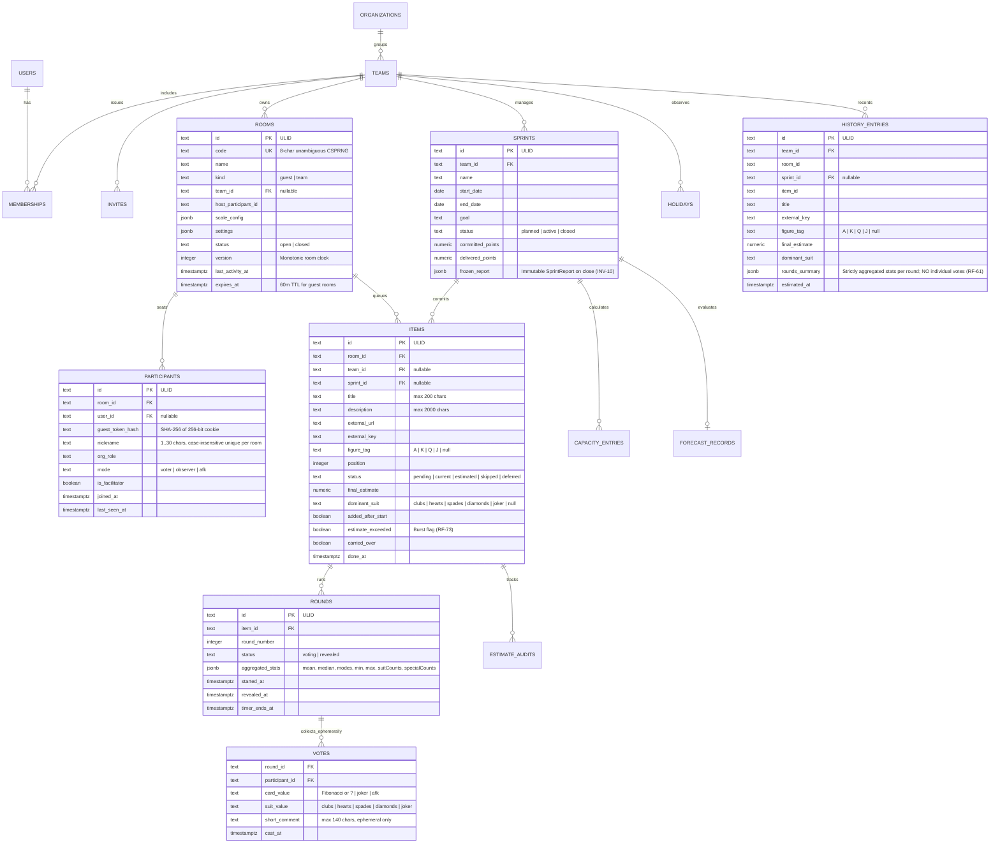

# Fibonaipe — Technology Stack, Architecture & Standards (v1.0)

**Project:** Fibonaipe (Fibonacci + Naipe — Two-Dimensional Planning Poker, Sprint Management & Forecasting)  
**Version:** 1.0 (Consolidated Technical Blueprint)  
**Date:** 2026-10-26  
**Host Probe Reference:** `.docs/host.json` (`win32/x64`, `Node v24.12.0`, `hasNodeSqlite: true`, `nativeCompileLikelyOk: false`)

---

## 1. Architectural Principles & Host Constraints

1. **Hexagonal Architecture (Ports & Adapters):** Strict inward dependency flow:
   ```text
   packages/domain  ←  packages/application  ←  packages/adapter-*  ←  apps/web (Composition Root)
   ```
   - `packages/domain` has **zero runtime dependencies** (`dependencies: {}`). It never imports I/O, HTTP, database drivers, UI frameworks, `Date.now()`, `new Date()` (without arguments), or `Math.random()`.
   - `packages/application` depends exclusively on `@fibonaipe/domain`. It defines all **Port interfaces** and orchestrates transactional **Use Cases** and safe projections (`projectRoomForViewer`).
   - `packages/adapter-*` implement application ports. **An adapter never imports another adapter.**
   - `apps/web` hosts the React + TanStack + Vite PWA, the thin Hono HTTP API routes, and the **Composition Root** (`apps/web/src/server/composition.ts`), which is the single place that instantiates and wires concrete adapters.
2. **Explicit Error Handling (`Result<T, AppError>`):** Expected domain and application failures never throw exceptions. Every builder, domain mutation, port method, and use case returns `Result<T, AppError>` with stable error codes (`VALIDATION`, `NOT_FOUND`, `FORBIDDEN`, `ROOM_FULL`, `NICKNAME_TAKEN`, `ROUND_NOT_VOTING`, `LIMIT_EXCEEDED`, `RATE_LIMITED`, `INSUFFICIENT_DATA`, `LAST_ADMIN`, `AUTH_LINK_INVALID`, `ACCOUNT_SUSPENDED`).
3. **Builder / Constructor Pattern:** Complex aggregates and value objects (`Room`, `RoomSettings`, `Scale`, `Sprint`, `ForecastReport`) enforce private/protected constructors and expose fluent **Builders** (`RoomBuilder`, `RoomSettingsBuilder`, `ScaleBuilder`, `SprintBuilder`, `ForecastReportBuilder`) with sensible defaults whose `.build()` method validates all domain invariants (`INV-01` to `INV-14`) and returns `Result<Entity, AppError>`.
4. **Package Manager & Monorepo (`npm` pure):** Exclusive use of **npm workspaces** with a **single root `package-lock.json`**. `pnpm` and `yarn` are strictly prohibited (`RNF-24`).
5. **Host Environment Compatibility (`.docs/host.json`):**
   - Detected host: `win32 x64`, `Node v24.12.0`, `hasNodeSqlite: true`, `nativeCompileLikelyOk: false` (no Visual C++ Build Tools / `node-gyp`).
   - **Zero Native C++ Addons Policy:** Packages requiring `node-gyp` or native compilation (`better-sqlite3`, `bcrypt`, `sharp`, `canvas`, etc.) are **strictly forbidden** so `npm ci` succeeds out-of-the-box on Windows, Linux, and serverless runtimes.
   - Unit and contract tests run against `InMemoryPersistence` (`packages/testing`). If local SQLite persistence is ever used for local dev/offline fixtures, it **must** use Node's built-in `node:sqlite` (`DatabaseSync` in Node 24+). Production persistence uses managed PostgreSQL (Supabase / Neon) via pure-JS `postgres` (`postgres.js`).

---

## 2. 9-Layer System Design + AI Stack Matrix

Every layer is classified as **`adopt`** (implemented in MVP R0–R4), **`defer`** (scheduled for Post-MVP), or **`none`** (explicitly excluded by YAGNI / product requirements).

| Layer | Category | Status | Adopted / Planned Technology | Rationale & Trade-offs |
| :--- | :--- | :---: | :--- | :--- |
| **1. Clients & Interfaces** | Web UI, Routing, Server State, Styling, Charts, QR, A11y, i18n, PWA | **`adopt`** | **React 19** + **TanStack Router** + **TanStack Query v5** + **Vite 6** + **CSS Modules / Design Tokens** + **Custom Accessible SVG Charts** + **`qrcode` (client-side SVG)** + **Typed i18n catalog (`pt-BR` default + `Intl`)** + **`vite-plugin-pwa`** | Delivers a mobile-first (`360px`), installable PWA within the `≤ 150 KB` gzipped room bundle budget (`RNF-02`). Custom SVG charts with paired HTML `<table>` satisfy `RNF-09` without heavy charting libraries. |
| **2. Edge, DNS & Traffic** | CDN, TLS, WAF, Origin Validation, Rate Limiting | **`adopt`** | **Cloudflare Pages / Vercel Edge CDN** (HTTPS, Brotli/Gzip, DDoS protection) + **Strict `Origin` / `Sec-Fetch-Site` middleware** + **`RateLimiter` Port** (In-Memory sliding window with `Upstash Redis` free-tier option) | Enforces 100% HTTPS (`RNF-12`), CSRF protection on mutating endpoints, and per-IP / per-participant rate limits (`10 rooms/h/IP`, `20 joins/min/IP`, `60 mutations/min/participant`). |
| **3. APIs & Service Layer** | HTTP Server, Schema Validation, Use Case Orchestration, Auth | **`adopt`** | **Hono v4** (Web Fetch Standard router) + **Zod** (boundary request/env validation) + **`@fibonaipe/application` Use Cases** + **`AuthProvider` Port** (Supabase Auth: Magic Link + Google OAuth + `httpOnly` Guest Session Cookie) | Hono is ultra-lightweight (`~14 KB`), zero-native-dependency, and runs identically on Node.js (`@hono/node-server`), Cloudflare Workers/Pages, and Vercel Functions. |
| **4. Messaging & Workflows** | Realtime Pub/Sub, Presence, Polling Fallback, Scheduled Jobs | **`adopt`** | **`RealtimePublisher` & `RealtimeClient` Ports** over **Supabase Realtime / WebSocket** + **Automatic HTTP Polling Fallback (`2–3s` via `GET /api/rooms/:code/state?since=v`)** + **GitHub Actions Cron / Platform Cron** calling `POST /api/internal/cron/purge-expired-rooms` | Guarantees `≤ 1s` p95 vote/reveal propagation (`RNF-01`) and seamless resilience if WebSockets are blocked by corporate firewalls (`RNF-05`). Cron purges anonymous rooms inactive for `> 60 min` (`RNF-15`). |
| **5. Data, Storage & Cache** | Transactional DB, Concurrency Locking, Migrations, Local Ephemeral Storage | **`adopt`** | **`Persistence` Port** → **Managed PostgreSQL 16+** (Supabase / Neon Free Tier) via **`postgres` (`postgres.js`)** + **Versioned Pure SQL Migrations** + **`InMemoryPersistence` Fake** (with per-room mutex) + **`node:sqlite`** (optional local dev inspect) + **Browser `localStorage`** (theme/locale & offline `clientOpId` queue) | `SELECT ... FOR UPDATE` on the `rooms` row serializes concurrent votes/reveals and increments `Room.version` (`RNF-23`). Strict privacy: historical tables (`history_entries`) store **only aggregated statistics**, never individual votes (`RF-61`). |
| **6. Search, Vector & Retrieval** | Relational History Filtering vs. Vector DB | **`adopt` (SQL)** / **`none` (Vector)** | **PostgreSQL B-Tree & GIN (`pg_trgm`) Indexes** for team estimation history search (`RF-62`). **No Vector DB / Embeddings (`none`)**. | Estimation history filtering (by date range, sprint, room, Fibonacci points, suit, `A/K/Q/J` tag, and title substring) is 100% deterministic relational querying. Vector search is unnecessary overhead. |
| **7. AI, RAG & Agents *[product only]*** | Product Runtime AI vs. Deterministic Statistical Forecasting | **`none`** | **None in Product Runtime.** All round statistics (`computeRoundStats`), capacity (`computeCapacity`), and sprint forecasts (`computeForecast` via median pace and P25–P75 linear interpolation) are **100% deterministic pure TypeScript math in `packages/domain`**. | Product requirements (`§5`) mandate deterministic, auditable math with zero hallucination risk, zero LLM latency, and zero token cost (`RNF-20`). |
| **8. Eval, Compute & Deployment** | Unit/Property/Contract/E2E Testing, Accessibility Eval, CI/CD, Hosting | **`adopt`** | **Vitest** (Unit + Contract suites) + **`fast-check`** (Property-Based Testing for math & vote non-leakage) + **Playwright** + **`@axe-core/playwright`** (WCAG 2.2 AA eval) + **GitHub Actions CI (`npm run verify`)** + **Free-Tier Hosting** (Cloudflare Pages/Workers, Vercel, or Render) | Enforces `≥ 90%` line coverage in `domain`/`application`, verifies all 14 domain invariants, proves zero vote leakage over the network, and blocks PRs on serious/critical `axe` violations or bundle budget overruns. |
| **9. Security & Observability** | Cryptography, Vote Privacy, Structured Logging, Error Tracking, License Governance | **`adopt`** | **Node `node:crypto` CSPRNG** (8-char unambiguous room codes, 256-bit tokens hashed with `SHA-256`, **`AES-256-GCM`** for ClickUp/Jira API tokens) + **PostgreSQL RLS** (enabled, zero anon policies) + **Structured JSON Logger** (zero PII/vote redaction) + **`ErrorReporter` Port** + **`license-checker` in CI** | Protects secret ballots on the wire (`RNF-13`), encrypts third-party issue tracker credentials at rest (`RNF-26`), complies with LGPD (`RF-05`, `RNF-14`), and enforces permissive open-source licenses (`RNF-25`). |

---

## 3. Architecture Decision Records (ADRs)

| ID | Decision Area | Chosen Technology | Alternatives Considered | Rationale & Trade-offs |
| :--- | :--- | :--- | :--- | :--- |
| **ADR-01** | **Monorepo & Package Manager** | **`npm workspaces`** (Node v24 LTS, single root `package-lock.json`) | `pnpm`, `yarn`, Turborepo | Mandatory requirement (`RNF-24`). Zero external global binary installation needed; native to Node.js LTS. Workspace protocol via standard version references (`"*"`) resolves local packages cleanly. |
| **ADR-02** | **Frontend Framework & Routing** | **React 19 + TanStack Router + TanStack Query v5 + Vite 6** | Next.js, SvelteKit, Remix | Mandatory requirement (`§2.11`). TanStack Router provides 100% type-safe route params (`/r/$code`, `/r/$code/screen`). TanStack Query manages snapshot caching, optimistic UI updates, and automatic `2–3s` polling fallback seamlessly. |
| **ADR-03** | **HTTP API Framework** | **Hono v4** | Fastify, Express | Hono is built on Web Standard `Request`/`Response`, has zero native dependencies, first-class TypeScript inference, and deploys unmodified to Node.js (`@hono/node-server`), Cloudflare Workers/Pages, or Vercel Serverless Functions. |
| **ADR-04** | **Database Driver & Migrations** | **`postgres` (`postgres.js`) + Pure SQL Versioned Migrations** | Prisma, Drizzle, `pg`, `better-sqlite3` | Pure JS with zero C++ compilation (`nativeCompileLikelyOk: false` in `.docs/host.json`). Explicit SQL transactions (`BEGIN` / `SELECT ... FOR UPDATE` / `COMMIT`) guarantee room-level serialization (`D-07`, `RNF-23`) without ORM bloat. |
| **ADR-05** | **Realtime Transport & Fallback** | **Supabase Realtime (WebSocket Broadcast/Presence) + HTTP Polling Fallback (`2–3s`)** | Socket.io, Pusher, Ably | Works on serverless free tiers without requiring sticky sessions. All realtime events carry only `{ type, roomId, version, at, payload }` with **zero vote values** (`D-05`). Clients reconcile gaps via `GET /api/rooms/:code/state?since=v`. |
| **ADR-06** | **Styling & Data Visualization** | **Native CSS Modules + CSS Custom Properties (Design Tokens) + Custom SVG Charts** | Tailwind CSS, Recharts, Chart.js | Zero runtime CSS overhead; guarantees the `≤ 150 KB` gzipped budget (`RNF-02`). Custom SVG charts allow keyboard focus per data point, pattern fills (beyond color alone), `prefers-reduced-motion` compliance, and 1:1 pairing with accessible HTML tables (`RNF-09`). |
| **ADR-07** | **Testing & Verification Stack** | **Vitest + `fast-check` + Playwright + `@axe-core/playwright`** | Jest, Cypress | Native ESM/TypeScript speed in Vitest. `fast-check` mathematically proves statistical properties (`min ≤ median ≤ max`, permutation invariance) and the golden **Vote Non-Leakage Property** (`§5.3`). Playwright + Axe enforce WCAG 2.2 AA across `360px`, `1280px`, and `1920px` viewports. |

---

## 4. Complete Monorepo Workspace Layout

```text
fibonaipe/
├─ .docs/
│  ├─ host.json                             # Environment probe (Node v24.12.0, win32, nativeCompileLikelyOk: false)
│  ├─ requirements.md                       # Consolidated Functional, Non-Functional & UX/Juice Requirements
│  ├─ technologies.md                       # This technical architecture & standards document
│  ├─ limits.md                             # Free-tier quota documentation and 80% alert thresholds (RNF-20)
│  ├─ questions.md                          # Ambiguity log for agentic development
│  └─ a11y/                                 # Manual screen-reader audit checklists per release (R1..R4)
├─ .github/
│  └─ workflows/
│     ├─ verify.yml                         # Runs `npm run verify` on every PR and push
│     └─ cron-purge.yml                     # Scheduled hourly trigger for `PurgeExpiredRooms` (RNF-15)
├─ .nvmrc                                   # Pinned Node.js LTS version (v24)
├─ AGENTS.md                                # Concise rules, dependency law, and `npm run verify` gate for agents
├─ package.json                             # Root npm workspace definition and unified scripts
├─ package-lock.json                        # Single source of truth lockfile (npm pure)
├─ tsconfig.base.json                       # Shared strict TypeScript compiler options
├─ eslint.config.js                         # Flat ESLint config with architectural boundary rules
├─ playwright.config.ts                     # E2E + Axe accessibility test configuration (360px, 1280px, 1920px)
├─ tools/
│  ├─ check-boundaries.mjs                  # Verifies hexagonal import rules & zero domain dependencies
│  ├─ check-i18n.mjs                        # Verifies no missing/orphan i18n keys and no hardcoded JSX strings
│  ├─ check-bundle-budget.mjs               # Verifies room route initial JS <= 150 KB gzip (RNF-02)
│  └─ check-licenses.mjs                    # Verifies all production dependencies use permissive licenses (RNF-25)
├─ packages/
│  ├─ domain/                               # @fibonaipe/domain — ZERO runtime dependencies
│  │  ├─ package.json
│  │  ├─ tsconfig.json
│  │  └─ src/
│  │     ├─ index.ts
│  │     ├─ shared/
│  │     │  ├─ result.ts                    # Result<T, E>, ok(), err(), map(), andThen()
│  │     │  ├─ app-error.ts                 # AppError class/type & ErrorCode enum
│  │     │  ├─ ids.ts                       # Branded opaque IDs (RoomId, ParticipantId, ItemId, SprintId, etc.)
│  │     │  └─ constants.ts                 # Operational limits (MAX_PARTICIPANTS=30, ANON_ROOM_TTL_MINUTES=60, etc.)
│  │     ├─ scales/
│  │     │  ├─ card.ts                      # Fibonacci cards (0..89, ½), Special cards (?, Coringa, AFK)
│  │     │  ├─ suit.ts                      # Naipes (♣=4 High, ♥=3 Med, ♠=2 Low, ♦=1 Insignificant, Coringa=Neutral)
│  │     │  ├─ item-tag.ts                  # Deck figure tags (A, K, Q, J) and configurable meanings
│  │     │  └─ scale-builder.ts             # Scale & ScaleBuilder (custom active Fibonacci subset)
│  │     ├─ policy/
│  │     │  └─ can.ts                       # Pure RBAC + session role authorization matrix (`can(actor, action, ctx)`)
│  │     ├─ entities/
│  │     │  ├─ room.ts                      # Room aggregate, host transfer (manual & 60s auto), RoomBuilder
│  │     │  ├─ room-settings.ts             # RoomSettings & RoomSettingsBuilder
│  │     │  ├─ participant.ts               # Participant entity (nickname validation INV-14, Voter/Observer/AFK)
│  │     │  ├─ item.ts                      # Item aggregate, Round & Vote state machines, EstimateAudit
│  │     │  ├─ team.ts                      # Organization, Team, Membership, Invite entities (LAST_ADMIN invariant)
│  │     │  └─ sprint.ts                    # Sprint aggregate (planned -> active -> closed), SprintBuilder, Holiday
│  │     └─ math/
│  │        ├─ round-stats.ts               # computeRoundStats (mean, median, modes, consensus, suitDivergence)
│  │        ├─ capacity.ts                  # computeWorkingDays, computeCapacity (person-days & focusPct)
│  │        ├─ indicators.ts                # computeEstimationIndicators (1st-round consensus, suit x overrun matrix)
│  │        └─ forecast.ts                  # computeForecast (median pace, P25-P75 linear interpolation), computeAccuracy
│  │
│  ├─ application/                          # @fibonaipe/application — Depends ONLY on @fibonaipe/domain
│  │  ├─ package.json
│  │  ├─ tsconfig.json
│  │  └─ src/
│  │     ├─ index.ts
│  │     ├─ ports/
│  │     │  ├─ clock.port.ts                # Clock { now(): Date }
│  │     │  ├─ id-generator.port.ts         # IdGenerator { newId(), newRoomCode(), newToken(), sha256() }
│  │     │  ├─ persistence.port.ts          # Persistence { transaction({ lockRoomId }, fn) } & Repositories
│  │     │  ├─ realtime.port.ts             # RealtimePublisher (server) & RealtimeClient (browser)
│  │     │  ├─ auth-provider.port.ts        # AuthProvider (Magic Link, Google OAuth, identity lifecycle)
│  │     │  ├─ issue-tracker.port.ts        # IssueTracker (importItems, post-MVP writeEstimate)
│  │     │  ├─ exporter.port.ts             # Exporter (csv, json)
│  │     │  ├─ rate-limiter.port.ts         # RateLimiter { hit(key, rule) }
│  │     │  ├─ crypto-vault.port.ts         # CryptoVault (AES-256-GCM encrypt/decrypt for ClickUp/Jira tokens)
│  │     │  └─ logger.port.ts               # StructuredLogger & ErrorReporter
│  │     ├─ projections/
│  │     │  ├─ events.ts                    # RoomEvent envelope & EVT-01..EVT-12 definitions
│  │     │  └─ room-view.ts                 # projectRoomForViewer (guarantees hidden votes before reveal)
│  │     └─ use-cases/
│  │        ├─ rooms/                       # CreateRoom, JoinRoom, ReconnectParticipant, Heartbeat, TransferHost, etc.
│  │        ├─ items/                       # AddItem, ImportItems, ReorderItems, SetCurrentItem, SkipItem, DeferItem
│  │        ├─ voting/                      # CastVote (idempotent via clientOpId), RetractVote, RevealRound, NewRound, SetFinalEstimate
│  │        ├─ auth-teams/                  # ClaimRoom, CreateTeam, ManageInvites, ChangeMemberRole, DeleteAccount
│  │        ├─ history/                     # RecordAggregatedHistory, QueryHistory, EditFinalEstimateWithAudit
│  │        ├─ sprints/                     # CreateSprint, SetCapacity, ActivateSprint, MarkItemDone, CloseSprint
│  │        └─ maintenance/                 # PurgeExpiredRooms
│  │
│  ├─ testing/                              # @fibonaipe/testing — Fakes & Reusable Contract Test Suites
│  │  ├─ package.json
│  │  ├─ tsconfig.json
│  │  └─ src/
│  │     ├─ index.ts
│  │     ├─ fakes/
│  │     │  ├─ in-memory-persistence.ts     # Transactional fake with per-room async mutex & version increment
│  │     │  ├─ fake-realtime.ts             # Ordered in-memory pub/sub + disconnect/polling simulator
│  │     │  ├─ fake-clock.ts                # Deterministic FakeClock with advance(ms)
│  │     │  ├─ sequential-id-generator.ts   # Deterministic IDs, room codes, and tokens
│  │     │  ├─ fake-auth-provider.ts        # In-memory Magic Link & OAuth identity fake
│  │     │  └─ fake-rate-limiter.ts         # Deterministic rate limiter fake
│  │     └─ contracts/
│  │        ├─ persistence.contract.ts      # describePersistenceContract(factory)
│  │        ├─ realtime.contract.ts         # describeRealtimeContract(factory)
│  │        ├─ auth-provider.contract.ts    # describeAuthProviderContract(factory)
│  │        ├─ issue-tracker.contract.ts    # describeIssueTrackerContract(factory)
│  │        └─ exporter.contract.ts         # describeExporterContract(factory)
│  │
│  ├─ adapter-system/                       # @fibonaipe/adapter-system — Real Clock, CSPRNG IdGenerator, AES-256-GCM Vault
│  ├─ adapter-persistence-postgres/         # @fibonaipe/adapter-persistence-postgres — postgres.js + SQL migrations
│  ├─ adapter-realtime-supabase/            # @fibonaipe/adapter-realtime-supabase — WebSocket + 2-3s HTTP polling fallback
│  ├─ adapter-auth-supabase/                # @fibonaipe/adapter-auth-supabase — Magic Link + Google OAuth
│  ├─ adapter-issuetracker-manual/          # @fibonaipe/adapter-issuetracker-manual — Free-text & RFC 4180 CSV parser
│  ├─ adapter-issuetracker-clickup/         # @fibonaipe/adapter-issuetracker-clickup — Read-only ClickUp REST v2 adapter (R4)
│  ├─ adapter-issuetracker-jira/            # @fibonaipe/adapter-issuetracker-jira — Read-only Jira Cloud REST/JQL adapter (R4)
│  └─ adapter-exporter-csvjson/             # @fibonaipe/adapter-exporter-csvjson — UTF-8 BOM CSV (injection-safe) & JSON
│
└─ apps/
   └─ web/                                  # @fibonaipe/web — React 19 + TanStack + Vite PWA & Hono API Server
      ├─ package.json
      ├─ tsconfig.json
      ├─ vite.config.ts
      ├─ index.html
      ├─ public/
      │  ├─ manifest.webmanifest
      │  └─ icons/
      └─ src/
         ├─ server/                         # Backend HTTP API & Composition Root
         │  ├─ composition.ts               # ONLY file allowed to import and wire concrete `@fibonaipe/adapter-*`
         │  ├─ env.ts                       # Zod-validated environment configuration
         │  ├─ app.ts                       # Hono app setup, Origin/CSRF check, cookie session, error mapper
         │  └─ routes/                      # Thin HTTP handlers: rooms, items, votes, teams, history, sprints, cron
         └─ client/                         # Frontend React 19 PWA
            ├─ main.tsx
            ├─ router.tsx                   # TanStack Router tree (`/`, `/r/$code`, `/r/$code/screen`, `/teams/...`, `/admin`)
            ├─ query-client.ts              # TanStack Query client + offline mutation queue (`clientOpId`)
            ├─ i18n/                        # `pt-BR.json` (default), `en-US.json`, `es-ES.json` + typed `t()` helper & `Intl` formatters
            ├─ styles/
            │  ├─ tokens.css                # Light/Dark AA contrast tokens, 44x44px touch targets, motion tokens
            │  └─ global.css                # Reset, `:focus-visible` rings, `prefers-reduced-motion` overrides
            ├─ components/
            │  ├─ deck/                     # CardButton (3D flip / reduced-motion cross-fade), SuitSelector (♣ ♥ ♠ ♦ Coringa)
            │  ├─ table/                    # PokerTable, SeatBadge, ConsensusBanner, SuitDivergenceAlert, RoundTimer
            │  ├─ queue/                    # ItemQueue, CsvImportModal, ItemTagBadge (A, K, Q, J)
            │  ├─ charts/                   # VelocitySvgChart, CapacitySvgChart, ForecastBandChart + AccessibleDataTable
            │  └─ status/                   # ConnectionStatusPill (Connected / Syncing / Reconnecting / Polling)
            └─ pages/                       # Route views wired to TanStack Query & RealtimeClient
```

---

## 5. Constructor / Builder Pattern & Ports/Adapters Coding Standards

### 5.1 Result<T, AppError> Pattern (`packages/domain/src/shared/result.ts`)

All domain and application operations return explicit `Result<T, AppError>` values rather than throwing exceptions:

```typescript
export type ErrorCode =
  | 'VALIDATION'
  | 'NOT_FOUND'
  | 'FORBIDDEN'
  | 'ROOM_FULL'
  | 'NICKNAME_TAKEN'
  | 'ROUND_NOT_VOTING'
  | 'LIMIT_EXCEEDED'
  | 'RATE_LIMITED'
  | 'INSUFFICIENT_DATA'
  | 'LAST_ADMIN'
  | 'AUTH_LINK_INVALID'
  | 'ACCOUNT_SUSPENDED';

export interface AppError {
  readonly code: ErrorCode;
  readonly messageKey: string; // Maps directly to i18n key (e.g., 'errors.ROOM_FULL')
  readonly params?: Readonly<Record<string, string | number>>;
}

export type Result<T, E = AppError> =
  | { readonly ok: true; readonly value: T }
  | { readonly ok: false; readonly error: E };

export const ok = <T>(value: T): Result<T, never> => ({ ok: true, value });
export const err = <E = AppError>(error: E): Result<never, E> => ({ ok: false, error });
```

### 5.2 Builder & Private Constructor Pattern (`packages/domain`)

Domain entities cannot be instantiated in an invalid state. Constructors are `private`, and creation goes through fluent Builders with valid defaults that verify invariants on `.build()`:

```typescript
export class RoomSettings {
  private constructor(
    public readonly activeCards: readonly FibonacciCard[],
    public readonly suitsEnabled: boolean,
    public readonly suitAxisLabel: string,
    public readonly autoReveal: boolean,
    public readonly showAverage: boolean,
    public readonly timerSeconds: number | null,
    public readonly maxParticipants: number,
  ) {}

  public static builder(): RoomSettingsBuilder {
    return new RoomSettingsBuilder();
  }
}

export class RoomSettingsBuilder {
  private activeCards: readonly FibonacciCard[] = DEFAULT_FIBONACCI_CARDS;
  private suitsEnabled = true;
  private suitAxisLabel = 'Risco';
  private autoReveal = false;
  private showAverage = true;
  private timerSeconds: number | null = null;
  private maxParticipants = 30;

  public withActiveCards(cards: readonly FibonacciCard[]): this {
    this.activeCards = cards;
    return this;
  }

  public withSuits(enabled: boolean, label = 'Risco'): this {
    this.suitsEnabled = enabled;
    this.suitAxisLabel = label.trim();
    return this;
  }

  public withAutoReveal(autoReveal: boolean): this {
    this.autoReveal = autoReveal;
    return this;
  }

  public withTimerSeconds(seconds: number | null): this {
    this.timerSeconds = seconds;
    return this;
  }

  public build(): Result<RoomSettings, AppError> {
    if (this.activeCards.length < 2) {
      return err({ code: 'VALIDATION', messageKey: 'errors.scale.min_cards', params: { min: 2 } });
    }
    if (this.suitsEnabled && (this.suitAxisLabel.length < 1 || this.suitAxisLabel.length > 40)) {
      return err({ code: 'VALIDATION', messageKey: 'errors.settings.invalid_suit_label' });
    }
    if (this.maxParticipants < 1 || this.maxParticipants > 30) {
      return err({ code: 'VALIDATION', messageKey: 'errors.settings.invalid_max_participants' });
    }
    return ok(
      new RoomSettings(
        Object.freeze([...this.activeCards]),
        this.suitsEnabled,
        this.suitAxisLabel,
        this.autoReveal,
        this.showAverage,
        this.timerSeconds,
        this.maxParticipants,
      ),
    );
  }
}
```

### 5.3 Transactional Use Cases & Post-Commit Event Publishing (`packages/application`)

Use cases receive ports via constructor injection, serialize room mutations inside `persistence.transaction({ lockRoomId })`, and publish realtime events **strictly after the database transaction commits**:

```typescript
export class CastVoteUseCase {
  public constructor(
    private readonly persistence: Persistence,
    private readonly realtime: RealtimePublisher,
    private readonly clock: Clock,
  ) {}

  public async execute(input: CastVoteInput): Promise<Result<RoomView, AppError>> {
    const now = this.clock.now();

    const txResult = await this.persistence.transaction(
      { lockRoomId: input.roomId },
      async (repos) => {
        if (await repos.idempotency.hasProcessed(input.participantId, input.clientOpId, now)) {
          const snapshot = await repos.rooms.loadFullRoom(input.roomId);
          return ok({ snapshot, events: [] as RoomEvent[] });
        }

        const room = await repos.rooms.findById(input.roomId);
        if (!room) return err({ code: 'NOT_FOUND', messageKey: 'errors.NOT_FOUND' });

        const mutation = room.castVote({
          participantId: input.participantId,
          card: input.card,
          suit: input.suit ?? 'joker',
          comment: input.comment,
          now,
        });
        if (!mutation.ok) return mutation;

        await repos.rooms.save(mutation.value.room);
        await repos.idempotency.record(input.participantId, input.clientOpId, now);

        return ok({
          snapshot: mutation.value.room,
          events: mutation.value.events, // EVT-08 vote.changed ONLY contains { participantId, hasVoted: true }
        });
      },
    );

    if (!txResult.ok) return txResult;

    // Publish events ONLY after transaction commit succeeds
    for (const event of txResult.value.events) {
      await this.realtime.publish(input.roomId, event);
    }

    return ok(projectRoomForViewer(txResult.value.snapshot, input.viewer, now));
  }
}
```

---

## 6. Database Schema & Persistence Strategy

### 6.1 Entity-Relationship Diagram (Mermaid)



### 6.2 Privacy & Concurrency Guarantees in PostgreSQL

1. **Strict Aggregated History (`RF-60`, `RF-61`, `INV-13`):**
   - `votes` rows exist **only** while an active room session is in progress.
   - When an item's final estimate is confirmed in a team room, `RecordAggregatedHistory` writes a row to `history_entries` containing `rounds_summary` (JSONB array of `{ roundNumber, mean, median, modes, min, max, consensus, nearConsensus, suitDistribution, suitDivergence, specialCounts }`). Individual `participant_id → card_value` mappings and `short_comment` strings are **never** copied to `history_entries` and are purged when the room closes.
2. **Room-Level Serialization (`D-07`, `RNF-23`):**
   - Every mutating use case executes inside `Persistence.transaction({ lockRoomId })`:
     ```sql
     BEGIN;
     SELECT id, version FROM rooms WHERE id = $1 FOR UPDATE;
     -- Execute domain mutations and repository writes
     UPDATE rooms SET version = version + 1, last_activity_at = $2 WHERE id = $1;
     COMMIT;
     ```
3. **Row Level Security (`D-03`):**
   - All PostgreSQL tables have `ALTER TABLE ... ENABLE ROW LEVEL SECURITY;` with **no policies granted to the `anon` role**, ensuring the browser can never query or mutate tables directly via Supabase client keys. All database access occurs exclusively through the server's `DATABASE_URL` connection inside `@fibonaipe/adapter-persistence-postgres`.

---

## 7. API Specification & Realtime Protocol

### 7.1 Standard Error & Mutation Envelopes

- **Idempotency Header / Field:** Every mutating request (`POST`, `PUT`, `PATCH`, `DELETE`) accepts `"clientOpId": "<ULID>"` in the JSON body or `X-Client-Op-Id` header (`RNF-05`).
- **Error Response Envelope:**
  ```json
  {
    "error": {
      "code": "ROOM_FULL",
      "messageKey": "errors.ROOM_FULL",
      "params": { "max": 30 }
    }
  }
  ```
- **HTTP Status Mapping:**
  - `VALIDATION` → `400 Bad Request`
  - `AUTH_LINK_INVALID` / Unauthenticated → `401 Unauthorized`
  - `FORBIDDEN` / `ACCOUNT_SUSPENDED` → `403 Forbidden`
  - `NOT_FOUND` → `404 Not Found` (identical payload to prevent room/account enumeration)
  - `NICKNAME_TAKEN` / `ROOM_FULL` / `ROUND_NOT_VOTING` / `LAST_ADMIN` / `INSUFFICIENT_DATA` → `409 Conflict`
  - `LIMIT_EXCEEDED` → `422 Unprocessable Entity`
  - `RATE_LIMITED` → `429 Too Many Requests` (includes `Retry-After` header and `params.retryAfterSec`)

### 7.2 REST Endpoints Overview

| Release | Method & Path | Use Case | Authorization (`can`) |
| :---: | :--- | :--- | :--- |
| **R0** | `GET /healthz` | Healthcheck & DB ping | Public |
| **R1** | `POST /api/rooms` | `CreateRoom` | Public (Rate limited: `10/h/IP`) |
| **R1** | `POST /api/rooms/:code/join` | `JoinRoom` | Public (Rate limited: `20/min/IP`) |
| **R1** | `GET /api/rooms/:code/state?since=v&mode=screen` | `GetRoomSnapshot` | Participant or Screen (`304/unchanged` if `version == v`) |
| **R1** | `POST /api/rooms/:code/heartbeat` | `Heartbeat` | Participant |
| **R1** | `POST /api/rooms/:code/votes` | `CastVote` (`card`, `suit`, `comment?`, `clientOpId`) | Voter (`canVote && mode === 'voter'`) |
| **R1** | `DELETE /api/rooms/:code/votes` | `RetractVote` | Voter |
| **R1** | `POST /api/rooms/:code/reveal` | `RevealRound` | Host or Delegated Facilitator |
| **R1** | `POST /api/rooms/:code/rounds` | `NewRound` | Host or Delegated Facilitator |
| **R1** | `PUT /api/rooms/:code/items/:id/estimate` | `SetFinalEstimate` | Host or Delegated Facilitator |
| **R1** | `POST /api/rooms/:code/items` | `AddItem` | Host or Delegated Facilitator |
| **R1** | `POST /api/rooms/:code/items/import` | `ImportItems` (`text` / `csv` / `clickup` / `jira`) | Host or Delegated Facilitator |
| **R1** | `POST /api/rooms/:code/items/reorder` | `ReorderItems` | Host or Delegated Facilitator |
| **R1** | `POST /api/rooms/:code/items/:id/:action` | `SetCurrentItem` / `SkipItem` / `DeferItem` | Host or Delegated Facilitator |
| **R1** | `PATCH /api/rooms/:code/settings` | `UpdateRoomSettings` | Host only |
| **R1** | `POST /api/rooms/:code/host` | `TransferHost` / `DelegateFacilitator` | Host only |
| **R1** | `GET /api/rooms/:code/summary?format=csv\|json` | `ExportRoomSummary` | Any Participant in Room |
| **R1** | `POST /api/internal/cron/purge-expired-rooms` | `PurgeExpiredRooms` | `Authorization: Bearer <CRON_SECRET>` |
| **R2** | `POST /api/auth/magic-link` · `GET /api/auth/google` · `POST /api/auth/callback` · `POST /api/auth/logout` | `AuthProvider` flows | Public / Authenticated |
| **R2** | `DELETE /api/me` · `PATCH /api/me/preferences` | `DeleteAccount` (LGPD) · `UpdatePreferences` | Authenticated User |
| **R2** | `POST /api/rooms/:code/claim` | `ClaimRoom` | Host Token + Authenticated Team Member |
| **R2** | `GET, POST /api/teams` · `POST /api/teams/:id/invites` · `PATCH, DELETE /api/teams/:id/members/:uid` | Team & RBAC Management | `can(actor, 'manageTeam')` |
| **R2** | `GET /api/teams/:id/history` · `GET /api/teams/:id/history/export` | `QueryHistory` · `ExportHistory` | `can(actor, 'viewDashboard')` / `can(actor, 'exportData')` |
| **R2** | `GET /api/admin/overview` · `PATCH /api/admin/users/:id/status` | SuperAdmin instance management | `can(actor, 'manageInstance')` |
| **R3** | `GET, POST /api/teams/:id/sprints` · `PUT /api/sprints/:id/capacity` · `POST /api/sprints/:id/activate` · `POST /api/sprints/:id/close` | Sprint Lifecycle & Capacity | `can(actor, 'configureSprints')` |
| **R3/R4** | `GET /api/teams/:id/dashboard` · `GET /api/teams/:id/forecast` | Velocity, Capacity, Indicators & Statistical Forecast | `can(actor, 'viewDashboard')` |

---

## 8. Free-Tier Deployment Architecture (`RNF-20`)

The entire MVP runs at **$0.00/month** within standard cloud free tiers while preserving full portability via Hexagonal Ports:

```text
┌──────────────────────────────────────────────────────────────────────────┐
│ Browser / Mobile PWA (React 19 + TanStack Router/Query + Service Worker) │
└───────────────┬──────────────────────────────────────────┬───────────────┘
                │ HTTPS REST (/api/*) + Static Assets      │ WSS (Realtime Events + Presence)
                │ (+ 2-3s Polling Fallback on /state)      │ (Zero vote values on wire)
                ▼                                          ▼
┌───────────────────────────────────────────┐  ┌───────────────────────────┐
│ Cloudflare Pages/Workers or Vercel (Free) │  │ Supabase Realtime (Free)  │
│ - Static PWA Assets (Global Edge CDN)     │  │ - Broadcast EVT-01..12    │
│ - Hono API Server + Composition Root      │──► - Room Presence Tracking  │
└───────────────┬───────────────────────────┘  └───────────────────────────┘
                │ Connection Pooler (TLS)
                ▼
┌───────────────────────────────────────────┐  ┌───────────────────────────┐
│ Supabase or Neon Managed Postgres (Free)  │  │ GitHub Actions Cron (Free)│
│ - Transactional locking (FOR UPDATE)      │◄─│ - Hourly PurgeExpiredRooms│
│ - Encrypted integration tokens (AES-GCM)  │  │ - Daily DB Backup Export  │
└───────────────────────────────────────────┘  └───────────────────────────┘
```

- **Cold Start Mitigation (`RNF-04`):** If the serverless API or free-tier database takes `> 1.5s` to respond on initial connection, the UI displays the non-blocking `ConnectionStatusPill` (*"Reconectando / Acordando servidor..."*) while preserving any local vote selection in the `clientOpId` queue.
- **Quota Monitoring (`RNF-20`):** `.docs/limits.md` documents the exact free-tier limits (e.g., Supabase 500 MB DB / 200 concurrent Realtime connections; Neon 0.5 GB storage) and logs a structured warning when active usage reaches 80% of any quota.

---

## 9. Environment & Configuration Strategy

All environment variables are validated at server startup in `apps/web/src/server/env.ts` using **Zod**. Neither `packages/domain` nor `packages/application` may access `process.env` or `import.meta.env`.

| Variable | Scope | Required | Default (Dev/Test) | Description |
| :--- | :---: | :---: | :--- | :--- |
| `NODE_ENV` | Server | Yes | `development` | `development` \| `test` \| `production` |
| `PORT` | Server | No | `3000` | Local HTTP server port |
| `PUBLIC_APP_URL` | Shared | Yes | `http://localhost:5173` | Canonical origin used for `Origin` CSRF validation and Magic Link redirects |
| `PERSISTENCE_DRIVER` | Server | Yes | `in-memory` (dev/test) | `in-memory` \| `postgres` |
| `DATABASE_URL` | Server | Prod | — | PostgreSQL connection string (`postgres://...`) |
| `REALTIME_DRIVER` | Shared | Yes | `fake` (dev/test) | `fake` \| `supabase` \| `polling-only` |
| `PUBLIC_SUPABASE_URL` | Shared | R2 / Prod | — | Supabase project URL for Realtime & Auth |
| `PUBLIC_SUPABASE_ANON_KEY` | Shared | R2 / Prod | — | Supabase anon key (used only for Realtime channel subscription; DB RLS blocks table access) |
| `SUPABASE_SERVICE_ROLE_KEY` | Server | R2 / Prod | — | Server-only key for `RealtimePublisher` and `AuthProvider` admin operations |
| `SESSION_SECRET` | Server | Yes | 64-hex dev secret | 256-bit key for signing/verifying cookies |
| `INTEGRATION_VAULT_KEY` | Server | R4 | 64-hex dev key | 32-byte (64-hex) key for `AES-256-GCM` encryption of ClickUp/Jira tokens (`RNF-26`) |
| `CRON_SECRET` | Server | Yes | `dev-cron-secret` | Bearer secret authenticating `/api/internal/cron/*` endpoints |
| `SUPERADMIN_EMAILS` | Server | No | `""` | Comma-separated list of emails granted `SuperAdmin` permissions (`RF-13`) |

---

## 10. Dependency Policy (YAGNI & Zero Native Addons)

1. **`packages/domain`:** ** strictly 0 runtime dependencies** (`dependencies` field must be omitted or `{}` in `packages/domain/package.json`).
2. **`packages/application`:** May depend **only** on `@fibonaipe/domain`. Zero third-party runtime dependencies.
3. **No Native C++ Addons (`nativeCompileLikelyOk: false`):** Any dependency that invokes `node-gyp`, Python, or C/C++ compilers during `npm install` is banned.
4. **Bundle Budget (`RNF-02`):** The initial JavaScript payload for the room route (`/r/:code`) must remain **`≤ 150 KB` gzipped**. Adding any frontend runtime dependency requires verifying `npm run check:bundle`.
5. **License Policy (`RNF-25`):** All runtime dependencies must use permissive open-source licenses (`MIT`, `ISC`, `Apache-2.0`, `BSD-2-Clause`, `BSD-3-Clause`, `0BSD`, `BlueOak-1.0.0`). GPL/AGPL/LGPL dependencies are rejected by `npm run check:licenses`.

---

## 11. Coding Standards, Security & Quality Gate (`npm run verify`)

### 11.1 TypeScript & ESLint Configuration (`tsconfig.base.json` & `eslint.config.js`)

- **Compiler Flags (`tsconfig.base.json`):**
  ```json
  {
    "compilerOptions": {
      "target": "ES2023",
      "module": "ESNext",
      "moduleResolution": "bundler",
      "strict": true,
      "noUncheckedIndexedAccess": true,
      "exactOptionalPropertyTypes": false,
      "noImplicitOverride": true,
      "noFallthroughCasesInSwitch": true,
      "forceConsistentCasingInFileNames": true,
      "isolatedModules": true,
      "skipLibCheck": true
    }
  }
  ```
- **Forbidden Constructs in `domain` and `application` (Enforced by ESLint `no-restricted-syntax` / `no-restricted-globals`):**
  - `Date.now()` and `new Date()` (with 0 arguments) → Must use injected `Clock.now()`.
  - `Math.random()` and `crypto.randomUUID()` → Must use injected `IdGenerator`.
  - `process.env` → Must pass configuration values via Builders or Use Case inputs.
  - `@ts-ignore` and explicit `any` → Forbidden.

### 11.2 Security Checklist (`RNF-12` to `RNF-15`, `RNF-26`)

- [x] **Vote Secrecy on the Wire (`D-05`, `RNF-13`):** `EVT-08 (vote.changed)` carries only `{ participantId, hasVoted }`. `projectRoomForViewer` strips all other participants' card/suit/comment values while `Round.status === 'voting'`. Verified by a mandatory `fast-check` property test.
- [x] **Opaque Hashed Guest Tokens (`D-10`):** Guest session tokens (256 bits via `node:crypto.randomBytes(32)`) are sent in `httpOnly; Secure; SameSite=Lax; Path=/` cookies; only `SHA-256(token)` is persisted in PostgreSQL.
- [x] **Unambiguous CSPRNG Room Codes (`D-09`):** 8 characters drawn uniformly from `23456789ABCDEFGHJKMNPQRSTUVWXYZ` (31 chars, excluding `0/O/1/I/L`).
- [x] **CSV Formula Injection Protection (`RNF-12`, `RF-63`):** `@fibonaipe/adapter-exporter-csvjson` prefixes any cell starting with `=`, `+`, `-`, `@`, `\t`, or `\r` with a single quote (`'`) and prepends the UTF-8 BOM (`\uFEFF`).
- [x] **Credential Encryption at Rest (`RNF-26`):** ClickUp and Jira API tokens are encrypted with `AES-256-GCM` (unique 96-bit IV + 128-bit auth tag per record) via `@fibonaipe/adapter-system` before storage.
- [x] **Zero PII / Zero Vote Logging (`RNF-19`):** Structured JSON logs allow only `{ timestamp, level, requestId, roomId, useCase, errorCode, durationMs }`. Automated log-scrubbing tests assert that nicknames, emails, tokens, and vote cards never appear in log output.

### 11.3 Unified Verification Pipeline (`npm run verify`)

Every task, PR, and release gate must pass `npm run verify` from the repository root with zero errors:

```json
{
  "scripts": {
    "lint": "eslint .",
    "typecheck": "tsc -b tsconfig.json",
    "check:boundaries": "node tools/check-boundaries.mjs",
    "check:i18n": "node tools/check-i18n.mjs",
    "check:licenses": "node tools/check-licenses.mjs",
    "test:unit": "vitest run",
    "build": "npm run build --workspaces --if-present",
    "check:bundle": "node tools/check-bundle-budget.mjs",
    "test:e2e": "playwright test",
    "verify": "npm run lint && npm run typecheck && npm run check:boundaries && npm run check:i18n && npm run check:licenses && npm run test:unit && npm run build && npm run check:bundle && npm run test:e2e"
  }
}
```

| Pipeline Step | Command | Enforcement Target |
| :--- | :--- | :--- |
| **1. Lint** | `npm run lint` | Zero warnings/errors; no `any`, no `Date.now()` / `Math.random()` in `domain` or `application`. |
| **2. Typecheck** | `npm run typecheck` | Strict TypeScript (`strict: true`, `noUncheckedIndexedAccess: true`) across all workspaces. |
| **3. Boundary Check** | `npm run check:boundaries` | Verifies `domain` has `0` runtime deps, `application` imports only `domain`, and no `adapter-*` imports another `adapter-*`. Includes negative fixtures in `tools/boundary-fixtures` that must fail when tested. |
| **4. i18n Check** | `npm run check:i18n` | Verifies every `t('...')` key exists in `pt-BR.json`, no orphan keys exist, and no hardcoded UI strings appear in JSX/TSX. |
| **5. License Check** | `npm run check:licenses` | Verifies all production dependencies in `package-lock.json` have permissive licenses. |
| **6. Unit, Property & Contract Tests** | `npm run test:unit` | Vitest suite (`≥ 90%` line coverage in `domain` and `application`), `fast-check` property tests, and all `describe*Contract` suites. |
| **7. Production Build** | `npm run build` | Compiles all packages and builds the Vite PWA + Hono server bundle. |
| **8. Bundle Budget** | `npm run check:bundle` | Asserts the initial JS chunk for `/r/:code` is `≤ 150 KB` gzipped (`RNF-02`). |
| **9. E2E & Axe Accessibility** | `npm run test:e2e` | Playwright tests across `360×640` (Mobile), `1280×720` (Desktop), and `1920×1080` (Screen Mode), running `@axe-core/playwright` in both Light and Dark themes with zero serious/critical WCAG 2.2 AA violations. |
