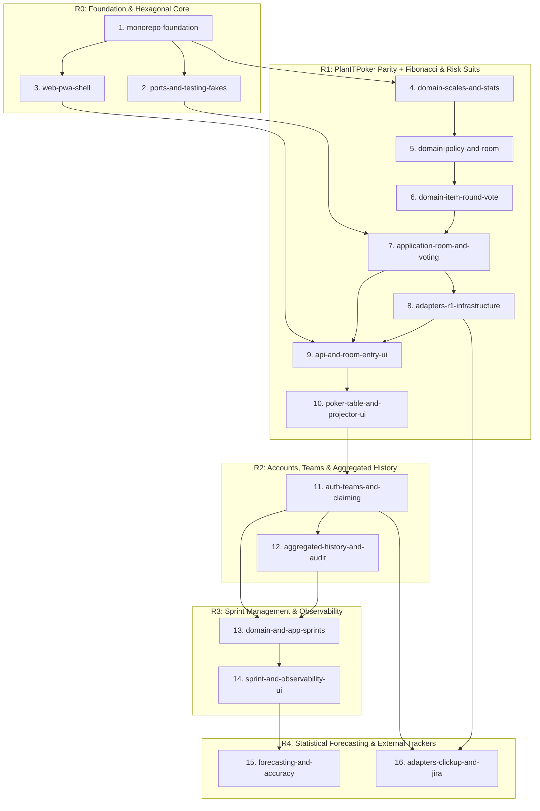

# Fibonaipe — Master Implementation Plan & Task Checklist (`todo.md`)

**Project:** Fibonaipe (Fibonacci + Naipe — Two-Dimensional Planning Poker, Sprint Management & Forecasting)  
**Version:** 1.0  
**Date:** 2026-10-26  
**Source of Truth:** `.docs/requirements.md` (`RF-01`..`RF-96`, `INV-01`..`INV-14`, `RNF-01`..`RNF-26`), `.docs/technologies.md` (`ADR-01`..`ADR-07`), `.docs/ui-ux.md`  
**Verification Gate:** `npm run verify` (lint, strict typecheck, hexagonal boundary checks, i18n check, license check, unit/property/contract tests, build, 150 KB gzip bundle budget, Playwright E2E + `@axe-core/playwright` WCAG 2.2 AA).

---

## 1. Release & Task Checklist (16 Cohesive Spec Slugs in Dependency Order)

### Release R0 — Foundation & Hexagonal Core

- [ ] monorepo-foundation: Pure npm workspaces, TypeScript strict config, architectural boundary checks (`check-boundaries`), and shared `Result<T, AppError>` + domain primitives
- [x] ports-and-testing-fakes: Application Ports (`Persistence`, `Realtime`, `Auth`, `IssueTracker`, `Exporter`, `RateLimiter`, `Clock`, `IdGenerator`, `CryptoVault`, `Logger`) + `packages/testing` (`InMemoryPersistence`, `FakeRealtime`, `FakeClock`, `SequentialIdGenerator`, `FakeAuthProvider`, `FakeRateLimiter`, and reusable contract test suites)
- [x] web-pwa-shell: React 19 + TanStack Router & Query + Vite mobile-first PWA shell (`360px`), Light/Dark CSS tokens, `pt-BR`/`en-US`/`es-ES` i18n engine (`check-i18n`), Hono server composition root, and `GET /healthz`

### Release R1 — PlanITPoker Parity + Fibonacci & Risk Suits

- [x] domain-scales-and-stats: Fibonacci scale builder (`0..89, ½`), Suit hierarchy (`♣ ♥ ♠ ♦` + `Coringa`), Special cards (`?`, `Coringa`, `AFK`), Item figure tags (`A/K/Q/J`), and pure `computeRoundStats` (mean, median, modes, consensus, near-consensus, `suitDivergence >= 2`)
- [x] domain-policy-and-room: Permission matrix `can(actor, action, ctx)`, `Room` & `Participant` aggregates (`RoomBuilder`, `RoomSettingsBuilder`, 30-participant cap `INV-01`, single active Host `INV-02`, nickname validation `INV-14`, manual host transfer, facilitator delegation & 60s auto-transfer)
- [x] domain-item-round-vote: `Item`, `Round` & `Vote` aggregates, state machines (`pending -> current -> estimated | skipped | deferred`, `voting -> revealed`), `INV-03`..`INV-09` enforcement, `EstimateAudit`, and non-leaking `projectRoomForViewer` (`RoomView` + `EVT-01`..`EVT-12`)
- [ ] application-room-and-voting: Transactional use cases for Rooms (`CreateRoom`, `JoinRoom`, `ReconnectParticipant`, `Heartbeat`, `UpdateRoomSettings`, `TransferHost`, `ExportRoomSummary`, `PurgeExpiredRooms`), Items (`AddItem`, `ImportItems`, `ReorderItems`, `SetCurrentItem`, `SkipItem`, `DeferItem`), and Voting (`CastVote` with `clientOpId` idempotency, `RetractVote`, `RevealRound`, `NewRound`, `SetFinalEstimate`, `Timer`)
- [ ] adapters-r1-infrastructure: Concrete R1 Adapters — `adapter-persistence-postgres` (`SELECT ... FOR UPDATE` room lock + `Room.version` + RLS), `adapter-realtime-supabase` (WebSocket + 2–3s HTTP polling fallback), `adapter-issuetracker-manual` (Free-text & RFC 4180 CSV parser), `adapter-exporter-csvjson` (UTF-8 BOM CSV injection-safe + JSON), and `adapter-system` (Clock, CSPRNG 8-char room codes, ULID, SHA-256, AES-256-GCM vault, RateLimiter, zero-PII JSON Logger)
- [ ] api-and-room-entry-ui: Hono HTTP API endpoints (`/api/rooms/*`, `/api/internal/cron/purge-expired-rooms`), `httpOnly` SHA-256 guest session cookie, `Origin` CSRF guard, Home/Create/Join screens, client-side SVG QR Code, and resilient Reconnection UX (`ConnectionStatusPill` + `clientOpId` offline queue)
- [ ] poker-table-and-projector-ui: Interactive Poker Table UI (30 seats, Fibonacci deck, 1-tap Suit toggle, 3D/reduced-motion Reveal choreography, Round Stats & Suit Divergence banner, Item Queue drawer with drag + keyboard reorder, CSV import modal, Host settings & synced Timer) + `/r/:code/screen` Projector Mode (`1920x1080`, `>= 48px`)

### Release R2 — Accounts, Teams, Permissions & Strictly Aggregated History

- [ ] auth-teams-and-claiming: `adapter-auth-supabase` (Magic Link + Google OAuth), `Organization`, `Team`, `Membership` & `Invite` aggregates/use cases (7-day invites, `LAST_ADMIN` guard, multi-team switching, user preferences sync), `ClaimRoom` & `LinkGuestToAccount`, persistent Team Rooms, SuperAdmin `/admin` panel, and LGPD `DeleteAccount`
- [ ] aggregated-history-and-audit: Strictly aggregated `RecordAggregatedHistory` (`history_entries` with zero individual votes or comments persisted per `RF-61` / `INV-13`), `EditFinalEstimateWithAudit` (`EstimateAudit` trail per `RF-65` / `INV-09`), History search/filter UI (`RF-62`), and filtered CSV/JSON export (`RF-63`)

### Release R3 — Sprint Management, Capacity & Estimation Observability

- [ ] domain-and-app-sprints: `Sprint` aggregate (`SprintBuilder`, `planned -> active -> closed` immutable metrics `INV-10`, single active sprint allocation `INV-11`, non-overlapping dates), `computeWorkingDays` (with team `Holidays`), `computeCapacity` (`absenceDays`, `focusPct`), `committedPoints` snapshot (`addedAfterStart`), `deliveredPoints` (`INV-12`), `carryOver`, and estimate-blown flag (`estimateExceeded`)
- [ ] sprint-and-observability-ui: Sprint management UI (capacity grid, holiday calendar, scope linking, delivery/overrun tracker, sprint closure modal), Vote short comments (`RF-50`, 140 chars ephemeral), Item figure tag meanings (`RF-56`), Velocity & Capacity custom SVG charts + accessible HTML table twins (`RF-80`, `RF-81`, `RNF-09`), and Estimation Observability indicators (`computeEstimationIndicators`: 1st-round consensus rate, Fibonacci distribution, high-divergence items, Risk Suit vs. Blown Estimate matrix `RF-83`)

### Release R4 — Statistical Forecasting & External Issue Tracker Adapters

- [ ] forecasting-and-accuracy: `computeForecast` engine (`ForecastReportBuilder`, median pace over 3–6 sprints, P25–P75 linear interpolation / min–max intervals, `< 3` sprints `insufficient_data` guard `RF-85`, high-risk `♣ Paus` concentration warning) + `ForecastRecord` accuracy tracking (`computeAccuracy`, `errorPct` `RF-84`) + Forecast Dashboard UI & SVG/PNG/CSV/JSON export (`RF-86`)
- [ ] adapters-clickup-and-jira: Read-only `adapter-issuetracker-clickup` (`RF-91`) and `adapter-issuetracker-jira` (`RF-92`) with `AES-256-GCM` server-side encrypted credentials (`RNF-26`), external item mapping, and import preview modal in Room Queue & Team Settings

---

## 2. Dependency Order & Execution DAG

| Order | Slug | Release | Depends On | Requirements (`RF` / `INV` / `RNF`) Covered |
| :---: | :--- | :---: | :--- | :--- |
| **1** | `monorepo-foundation` | R0 | — | `RNF-16`, `RNF-18`, `RNF-24`, `RNF-25` |
| **2** | `ports-and-testing-fakes` | R0 | `monorepo-foundation` | `RNF-16`, `RNF-17`, `RNF-18` |
| **3** | `web-pwa-shell` | R0 | `monorepo-foundation` | `RF-95`, `RNF-02`, `RNF-06`, `RNF-07`, `RNF-08`, `RNF-09`, `RNF-10`, `RNF-11`, `RNF-20`, `RNF-21`, `RNF-22` |
| **4** | `domain-scales-and-stats` | R1 | `monorepo-foundation` | `RF-44`, `RF-47`, `RF-48`, `RF-51`, `RF-52`, `RF-54`, `RF-56`, `INV-06` |
| **5** | `domain-policy-and-room` | R1 | `domain-scales-and-stats` | `RF-01`, `RF-20`, `RF-22`, `RF-23`, `RF-24`, `RF-25`, `RF-55`, `INV-01`, `INV-02`, `INV-14` |
| **6** | `domain-item-round-vote` | R1 | `domain-policy-and-room` | `RF-30`, `RF-32`, `RF-33`, `RF-40`..`RF-46`, `RF-49`, `INV-03`..`INV-09`, `RNF-13` |
| **7** | `application-room-and-voting` | R1 | `ports-and-testing-fakes`, `domain-item-round-vote` | `RF-01`, `RF-02`, `RF-20`..`RF-25`, `RF-30`..`RF-33`, `RF-40`..`RF-49`, `RF-64`, `RF-90`, `INV-13`, `RNF-01`, `RNF-05`, `RNF-15` |
| **8** | `adapters-r1-infrastructure` | R1 | `application-room-and-voting` | `RF-21`, `RF-31`, `RF-64`, `RF-90`, `RNF-01`, `RNF-03`, `RNF-12`, `RNF-13`, `RNF-17`, `RNF-19`, `RNF-23`, `RNF-26` |
| **9** | `api-and-room-entry-ui` | R1 | `web-pwa-shell`, `application-room-and-voting`, `adapters-r1-infrastructure` | `RF-01`, `RF-02`, `RF-20`, `RF-21`, `RF-25`, `RNF-04`, `RNF-05`, `RNF-12`, `RNF-13`, `RNF-15` |
| **10** | `poker-table-and-projector-ui` | R1 | `api-and-room-entry-ui` | `RF-22`..`RF-24`, `RF-27`, `RF-30`..`RF-33`, `RF-40`..`RF-49`, `RF-51`, `RF-52`, `RF-54`, `RF-55`, `RF-64`, `RNF-02`, `RNF-06`..`RNF-10` |
| **11** | `auth-teams-and-claiming` | R2 | `poker-table-and-projector-ui` | `RF-03`..`RF-05`, `RF-10`..`RF-14`, `RF-26`, `RF-53`, `RF-96`, `RNF-14` |
| **12** | `aggregated-history-and-audit` | R2 | `auth-teams-and-claiming` | `RF-60`..`RF-63`, `RF-65`, `INV-09`, `INV-13`, `RNF-14` |
| **13** | `domain-and-app-sprints` | R3 | `auth-teams-and-claiming`, `aggregated-history-and-audit` | `RF-70`..`RF-75`, `INV-10`..`INV-12` |
| **14** | `sprint-and-observability-ui` | R3 | `domain-and-app-sprints` | `RF-50`, `RF-56`, `RF-70`..`RF-75`, `RF-80`, `RF-81`, `RF-83`, `RNF-08`..`RNF-10` |
| **15** | `forecasting-and-accuracy` | R4 | `sprint-and-observability-ui` | `RF-82`, `RF-84`..`RF-86` |
| **16** | `adapters-clickup-and-jira` | R4 | `auth-teams-and-claiming`, `adapters-r1-infrastructure` | `RF-91`, `RF-92`, `RNF-26`, *(Post-MVP extensibility seam for `RF-93`, `RF-94`)* |

---

## 3. TDD Execution Workflow Mapping (`QA-red` → `SE-green` → `QA-verify`)

Every task in `.docs/todo.md` follows the strict 3-phase verification loop:

| Slug | Phase 1: `QA-red` (Failing Specification Tests) | Phase 2: `SE-green` (Minimal Hexagonal Implementation) | Phase 3: `QA-verify` (Contract, Property, A11y & Gate) |
| :--- | :--- | :--- | :--- |
| **`monorepo-foundation`** | Write unit tests for `Result<T, AppError>` combinators (`ok`, `err`, `map`, `andThen`), branded IDs, operational constants, and negative fixtures in `tools/boundary-fixtures` asserting `check-boundaries.mjs` rejects illegal imports (`domain -> adapter`, `adapter-a -> adapter-b`, `Date.now()` in `domain`). | Configure root `package.json` (`npm workspaces`), `.nvmrc` (v24), `tsconfig.base.json`, `eslint.config.js`, `tools/check-boundaries.mjs`, `tools/check-licenses.mjs`, `.docs/limits.md`, and `packages/domain/src/shared/*`. | Run `npm run lint`, `npm run typecheck`, `npm run check:boundaries`, `npm run check:licenses`, and `npm run test:unit` (all green). |
| **`ports-and-testing-fakes`** | Write reusable contract suites (`describePersistenceContract`, `describeRealtimeContract`, `describeAuthProviderContract`, `describeIssueTrackerContract`, `describeExporterContract`) expecting deterministic behavior, room-level mutex locking, and monotonic `Room.version` increments. | Define all Port interfaces in `packages/application/src/ports/*` and implement `InMemoryPersistence` (with per-room async lock), `FakeRealtime`, `FakeClock`, `SequentialIdGenerator`, `FakeAuthProvider`, and `FakeRateLimiter` in `packages/testing`. | Execute all `describe*Contract` suites against `packages/testing` fakes; verify `packages/application` imports only `@fibonaipe/domain`. |
| **`web-pwa-shell`** | Write Playwright + `@axe-core/playwright` tests for `/` and `/healthz` across `360x640` and `1280x720` in Light and Dark themes; write `check-i18n.mjs` tests rejecting hardcoded JSX strings or missing `pt-BR.json` keys; write `check-bundle-budget.mjs` test (`<= 150 KB` gzip). | Build `apps/web` with React 19, TanStack Router, TanStack Query, Vite 6, `vite-plugin-pwa`, `tokens.css` (WCAG 2.2 AA tokens from `ui-ux.md`), `pt-BR`/`en-US`/`es-ES` catalogs, theme/locale toggle, Hono `GET /healthz`, and `composition.ts`. | Full `npm run verify` green, including `check:i18n`, `check:bundle`, and zero serious/critical Axe violations in Light & Dark modes. |
| **`domain-scales-and-stats`** | Write unit and `fast-check` property tests for `ScaleBuilder`, Fibonacci cards (`0..89, ½`), Special cards (`?`, `Coringa`, `AFK`), Suit ordinal ranks (`♣=4, ♥=3, ♠=2, ♦=1, Coringa=0`), Figure tags (`A/K/Q/J`), and `computeRoundStats` (mean, median, modes, consensus, near-consensus within 1 Fibonacci step, `suitDivergence >= 2` ignoring `Coringa`). | Implement `packages/domain/src/scales/*` and `packages/domain/src/math/round-stats.ts` as pure, zero-dependency functions returning exact numbers without premature rounding. | Verify 100% property test pass rate (`min <= median <= max`, permutation invariance, special cards excluded from numeric averages) and `>= 90%` coverage. |
| **`domain-policy-and-room`** | Write exhaustive table-driven tests for `can(actor, action, ctx)` across all 7 roles × all actions (`§3.1`), plus unit tests for `RoomBuilder`, `RoomSettingsBuilder`, `Participant` nickname validation (`INV-14`: 1..30 visible chars, case-insensitive uniqueness), 30-participant cap (`INV-01`: 31st returns `ROOM_FULL`, `screen` mode and reconnects consume 0 slots), single Host (`INV-02`), manual transfer, facilitator delegation, and 60s offline auto-transfer priority (`Facilitator > PM > PO > Dev > QA > Observer`, tie-break by oldest `joinedAt`). | Implement `packages/domain/src/policy/can.ts` and `packages/domain/src/entities/{room,room-settings,participant}.ts` using private constructors and fluent Builders returning `Result<T, AppError>`. | Run unit & property suites verifying `INV-01`, `INV-02`, and `INV-14` hold under arbitrary join/leave/disconnect sequences. |
| **`domain-item-round-vote`** | Write unit tests for `Item`, `Round`, and `Vote` state machines (`INV-03` voter/non-AFK eligibility, `INV-04` voting window, `INV-05` irreversible reveal & `Round n+1` preserving prior round summaries, `INV-06` valid scale/suit, `INV-07` facilitator final estimate, `INV-08` single current item & single voting round, `INV-09` `EstimateAudit`), plus a `fast-check` property test proving `projectRoomForViewer` and `EVT-08 (vote.changed)` **never** leak another participant's card, suit, or comment while `Round.status === 'voting'`. | Implement `packages/domain/src/entities/item.ts` and `packages/application/src/projections/{events,room-view}.ts`. | Run `fast-check` non-leakage property tests across 1,000+ random room states and viewer roles (`voter`, `observer`, `screen`, `host`). |
| **`application-room-and-voting`** | Write use-case integration tests (against `InMemoryPersistence` and `FakeRealtime`) for room creation/join/reconnect/heartbeat, settings update, host transfer, item queue CRUD/import/reorder/skip/defer, `CastVote` idempotency via `clientOpId` (`RNF-05`), auto-reveal when all online non-AFK voters have voted (`RF-43`), server-synced timer (`RF-49`), session summary export (`RF-64`), and `PurgeExpiredRooms` after 60m (`RNF-15`, `INV-13`). | Implement transactional use cases in `packages/application/src/use-cases/{rooms,items,voting,maintenance}/*` ensuring events publish strictly post-commit and `Room.version` increments atomically. | Verify `>= 90%` line coverage across `packages/application`, concurrent `CastVote` serialization via room lock, and idempotent replay of duplicate `clientOpId` mutations. |
| **`adapters-r1-infrastructure`** | Wire `describePersistenceContract`, `describeRealtimeContract`, `describeIssueTrackerContract`, and `describeExporterContract` to the concrete R1 adapters; add unit tests for CSPRNG 8-char unambiguous room codes (`23456789ABCDEFGHJKMNPQRSTUVWXYZ`), UTF-8 BOM + CSV formula injection escaping (`=`, `+`, `-`, `@`, `\t`, `\r`), `AES-256-GCM` vault round-trips, sliding-window rate limits, and log scrubbing (zero PII/votes in JSON logs `RNF-19`). | Implement `@fibonaipe/adapter-system`, `@fibonaipe/adapter-persistence-postgres` (SQL migrations + `SELECT ... FOR UPDATE` + RLS enabled with 0 anon policies), `@fibonaipe/adapter-realtime-supabase` (WS + 2–3s HTTP polling fallback), `@fibonaipe/adapter-issuetracker-manual` (text + RFC 4180 CSV parser up to 500 items), and `@fibonaipe/adapter-exporter-csvjson`. | Pass all contract tests, verify `check-boundaries` confirms no adapter imports another adapter, and verify zero native C++ addons in `package-lock.json`. |
| **`api-and-room-entry-ui`** | Write API integration and Playwright E2E tests for `POST /api/rooms`, `POST /api/rooms/:code/join`, `GET /api/rooms/:code/state?since=v`, `Origin` CSRF rejection, rate-limit `429 Retry-After` headers, `httpOnly` SHA-256 cookie auto-reconnect (`RF-02`), client-side SVG QR Code modal (`RF-21`), and `ConnectionStatusPill` cold-start / offline mutation queue recovery (`RNF-04`, `RNF-05`). | Implement Hono routes in `apps/web/src/server/routes/rooms.ts`, cookie/CSRF/error middlewares, and React pages for Home, Create Room, Join Room (`/r/:code`), Share/QR dialog, and `ConnectionStatusPill`. | Run Playwright E2E + `@axe-core/playwright` on `360x640` and `1280x720` (Light & Dark); verify seamless reconnect on browser reload. |
| **`poker-table-and-projector-ui`** | Write Playwright E2E & Axe tests for the full R1 Planning Poker loop: 30-seat table, Fibonacci card selection (`translateY` / reduced-motion border), 1-tap Suit toggle (`♣ ♥ ♠ ♦ Coringa`), Observer strict mode (`RF-55`), Reveal choreography (`<= 450ms`), Consensus & Suit Divergence (`>= 2` levels) alert banner, Item Queue drag + keyboard reorder (`↑`/`↓`), CSV preview modal, session export, and `/r/:code/screen` Projector Mode (`1920x1080`, `>= 48px` typography, 0 slot consumption). | Implement `PokerTable`, `SeatBadge`, `CardButton`, `SuitSelector`, `ConsensusBanner`, `SuitDivergenceAlert`, `RoundTimer`, `ItemQueue`, `CsvImportModal`, and the `/r/:code/screen` route in `apps/web/src/client/*`. | Full `npm run verify` green, `check:bundle` confirming `/r/:code` initial JS `<= 150 KB` gzip, zero network vote leakage before reveal, and 0 Axe violations across `360px`, `1280px`, and `1920px`. |
| **`auth-teams-and-claiming`** | Write contract, API, and E2E authorization matrix tests (`can` across all routes × roles) for Magic Link & Google OAuth login (`RF-03`), `Organization`/`Team` creation (`RF-10`, `RF-14`), 7-day revocable invite links, role changes with `LAST_ADMIN` protection (`RF-11`), multi-team switching (`RF-12`), claiming an active anonymous room (`RF-04`), team default suit axis settings (`RF-53`), preference sync (`RF-96`), SuperAdmin `/admin` overview & account suspension (`RF-13`), and LGPD account deletion (`RF-05`). | Implement `packages/domain/src/entities/team.ts`, `packages/application/src/use-cases/auth-teams/*`, `@fibonaipe/adapter-auth-supabase`, Hono auth/teams/admin routes, and Team/Admin/Account UI pages. | Pass complete RBAC matrix E2E suite, verify LGPD `DeleteAccount` scrubs personal data while keeping team aggregated history intact, and pass Axe checks on all new views. |
| **`aggregated-history-and-audit`** | Write unit and integration tests proving `RecordAggregatedHistory` persists item summary and round stats on `SetFinalEstimate` in team rooms (`RF-60`) while **architecturally prohibiting** individual votes or comments from entering `history_entries` (`RF-61`, `INV-13`); test `EditFinalEstimateWithAudit` (`RF-65`, `INV-09`), relational filtering (`RF-62`), and injection-safe CSV/JSON export (`RF-63`). | Implement `packages/application/src/use-cases/history/*`, PostgreSQL `history_entries` and `estimate_audits` repositories/indexes, Hono `/api/teams/:id/history*` endpoints, and the Team History search/filter/audit UI. | Verify database inspection after room closure shows 0 individual vote records in permanent tables, `EstimateAudit` records every post-hoc change, and E2E + Axe pass. |
| **`domain-and-app-sprints`** | Write unit and property tests for `SprintBuilder`, non-overlapping team sprint dates (`RF-70`), `computeWorkingDays` discounting weekday `Holidays` (`RF-75`), `computeCapacity` (`absenceDays`, `focusPct` `RF-71`), `ActivateSprint` freezing `committedPoints` and tagging subsequent items `addedAfterStart` (`RF-72`), `INV-11` (item in at most one non-closed sprint), `INV-12` (100% points for `Done`, `0` + `carriedOver = true` for incomplete, `estimateExceeded` burst flag `RF-73`), and `INV-10` (`CloseSprint` freezes `SprintReport` immutably `RF-74`). | Implement `packages/domain/src/entities/sprint.ts`, `packages/domain/src/math/capacity.ts`, and `packages/application/src/use-cases/sprints/*` with persistence repository support. | Run unit, property, and persistence contract tests verifying `closed` sprints reject all mutations (`INV-10`) and capacity/velocity math is exact. |
| **`sprint-and-observability-ui`** | Write unit tests for `computeEstimationIndicators` (1st-round consensus rate, Fibonacci frequency distribution, high-divergence items `>= 3` steps or `>= 3` rounds, and 5×2 Suit × Overrun matrix `RF-83`), plus Playwright E2E and Axe tests for the Sprint Capacity Grid, Holiday calendar, ephemeral 140-char vote comments (`RF-50`), configurable `A/K/Q/J` meanings (`RF-56`), and custom SVG Velocity & Capacity charts paired with accessible HTML `<table>` twins (`RF-80`, `RF-81`, `RNF-09`). | Implement `packages/domain/src/math/indicators.ts`, Hono sprint & dashboard endpoints, `SprintCapacityGrid`, `VelocitySvgChart`, `CapacitySvgChart`, `AccessibleDataTable`, and the Observability Dashboard UI. | Verify keyboard `Tab` navigation across SVG chart data nodes, SVG pattern fills beyond color alone, 1:1 HTML table synchronization, and zero Axe violations. |
| **`forecasting-and-accuracy`** | Write unit and `fast-check` property tests for `computeForecast` (`ForecastReportBuilder`: `< 3` closed sprints returns `insufficient_data` `RF-85`; `3..5` sprints uses median pace + `min`/`max` band; `6` sprints uses median pace + linear-interpolated `P25`/`P75` band `RF-82`; high-risk `♣ Paus` concentration warning `§5.3.5`) and `computeAccuracy` (`errorPct` `RF-84`), plus E2E tests for the Forecast Dashboard and SVG/PNG/CSV/JSON export (`RF-86`). | Implement `packages/domain/src/math/forecast.ts`, forecast recording on sprint activation/closure, `ForecastBandChart.tsx`, insufficient-data empty state card, mandatory orientation disclaimer, and dashboard dataset/chart exporters. | Pass property tests (`low <= predicted <= high`), verify predictive numbers are strictly hidden when `< 3` closed sprints exist (`RF-85`), and pass E2E + Axe verification. |
| **`adapters-clickup-and-jira`** | Write `describeIssueTrackerContract` tests and mocked HTTP tests for `@fibonaipe/adapter-issuetracker-clickup` (`RF-91`) and `@fibonaipe/adapter-issuetracker-jira` (`RF-92`), plus security tests asserting API tokens are encrypted at rest via `AES-256-GCM` (`RNF-26`) and never serialized to client responses. | Implement `@fibonaipe/adapter-issuetracker-clickup` (ClickUp REST v2 read-only), `@fibonaipe/adapter-issuetracker-jira` (Jira Cloud REST/JQL read-only), encrypted team integration credentials storage, and the ClickUp/Jira tabs in the Import Preview Modal. | Full `npm run verify` green across all 16 slugs, verifying end-to-end ClickUp/Jira import preview, zero credential leakage, and all R0–R4 release gates satisfied. |

---

## 4. Definition of Done (DoD) per Release Milestone

### R0 Gate — Architectural Foundation
1. `npm ci` and `npm run verify` succeed out-of-the-box on Windows (`win32`) and Linux with zero native C++ addon compilation (`nativeCompileLikelyOk: false`).
2. `npm run check:boundaries` enforces `domain <- application <- adapter-* <- apps/web` and passes positive checks while rejecting all negative fixtures in `tools/boundary-fixtures`.
3. `packages/domain` has `0` runtime dependencies; `packages/application` depends only on `@fibonaipe/domain`.
4. All Port contract test suites in `packages/testing` pass against the in-memory fakes.
5. The PWA shell renders at `360×640` and `1280×720` in both Light and Dark themes with `pt-BR` i18n, zero hardcoded strings (`npm run check:i18n`), `GET /healthz` returning `200 OK`, and `0` serious/critical `@axe-core/playwright` violations.

### R1 Gate — PlanITPoker Parity + Two-Dimensional Suit Voting
1. Full anonymous room lifecycle works end-to-end: create room, join via link / 8-char CSPRNG code / client-side SVG QR Code (up to 30 participants, 31st blocked with `ROOM_FULL`), vote with Fibonacci card + 1-tap Suit (`♣ ♥ ♠ ♦ Coringa`) or special card (`?`, `Coringa`, `AFK`), manual/auto reveal, multi-round convergence, final estimate confirmation, and CSV/JSON session summary export.
2. **Zero Vote Leakage Proven:** Property-based tests (`fast-check`) and network payloads confirm hidden votes never leave the server before `Round.status === 'revealed'`.
3. **Resilience & Concurrency Proven:** Concurrent votes serialize cleanly via room lock (`Room.version`), `clientOpId` prevents duplicate mutations on retry, `httpOnly` cookie reconnects transparently, and 60s Host disconnect triggers deterministic auto-transfer.
4. **Projector Screen Mode (`/r/:code/screen`):** Renders at `1920×1080` with `≥ 48px` primary typography, high contrast, persistent QR Code, and consumes `0` participant slots.
5. **Performance & Bundle Budget:** Room route initial JS is `≤ 150 KB` gzipped (`npm run check:bundle`), p95 realtime propagation is `≤ 1s` with 30 simulated participants, and `PurgeExpiredRooms` deletes anonymous rooms inactive for `> 60 minutes`.

### R2 Gate — Accounts, Teams, RBAC & Strictly Aggregated History
1. Passwordless Magic Link and Google OAuth authentication work end-to-end, including claiming an active anonymous room (`ClaimRoom`) into a persistent Team Room.
2. Complete `can(actor, action, ctx)` authorization matrix is enforced on the server across all endpoints (`SuperAdmin`, `Admin do Time`, `PM`, `PO`, `Dev/QA`, `Observador`, `Convidado`), protecting the `LAST_ADMIN` invariant.
3. **Strict History Privacy (`RF-61`, `INV-13`):** Confirming an estimate in a Team Room records aggregated round statistics and dominant suit in `history_entries` while persisting **zero individual votes or comments**. Post-hoc estimate edits generate mandatory `EstimateAudit` trails (`INV-09`).
4. Team History search, multi-filter querying, injection-safe UTF-8 BOM CSV/JSON export, SuperAdmin `/admin` dashboard, and LGPD self-service `DeleteAccount` are verified by E2E and Axe tests.

### R3 Gate — Sprint Management, Capacity & Estimation Observability
1. Team sprints transition cleanly through `planned -> active -> closed` without date overlap, discounting team `Holidays` from `workingDays` and computing member and total capacity (`absenceDays`, `focusPct`).
2. Activating a sprint freezes `committedPoints` and flags late scope as `addedAfterStart`. Marking items `Done` awards 100% points (`INV-12`); incomplete items award `0` points and move to `carryOver`. Closing a sprint permanently freezes `SprintReport` (`INV-10`).
3. Ephemeral 140-char vote comments (`RF-50`) and configurable deck figure item tags (`A/K/Q/J`, `RF-56`) work in active rooms and feed analytics without leaking comments into permanent history.
4. Custom SVG charts for Velocity (`RF-80`), Capacity/Pace (`RF-81`), and Estimation Quality (`RF-83` including the Suit × Estimate Overrun matrix) render with pattern fills, keyboard-focusable data points, and synchronized HTML `<table>` twins (`RNF-09`).

### R4 Gate — Statistical Forecasting & External Issue Trackers (Full MVP Completion)
1. Statistical Forecast engine (`computeForecast`) enforces the `< 3` closed sprints `insufficient_data` guard (`RF-85`), computes median-pace predictions with `min–max` (`3..5` sprints) or linear-interpolated `P25–P75` (`6` sprints) bands (`RF-82`), surfaces high-risk `♣ Paus` concentration warnings, and tracks historical forecast accuracy (`errorPct`, `RF-84`).
2. Dashboard filters and exports (CSV, JSON, SVG, PNG) work across all analytical views (`RF-86`).
3. Read-only ClickUp (`RF-91`) and Jira Cloud (`RF-92`) adapters import tasks/issues through the `IssueTracker` port with API tokens encrypted at rest via `AES-256-GCM` (`RNF-26`).
4. Full `npm run verify` passes with `≥ 90%` coverage in `domain` and `application`, zero license/boundary/i18n/bundle violations, and zero serious/critical WCAG 2.2 AA violations across all R0–R4 routes.

---

## 5. Key Architectural & Operational Risk Notes

1. **Windows Host Without Native Build Tools (`nativeCompileLikelyOk: false`):**
   - *Risk:* Installing packages with C++ bindings (`better-sqlite3`, `bcrypt`, `canvas`, `sharp`) will break `npm ci` on the developer host.
   - *Mitigation:* Strictly enforce pure-JS/WASM packages (`postgres.js`, Node `node:crypto`, inline SVG / browser `<canvas>` API for PNG export) and verify via `npm run check:boundaries` and CI.
2. **Secret Ballot Leakage Before Reveal (`RF-40`, `RNF-13`):**
   - *Risk:* Accidental serialization of `Vote.card` or `Vote.suit` in WebSocket broadcasts or HTTP polling snapshots while `Round.status === 'voting'`.
   - *Mitigation:* All read paths and realtime broadcasts pass through `projectRoomForViewer` and `EVT-08 (vote.changed: { participantId, hasVoted })`, guarded by a mandatory `fast-check` property test in `domain-item-round-vote`.
3. **Concurrent Room Mutations & Race Conditions (`RNF-23`, `RF-43`):**
   - *Risk:* Simultaneous votes from 30 participants causing lost updates, skipped version numbers, or duplicate auto-reveal triggers.
   - *Mitigation:* Every room mutation executes inside `Persistence.transaction({ lockRoomId })` (per-room async mutex in `InMemoryPersistence` and `SELECT ... FOR UPDATE` in PostgreSQL), incrementing `Room.version` monotonically and publishing realtime events only after commit.
4. **Corporate Firewalls Blocking WebSockets & Free-Tier Cold Starts (`RNF-04`, `RNF-05`):**
   - *Risk:* Participants losing connection or votes during serverless cold starts or restricted networks.
   - *Mitigation:* `RealtimeClient` automatically falls back to `2–3s` HTTP polling (`GET /api/rooms/:code/state?since=v`), while the client queues mutations with `clientOpId` (ULID) and displays the non-blocking `ConnectionStatusPill`.
5. **150 KB Gzipped Room Bundle Budget (`RNF-02`):**
   - *Risk:* UI or charting libraries inflating the initial JS payload for `/r/:code`.
   - *Mitigation:* Zero external UI/charting frameworks (`ADR-06`); route-level code splitting in TanStack Router so `/teams/:id/dashboard` SVG charts and ClickUp/Jira import modals are lazy-loaded outside the core `/r/:code` bundle, enforced by `npm run check:bundle`.
