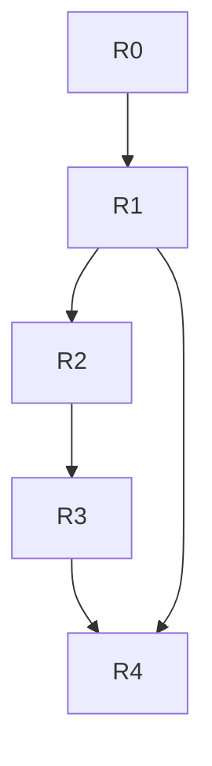

# PRD: Roadmap and status

Delivery is incremental in five phases (R0 to R4) plus post-MVP, each with an exit gate. Requirements are in [functional](functional-requirements.md) and [non-functional](non-functional-requirements.md) requirements.

## Releases and gates

| Release | Scope | Exit gate |
| :--- | :--- | :--- |
| **R0 Foundation** | npm workspaces, strict TypeScript, boundary lint rules, `Result`/`AppError`, `testing` package (fakes and contracts), React + TanStack + Vite shell (mobile-first, light/dark, i18n, PWA base), `npm run verify`. | `verify` green, boundary tests active, base layout passes axe at 360 px and 1280 px, `npm ci` works on Windows and Linux with no native addons. |
| **R1 PlanITPoker parity + suits** | Ephemeral rooms, join by link/code/QR, Fibonacci + optional suit voting, `?` and `AFK`, Observer mode, round stats with suit divergence, item queue with text/CSV import, exportable summary, projector mode, resilient reconnection, 1-hour purge. | 30-participant load test (p95 ≤ 1 s), WCAG 2.2 AA audit passed, **real use in at least one team planning session**. Also: no vote leakage proven by property tests and network payloads; auto host transfer after 60 s. |
| **R2 Accounts, teams, aggregated history** | Magic Link and Google login, teams, invites and roles (`can`), room claiming, persistent team rooms, strictly aggregated history, history search and export, SuperAdmin panel, account deletion (LGPD). | Full authorization suite (routes × roles) passing and a real authenticated team session. Confirming an estimate stores zero individual votes or comments; edits create `EstimateAudit`. |
| **R3 Sprints and observability** | Sprint lifecycle, holiday calendar, per-member capacity, item linking, delivery and carry-over, `A/K/Q/J` tags, ephemeral vote comments, accessible SVG Velocity and Capacity charts, estimate-observability panel. | At least one real sprint configured and closed with frozen, validated metrics. |
| **R4 Forecast and integrations** | Median-pace forecast with P25–P75 range, accuracy tracking (`errorPct`), insufficient-data guard (fewer than 3 sprints), dashboard filters and export, read-only ClickUp and Jira adapters. | MVP complete: 3 closed sprints on the dashboard, active forecast and a team-validated ClickUp import. |
| **Post-MVP** | Write-back to ClickUp/Jira, more adapters (Azure DevOps, GitHub, Linear, Trello), enterprise SSO (Entra ID / SAML), Monte Carlo date forecasting, multi-organization UI. | Autonomous adoption by several teams in the organization. |

### Release dependencies

## Status

| Release | Slice | State |
| :--- | :--- | :--- |
| R0 | Monorepo foundation | Open: re-verify against the gate |
| R0 | Ports and testing fakes | Done |
| R0 | Web PWA shell | Done |
| R1 | Domain: scales and stats, policy and room, item/round/vote | Done |
| R1 | Application: room and voting use cases | Done |
| R1 | Adapters: system, SQLite stand-in, Postgres, realtime, manual/CSV, CSV/JSON exporter | Done |
| R1 | API and room-entry UI | Done |
| R1 | Poker table and projector UI | Done |
| R2 | Auth, teams and claiming | Partly done (see pending) |
| R2 | Aggregated history and audit | Partly done (see pending) |
| R3 | Sprint domain and application | Open |
| R3 | Sprint and observability UI | Open |
| R4 | Forecasting and accuracy | Open |
| R4 | ClickUp and Jira adapters | Open |

### Pending work in R2

- `@fibonaipe/adapter-auth-supabase` (live Magic Link and Google OAuth). A dev fake adapter is the stand-in today.
- Screens `/login`, `/teams`, `/teams/:id`, `/admin`, `/privacy`, the team switcher and the delete-account modal.
- HTTP routes for claim, link-guest, invites, suspend and delete; the superadmin success path and usage counts; a sliding 7-day session.
- Hono `/api/teams/:id/history*` routes and the history screen (loading, empty, results, error states; sort and pagination; edit dialog).
- The full route-by-role authorization matrix, plus Playwright and axe coverage.

## Completion plan

1. **Foundation and diagnosis.** Run the gate, fix existing failures, re-check the foundation slice, and record any external-service limits.
2. **Finish R2.** Close the pending items above: real auth, deferred routes and screens, privacy and end-to-end tests.
3. **Sprint domain and application (R3).** Sprint aggregate, persistence, transactions, holidays, capacity, item linking and immutable closure; verify contracts and concurrency.
4. **Sprint and observability UI (R3).** Ephemeral comments, indicators, charts and accessible tables. Depends on step 3.
5. **Forecast (R4).** Formulas, accuracy history, dashboard and exports. Depends on step 3.
6. **Integrations (R4).** ClickUp and Jira, encrypted credentials, import preview. Depends on infrastructure and R2 auth.
7. **Final acceptance.** Walk real flows, verify accessibility, privacy and integrations, run `npm run verify`, and update this status with evidence and any external dependencies.

Never mark a slice done without current evidence from the gate. Preserve the architecture and invariants in [architecture](../specs/architecture.md) and [domain](../specs/domain.md).

## Key risks

| Risk | Mitigation |
| :--- | :--- |
| Windows host without native build tools | Pure-JS/WASM dependencies only (`postgres.js`, `node:crypto`, `node:sqlite`); enforced by the boundary and license checks. |
| Vote leakage before reveal | All reads and broadcasts pass through `projectRoomForViewer`; `vote.changed` carries only `{ participantId, hasVoted }`; mandatory `fast-check` non-leakage test. |
| Concurrent room mutations | Every mutation runs in `Persistence.transaction({ lockRoomId })` and bumps `Room.version`; events publish only after commit. |
| Firewalls blocking WebSockets, free-tier cold starts | HTTP polling fallback every 2–3 s, `clientOpId` offline queue, non-blocking `ConnectionStatusPill`. |
| 150 KB room bundle | No UI or charting framework; lazy-load dashboard charts and tracker import modals outside the `/r/:code` bundle; `npm run check:bundle`. |
