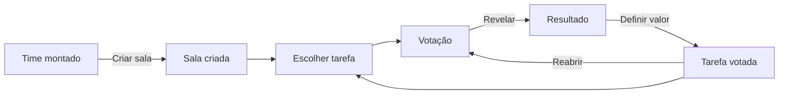

# PRD: Voting flow design

Product-facing source for the screens of the voting flow. [ui-ux](../specs/ui-ux.md) must follow this document. Items come from the [voting usability backlog](voting-usability-backlog.md).

## Principles

1. **One obvious next step.** At any moment the screen offers the action that moves the round forward; the rest is quiet.
2. **A control that cannot succeed is disabled**, not hidden and not clickable. Hidden controls make people hunt for them; clickable ones that fail erode trust.
3. **Same place, same meaning.** A button never changes position between rounds.
4. **Secrecy first.** Nothing on screen reveals another participant's card before the reveal.

## Flow

1. **Team to room.** Every row of the team list has a "Criar sala" button. It opens the room creation screen with that team already selected.
2. **Choose the task.** A dropdown lists the tasks. Group "Para votar" holds tasks not voted yet and is the only group that can be chosen to vote. Group "Já votadas" holds voted tasks. Choosing one shows its **average** and the **value the host chose**, plus "Reabrir votação".
3. **Vote.** Cards are small, in one row that wraps. The suit controls sit under the cards and follow the same size.
4. **Reveal and decide.** The host reveals, reads the result and sets the final value. The host may change that value later.

## Screen hierarchy (table)

| Order | Block | Rule |
| :--- | :--- | :--- |
| 1 | Notice banner | Only when an action failed. Dismissible. |
| 2 | Task title and task dropdown | Dropdown only for people who manage the queue. |
| 3 | Seats | Name, role, presence and the mini card. |
| 4 | Host actions: Tarefas, Revelar, Iniciar tempo | Fixed order, always in the same row. |
| 5 | Timer | Shows the configured time before it starts. |
| 6 | Deck, then suit controls | Voters only. |
| 7 | Result | After the reveal. |

## Enabled rules

| Control | Enabled when |
| :--- | :--- |
| Revelar | The viewer may reveal and the round is collecting votes. |
| Iniciar tempo | A task is open, the round is not revealed and no timer is running. |
| Cards | A task is open and the round is not revealed. |
| Reabrir votação | The task was voted and no other task is open. |
| Tarefas | Always, for people who manage the queue. |

## Seats and mini cards

- Another participant who voted: a face-down mini card.
- After the reveal: that mini card turns face up with value and suit.
- Your own seat: your card stays face up the whole time.
- The face-down card is decorative and hidden from assistive technology. The "voted" indicator already announces it.

## Design system for these elements

| Element | Rule |
| :--- | :--- |
| Card | 5.5 × 7.5 rem; rank 30 px; corner pip 22 px; special icons 3 rem. |
| Suit control | Same box as a card; glyph 44 px. |
| Mini card | 1.9 × 2.6 rem on the seat. Back uses the dark card colour with red stripes. |
| Disabled control | 45% opacity, `not-allowed` cursor, no lift. |
| Error | Red banner at the top of the table; the failed control turns red and stays red until the next success. |
| Touch target | At least the `--touch-min` token on every control. |

## Out of scope

Redesign of the queue drawer, projector layout and sprint screens.
