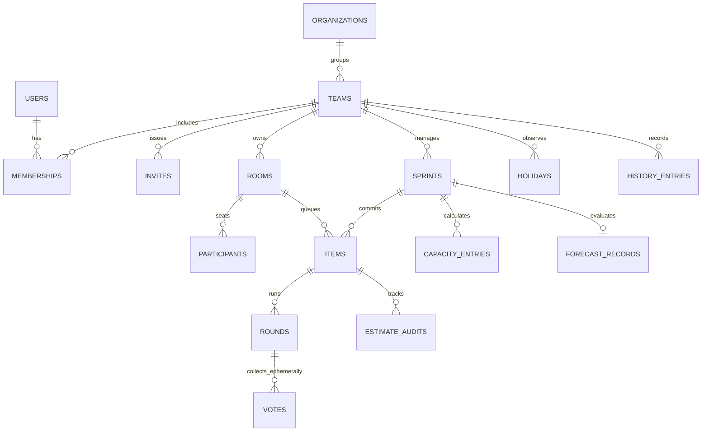

# Spec: Data model

Managed PostgreSQL 16+ (Supabase or Neon) through `adapter-persistence-postgres`, with versioned pure-SQL migrations (for example `002_r2_identity.sql`). Locally, `adapter-persistence-sqlite` (`node:sqlite`, default `:memory:`, file stand-in `data/local.sqlite`) and `InMemoryPersistence` serve dev and tests. Requirements: RF-60, RF-61, RNF-14, RNF-23.

## Entities



| Table | Key columns |
| :--- | :--- |
| `rooms` | `id` (ULID), `code` (unique, 8-char CSPRNG), `name`, `kind` (`guest` \| `team`), `team_id` (null for guests), `host_participant_id`, `scale_config`, `settings` (jsonb), `status` (`open` \| `closed`), `version` (monotonic room clock), `last_activity_at`, `expires_at` (60-minute TTL for guest rooms). |
| `participants` | `id`, `room_id`, `user_id` (nullable), `guest_token_hash` (`char(64)`, matches `[0-9a-f]{64}`), `nickname` (1..30, case-insensitive unique per room), `org_role`, `mode` (`voter` \| `observer`), `is_facilitator`, `joined_at`, `last_seen_at`. |
| `items` | `id`, `room_id`, `team_id`, `sprint_id`, `title` (≤200), `description` (≤2000), `external_url`, `external_key`, `figure_tag` (`A`/`K`/`Q`/`J`/null), `position`, `status` (`pending` \| `current` \| `estimated` \| `skipped` \| `deferred`), `final_estimate`, `dominant_suit`, `added_after_start`, `estimate_exceeded`, `carried_over`, `done_at`. |
| `rounds` | `id`, `item_id`, `round_number`, `status` (`voting` \| `revealed`), `aggregated_stats` (mean, median, modes, min, max, suit counts, special counts), `started_at`, `revealed_at`, `timer_ends_at`. |
| `votes` | `round_id`, `participant_id`, `card_value`, `suit_value`, `short_comment` (≤140, ephemeral only), `cast_at`. Exists only during an active session. |
| `history_entries` | `id`, `team_id`, `room_id`, `sprint_id`, `item_id`, `title`, `external_key`, `figure_tag`, `final_estimate`, `dominant_suit`, `rounds_summary` (aggregated stats per round, no individual votes), `estimated_at`. |
| `estimate_audits` | Previous value, new value, author, UTC timestamp. |
| `sprints` | `id`, `team_id`, `name`, `start_date`, `end_date`, `goal`, `status` (`planned` \| `active` \| `closed`), `committed_points`, `delivered_points`, `frozen_report` (immutable on close, INV-10). |
| Also | `organizations`, `teams`, `memberships`, `invites`, `holidays`, `capacity_entries`, `forecast_records`, idempotency records. |

## Guarantees

### Strict aggregated history

- `votes` rows exist only while a room session is active.
- When a final estimate is confirmed in a team room, `RecordAggregatedHistory` writes one `history_entries` row. Its `rounds_summary` is an array of `{ roundNumber, mean, median, modes, min, max, consensus, nearConsensus, suitDistribution, suitDivergence, specialCounts }`.
- Individual `participant → card` mappings and comments are never copied to history and are purged when the room closes. Inspecting the database after room closure must show zero individual vote records in permanent tables.
- History indexing: B-tree plus `pg_trgm` GIN for title search (RF-62).

### Room-level serialization

Every mutating use case runs inside `Persistence.transaction({ lockRoomId })`:

```sql
BEGIN;
SELECT id, version FROM rooms WHERE id = $1 FOR UPDATE;
-- domain mutation and repository writes
UPDATE rooms SET version = version + 1, last_activity_at = $2 WHERE id = $1;
COMMIT;
```

`InMemoryPersistence` uses a per-room async mutex and patches only the records written in the transaction onto the latest committed store, so a concurrent commit on another room is never erased.

### Row-level security

All Postgres tables have `ENABLE ROW LEVEL SECURITY` and **no policies for the `anon` role**. The browser can never query tables directly. All access goes through the server's `DATABASE_URL`.

### Other rules

- Dates are stored in UTC (`timestamptz`).
- A guest-room purge cascades. Guest rooms with `expiresAt <= before` are removed; guests with a later or null `expiresAt` and every team room are kept.
- `LAST_ADMIN` protects the final Team Admin of a team.

## Locked decisions

- Edits to an object returned inside a transaction commit only when `save` runs and the callback returns `ok`. A thrown defect rolls back and propagates; `err` results are returned, not thrown.
- `hasProcessed(actorId, clientOpId, now)` does not expire records. Recording the same pair twice stays one processed op and does not change `Room.version` when the room is not saved.
- Live Postgres contract cases skip when `DATABASE_URL` is unset. That absence does not fail `npm run verify`. `better-sqlite3` stays banned.
